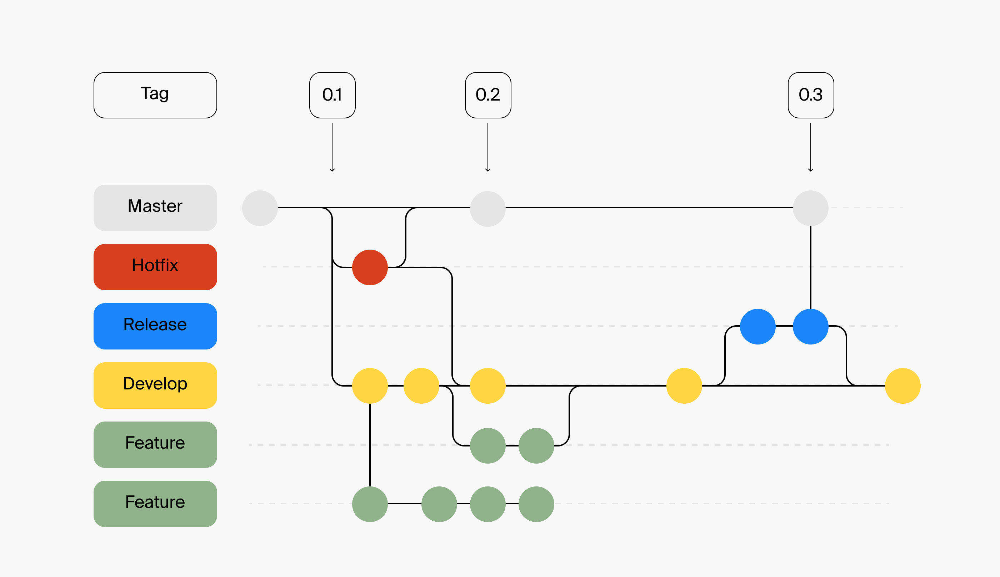
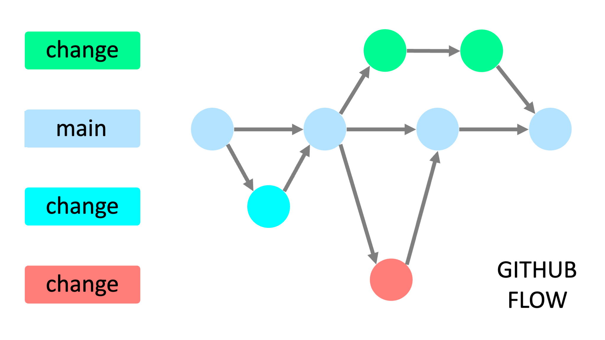

# Соглашения о Git

Git — это основной инструмент для контроля версий при разработке роботов на PIX RPA. Правильная организация работы с Git существенно повышает эффективность как индивидуальной, так и командной разработки.

## Содержание

- [GIT-01. Используйте осмысленные названия коммитов](#git-01-используйте-осмысленные-названия-коммитов) — SHOULD
- [GIT-02. Следуйте стратегии ветвления](#git-02-следуйте-стратегии-ветвления) — SHOULD
- [GIT-03. Используйте Pull/Merge Request для изменений](#git-03-используйте-pullmerge-request-для-изменений) — MUST
- [GIT-04. Настройте .gitignore для PIX-проектов](#git-04-настройте-gitignore-для-pix-проектов) — SHOULD
- [GIT-05. Не коммитьте конфиденциальные данные](#git-05-не-коммитьте-конфиденциальные-данные) — MUST
- [GIT-06. Ведите CHANGELOG для релизов](#git-06-ведите-changelog-для-релизов) — SHOULD
- [GIT-07. Используйте тегирование для версий](#git-07-используйте-тегирование-для-версий) — SHOULD
- [GIT-08. Используйте вкладку "Проекты" в PIX Master для контроля версий](#git-08-используйте-вкладку-проекты-в-pix-master-для-контроля-версий) — MAY

## GIT-01. Используйте осмысленные названия коммитов

**Уровень:** SHOULD — рекомендуется

Правильное название коммита должно описывать, что именно было изменено, и по возможности — почему. Это облегчает понимание истории проекта и упрощает откат изменений в будущем.

**Рекомендуемый формат:**
```
<тип>: <краткое описание изменений>

<подробное описание, если необходимо>
```

Типы коммитов:
- `feat`: новая функциональность
- `fix`: исправление ошибки
- `docs`: изменения в документации
- `style`: форматирование, отступы (не влияют на логику)
- `refactor`: рефакторинг кода без изменения функциональности
- `test`: добавление или изменение тестов
- `chore`: обновление внешних зависимостей, настройка сборки
- `wip`: промежуточная работа (Work In Progress) — для коммитов с частичной реализацией функциональности

**Примеры хороших названий коммитов:**
- `feat: добавлен модуль распознавания счетов-фактур`
- `fix: исправлена логика обработки транзакций при потере соединения`
- `refactor: оптимизирована выборка данных из БД для уменьшения потребления памяти`
- `docs: обновлена документация по настройке подключения к API`
- `wip: начата реализация парсера документов`
- `wip: добавлена часть логики Init`
- `feat: реализована валидация входных параметров в Init`
- `feat: добавлен модуль работы с API в Processing`

**Сценарии использования коммитов типа `wip` и `feat`:**

1. **Промежуточная работа (wip):**
   - Когда нужно сохранить прогресс, но функциональность еще не завершена
   - При реализации части большого блока (например, часть состояния Init)
   - Для сохранения работы в конце рабочего дня
   - Коммиты можно делать в личную ветку разработки

 **Рекомендации по коммитам промежуточной работы:**
- Стремитесь делать частые маленькие коммиты вместо редких больших
- Явно помечайте незавершенную работу префиксом `wip:`
- При командной разработке работайте с промежуточными коммитами в личных ветках
- Используйте `git rebase -i` перед слиянием в основную ветку для объединения промежуточных коммитов

2. **Завершенная функциональность (feat):**
   - Когда реализована законченная функция, даже если это часть большего блока
   - Если изменение можно протестировать отдельно
   - Такие коммиты подходят для отправки на ревью

**Сценарии использования других типов коммитов:**

3. **Исправление ошибок (fix):**
   - Устранение багов в существующей функциональности
   - Исправление некорректной логики обработки данных
   - Решение проблем совместимости или производительности
   - Примеры: `fix: исправлено зависание при отсутствии ответа от API`, `fix: устранена утечка памяти при обработке больших файлов`

4. **Документация (docs):**
   - Обновление или создание документации к роботу
   - Добавление комментариев к сложным участкам кода
   - Создание или обновление README, руководств пользователей, технических спецификаций
   - Примеры: `docs: создано руководство по настройке робота`, `docs: обновлено описание параметров конфигурации`

5. **Стиль (style):**
   - Форматирование кода без изменения его функциональности
   - Переименование переменных для большей понятности
   - Изменение отступов, пробелов, переносов строк
   - Примеры: `style: переформатирован код по стандартам проекта`, `style: улучшена читаемость скрипта обработки транзакций`

6. **Рефакторинг (refactor):**
   - Изменение структуры кода без изменения его функциональности
   - Оптимизация производительности существующего кода
   - Перенос логики между компонентами для лучшей архитектуры
   - Примеры: `refactor: оптимизирована обработка транзакций для повышения производительности`, `refactor: перенесены общие функции в Helper-компонент`

7. **Тестирование (test):**
   - Добавление или изменение тестов для существующего кода
   - Создание тестовых данных или сценариев
   - Настройка автоматизированного тестирования
   - Примеры: `test: добавлены тесты для валидации входных данных`, `test: созданы тестовые сценарии для обработки ошибочных ситуаций`

8. **Обслуживание (chore):**
   - Обновление внешних зависимостей или версий библиотек
   - Изменения в системе сборки или настройках проекта
   - Административные задачи, не влияющие напрямую на код
   - Примеры: `chore: обновлены настройки проекта`, `chore: изменена структура папок проекта`

## GIT-02. Следуйте стратегии ветвления

**Уровень:** SHOULD — рекомендуется

Для разработки RPA-проектов на PIX RPA с использованием Git рекомендуется следующая стратегия. Она поможет организовать ветки, коммиты и процессы так, чтобы команда легко ориентировалась в изменениях, особенно при работе с несколькими роботами.

**1. Стратегия веток (Branching Strategy)**

Используйте адаптированный GitFlow или GitHub Flow с акцентом на разделение по роботам:

| Тип ветки | Назначение | Пример имени ветки |
|-----------|------------|---------------------|
| `main` | Стабильная версия всех роботов (только релизные версии) | `main` |
| `develop` | Интеграционная ветка для текущей разработки | `develop` |
| `feature/{robot}/{task}` | Разработка нового робота или функционала существующего | `feature/InvoiceProcessing/ocr-update` |
| `fix/{robot}/{issue}` | Исправление бага в конкретном роботе | `fix/InvoiceProcessing/duplicate-entry` |
| `release/{robot}/{version}` | Подготовка к релизу робота (тестирование, документация) | `release/InvoiceProcessing/v1.2.0` |
| `hotfix/{robot}/{issue}` | Срочные исправления в релизной версии робота | `hotfix/InvoiceProcessing/login-error` |

**Модели ветвления:**

### GitFlow — для комплексных проектов с плановыми релизами



**GitFlow** подходит для RPA-проектов со строгим циклом релизов. Эта модель предоставляет четкую структуру для управления разработкой, тестированием и выпуском новых версий роботов:

- **master/main**: содержит только стабильные релизы роботов
- **develop**: основная ветка разработки
- **feature branches**: для разработки новых роботов/функций
- **release branches**: для подготовки к релизу
- **hotfix branches**: для срочных исправлений в релизной версии

**Когда использовать GitFlow:**
- Сложные роботы с долгосрочной поддержкой
- Командная разработка с четкими ролями
- Необходимость поддержки нескольких версий роботов

### GitHub Flow — для быстрой итеративной разработки



**GitHub Flow** — более простая модель, ориентированная на непрерывную доставку и интеграцию. Этот подход хорошо подходит для RPA-проектов с частыми обновлениями:

- **main**: всегда содержит рабочую версию, готовую к деплою
- **change branches**: создаются для любых изменений (новые функции, исправления и т.д.)
- После тестирования изменения сливаются напрямую в main

**Когда использовать GitHub Flow:**
- Небольшие роботы или быстрые изменения
- Непрерывная доставка и деплой
- Небольшие команды или индивидуальная разработка

**2. Именование веток**

Четко указывайте робота и задачу:
- Для разработки: `feature/InvoiceProcessing/add-email-trigger`
- Для исправлений: `fix/DataExtraction/column-missing`
- Для хотфиксов: `hotfix/ReportGenerator/date-format`

Избегайте общих названий вроде `fix-bug` или `update` — всегда уточняйте контекст.

**Привязка к задачам в Jira:**

Для улучшения отслеживания задач рекомендуется включать идентификатор задачи Jira в название ветки:

- `feature/InvoiceProcessing/RPA-56-api-integration`
- `fix/PayrollBot/RPA-128-incorrect-calculation`
- `hotfix/CustomerOnboarding/RPA-237-auth-error`
- `feature/common/RPA-84-excel-library`

При такой структуре:
- `RPA-56` - идентификатор задачи в Jira
- `InvoiceProcessing` - название робота
- `api-integration` - краткое описание задачи

Этот подход позволяет автоматически связывать коммиты с задачами в Jira и упрощает отслеживание прогресса.

**3. Процесс разработки**

**Для индивидуальной разработки (один разработчик):**
- Создайте ветку `feature/{robot}/{task}` из `develop`
- Разрабатывайте функционал с регулярными коммитами
- Создайте Pull Request в `develop` для самопроверки
- После завершения работы и тестирования, выполните слияние через Pull Request

**Для командной разработки:**
- Архитектор проекта создает ветку `develop` с базовой структурой роботов
- Разработчики создают ветки `feature/{robot}/{task}` для конкретных задач
- Слияние в `develop` выполняется через Pull Request после код-ревью
- Подготовка релиза осуществляется в ветке `release/{robot}/{version}`
- После тестирования релиз сливается в `main` и `develop`

**4. Управление релизами**

- Создавайте теги для релизов в формате `{robot}-v{MAJOR}.{MINOR}.{PATCH}`
- Документируйте изменения в CHANGELOG.md для каждого робота
- Для срочных исправлений создавайте ветки `hotfix/{robot}/{issue}` от `main`
- После исправления сливайте хотфикс в обе ветки: `main` и `develop`

**5. Особенности работы с несколькими роботами**

- Используйте префикс с именем робота во всех ветках (кроме `main` и `develop`)
- В сообщениях коммитов указывайте робота: `[InvoiceProcessing] feat: добавлен модуль OCR`
- Для общих компонентов используйте префикс `common`: `feature/common/api-client`
- Приоритизируйте изменения в общих компонентах, чтобы минимизировать конфликты

**Примеры workflow:**

1. **Разработка нового функционала:**
   ```
   develop → feature/InvoiceProcessing/add-validation → Pull Request → develop
   ```

2. **Релиз робота:**
   ```
   develop → release/InvoiceProcessing/v1.0.0 → тестирование → main (+ тег InvoiceProcessing-v1.0.0)
   ```

3. **Хотфикс производственной версии:**
   ```
   main → hotfix/InvoiceProcessing/fix-api-error → main и develop
   ```

[⬆ К содержанию](#содержание)

## GIT-03. Используйте Pull/Merge Request для изменений

**Уровень:** MUST — обязательно

Даже работая в одиночку, используйте механизм Pull Request для внесения изменений в основные ветки. Это обеспечивает дополнительный уровень проверки и документирует внесенные изменения.

**Для индивидуальной разработки:**
- Создавайте PR для слияния функциональных веток в основную
- Используйте PR как механизм самопроверки
- Документируйте ключевые решения в описании PR

**Для командной разработки:**
- Обязательно используйте PR для всех изменений в основных ветках
- Назначайте необходимых ревьюеров для каждого PR
- Приводите контекст задачи и список внесенных изменений

**Рекомендации для эффективных PR:**
**Описывайте контекст изменений**:
- Что было сделано и почему
- Как тестировалось
- Связанные задачи или проблемы

**Делайте небольшие PR**:
- Проще для проверки
- Снижение конфликтов слияния
- Быстрее получение обратной связи

**Используйте чек-листы** для отслеживания прогресса

**Рекомендации для ревью кода:**
- Сосредотачивайтесь на логике и архитектуре, а не на форматировании
- Используйте конструктивные комментарии
- Проверяйте обработку исключений и крайних случаев
- Обращайте внимание на производительность для операций с большими данными

[⬆ К содержанию](#содержание)

## GIT-04. Настройте .gitignore для PIX-проектов

**Уровень:** SHOULD — рекомендуется

Правильная настройка .gitignore предотвращает попадание в репозиторий временных, автоматически генерируемых и конфиденциальных файлов.

**Типичные элементы .gitignore для PIX RPA проектов:**

```gitignore
# Папки для временных файлов
[Tt]emp/
[Ll]ogs/
[Tt]estResults/

# Файлы с данными для тестирования
test_data/
sample_files/
```

Базовый шаблон: [templates/robot.gitignore](../../templates/robot.gitignore).

**Рекомендации по настройке .gitignore:**
- Адаптируйте базовый шаблон под конкретный проект
- Добавляйте новые правила по мере необходимости
- Избегайте слишком общих правил, которые могут исключить нужные файлы
- Проверяйте, что все конфиденциальные данные исключены из репозитория

[⬆ К содержанию](#содержание)

## GIT-05. Не коммитьте конфиденциальные данные

**Уровень:** MUST — обязательно

Конфиденциальные данные хранятся в защищенных ассетах мастера (см. [Конфигурация и конфиденциальные данные](config-and-secrets.md)), а не в коде и файлах проекта.

Никогда не коммитьте в репозиторий:
- Пароли, токены и учетные данные
- Приватные ключи и сертификаты
- Локальные конфигурационные файлы с чувствительными данными
- Временные и логи-файлы
- Тестовые данные с конфиденциальной информацией

**Что делать, если конфиденциальные данные случайно попали в репозиторий:**
1. Немедленно измените все скомпрометированные учетные данные
2. Используйте `git filter-branch` или BFG Repo-Cleaner для удаления данных из истории
3. Создайте новую историю и используйте `git push --force`
4. Обновите .gitignore, чтобы предотвратить повторение ситуации

[⬆ К содержанию](#содержание)

## GIT-06. Ведите CHANGELOG для релизов

**Уровень:** SHOULD — рекомендуется

Поддержание актуальной документации об изменениях (changelog) упрощает отслеживание внесенных модификаций и планирование развертывания.

**Рекомендации по ведению changelog:**
1. **Форматирование**: используйте стандартизированный формат (например, [Keep a Changelog](https://keepachangelog.com/))
2. **Версионирование**: следуйте Semantic Versioning (MAJOR.MINOR.PATCH)
3. **Группировка изменений** по типам:
- Added (добавлено)
- Changed (изменено)
- Deprecated (устарело)
- Removed (удалено)
- Fixed (исправлено)
- Security (безопасность)

**Пример структуры CHANGELOG.md:**
```markdown
# История изменений

## [1.2.0] - 2023-06-15
### Добавлено
- Поддержка нового формата счетов от поставщика XYZ
- Автоматическая проверка дубликатов документов

### Изменено
- Оптимизирован процесс обработки транзакций для повышения скорости

### Исправлено
- Корректное закрытие соединений с базой данных при возникновении ошибок
- Обработка случаев с отсутствующими датами в документах

## [1.1.0] - 2023-05-10
### Добавлено
...
```

**Интеграция changelog с процессом разработки:**
- Обновляйте changelog при подготовке Pull Request
- Включайте обновление changelog как часть проверки при ревью
- Используйте автоматизированные инструменты для генерации changelog на основе коммитов

[⬆ К содержанию](#содержание)

## GIT-07. Используйте тегирование для версий

**Уровень:** SHOULD — рекомендуется

Тегирование в Git позволяет отмечать важные точки в истории проекта, такие как релизы или значимые обновления.

**Рекомендации по тегированию:**
1. **Форматирование тегов:**
   - Используйте семантическое версионирование: `v1.0.0`, `v2.3.1`
   - Для релиз-кандидатов: `v1.0.0-rc.1`, `v1.0.0-rc.2`
   - Для бета-версий: `v1.0.0-beta`

2. **Аннотированные теги** предпочтительнее легких:
   ```
   git tag -a v1.0.0 -m "Релиз версии 1.0.0"
   ```

3. **Включайте информативное сообщение** с описанием основных изменений

4. **Синхронизируйте теги с удаленным репозиторием:**
   ```
   git push origin v1.0.0
   ```
   или для всех тегов:
   ```
   git push origin --tags
   ```

5. **Связывайте теги с релизами** в вашей системе управления проектами

**Процесс создания новой версии:**
1. Обновите номер версии в проекте
2. Обновите changelog
3. Создайте коммит с изменениями версии
4. Создайте тег для новой версии
5. Отправьте изменения и тег в репозиторий
6. Создайте релиз в системе управления проектами

[⬆ К содержанию](#содержание)

## GIT-08. Используйте вкладку "Проекты" в PIX Master для контроля версий

**Уровень:** MAY — допустимо

Помимо системы контроля версий Git, PIX RPA предоставляет встроенный механизм версионирования через вкладку "Проекты" в PIX Master.

**Преимущества использования вкладки "Проекты":**
- Нативная интеграция с платформой PIX RPA
- Не требует дополнительной настройки Git и хостинга репозиториев
- Упрощенный процесс сохранения и возврата к предыдущим версиям
- Доступно всем пользователям без необходимости обучения работе с Git

**Сценарии использования:**
1. **Быстрая разработка** небольших роботов одним разработчиком
2. **Создание контрольных точек** перед значительными изменениями
3. **Командная разработка** при ограниченном доступе к системам контроля версий
4. **Резервное копирование** проектов параллельно с Git

**Рекомендации по использованию:**
1. **Создавайте новую версию** после каждого значимого изменения
2. **Добавляйте описательные комментарии** к версиям для отслеживания изменений
3. **Следуйте стандартам именования** версий (например, семантическое версионирование)
4. **Периодически экспортируйте** проекты для резервного копирования

**Ограничения по сравнению с Git:**
- Отсутствие механизма веток для параллельной разработки
- Ограниченный контроль конфликтов при слиянии изменений
- Нет инструментов для профессионального код-ревью

**Рекомендации для гибридного подхода:**
Для оптимального управления версиями рассмотрите комбинирование Git и встроенного механизма версионирования PIX Master:
1. Используйте Git для полноценного контроля версий и командной разработки
2. Применяйте вкладку "Проекты" для быстрых контрольных точек и резервного копирования
3. Экспортируйте критически важные версии из PIX Master и сохраняйте их в Git-репозитории

[⬆ К содержанию](#содержание)
