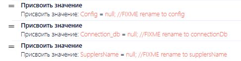
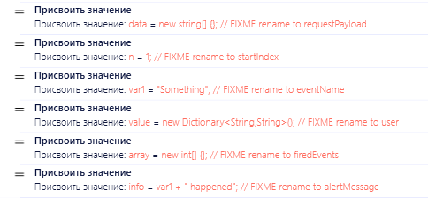
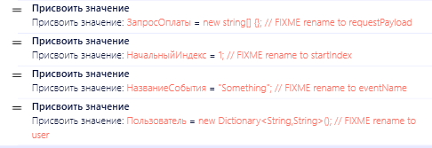
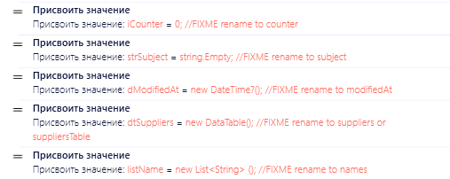
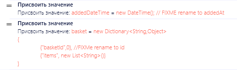
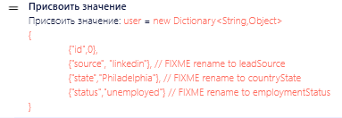
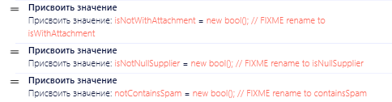

# Соглашение об именовании

Единые соглашения об именовании в проектах PIX RPA значительно упрощают разработку, поддержку и взаимодействие между членами команды. Правильное именование компонентов помогает быстрее понимать код и снижает количество ошибок.

## Содержание

- [NAM-01. Используйте PascalCasing для параметров скриптов](#nam-01-используйте-pascalcasing-для-параметров-скриптов) — MUST
- [NAM-02. Используйте camelCasing для локальных переменных](#nam-02-используйте-camelcasing-для-локальных-переменных) — MUST
- [NAM-03. Используйте осмысленные и информативные имена](#nam-03-используйте-осмысленные-и-информативные-имена) — MUST
- [NAM-04. Соблюдайте конвенции нейминга языка и компании](#nam-04-соблюдайте-конвенции-нейминга-языка-и-компании) — MUST
- [NAM-05. Используйте устоявшиеся термины для общих понятий](#nam-05-используйте-устоявшиеся-термины-для-общих-понятий) — SHOULD
- [NAM-06. Не используйте кириллицу в именах](#nam-06-не-используйте-кириллицу-в-именах) — MUST
- [NAM-07. Избегайте венгерской нотации](#nam-07-избегайте-венгерской-нотации) — SHOULD
- [NAM-08. Избегайте избыточных названий](#nam-08-избегайте-избыточных-названий) — SHOULD
- [NAM-09. Используйте контекстуально понятные имена](#nam-09-используйте-контекстуально-понятные-имена) — SHOULD
- [NAM-10. Избегайте абстрактных названий](#nam-10-избегайте-абстрактных-названий) — SHOULD
- [NAM-11. Избегайте отрицательных переменных](#nam-11-избегайте-отрицательных-переменных) — SHOULD

## NAM-01. Используйте PascalCasing для параметров скриптов

**Уровень:** MUST — обязательно

Используйте регистр Pascal Case (первая буква каждого слова заглавная, без разделителей) при именовании параметров скрипта. Добавляйте соответствующие префиксы для обозначения типа параметра:

- `In_` для входных параметров (например, `In_CustomerId`)
- `Out_` для выходных параметров (например, `Out_ProcessingResult`)
- `InOut_` для параметров, которые являются одновременно входными и выходными (например, `InOut_TransactionStatus`)

[⬆ К содержанию](#содержание)

## NAM-02. Используйте camelCasing для локальных переменных

**Уровень:** MUST — обязательно

Используйте регистр camel Case (первая буква строчная, первые буквы следующих слов заглавные) при именовании локальных переменных в скриптах.

**Преимущества:**
- Визуальное отличие локальных переменных от параметров скрипта
- Соответствие общепринятым стандартам C#
- Улучшенная читаемость и структурированность кода

**Последствия несоблюдения:**
- Смешение стилей затрудняет понимание области видимости переменных
- Снижение читаемости кода
- Усложнение поддержки и модификации существующего кода

[⬆ К содержанию](#содержание)

## NAM-03. Используйте осмысленные и информативные имена

**Уровень:** MUST — обязательно

Всегда давайте переменным, параметрам и функциям имена, которые ясно отражают их назначение и контекст использования.

**Хорошие примеры:**
- `customerInvoiceFilePath` вместо просто `path`
- `isTransactionCompleted` вместо `flag` или `status`
- `employeeCount` вместо `num` или `n`

**Последствия использования абстрактных имен:**
- Снижение читаемости кода
- Увеличение времени на анализ и понимание логики
- Повышение риска ошибок при использовании переменных
- Затруднение отладки и поддержки

**Исключения:** 
Для индексов в коротких циклах допустимо использовать однобуквенные переменные (`i`, `j`, `k`), но только в рамках локального контекста и небольших блоков кода. Никогда не используйте такие переменные как параметры скриптов.

[⬆ К содержанию](#содержание)

## NAM-04. Соблюдайте конвенции нейминга языка и компании

**Уровень:** MUST — обязательно

Придерживайтесь общепринятых правил именования в C# и соглашений, принятых в вашей компании. Это обеспечивает преемственность и совместимость с существующими проектами и библиотеками.

**Преимущества:**
- Сокращение времени на адаптацию новых разработчиков
- Единообразие кодовой базы

**Последствия несоблюдения:**
- Рассогласованность в кодовой базе
- Увеличение времени на обучение новых членов команды
- Увеличение времени на передачу проекта другому сотрудники или команде поддержки

Ссылки на официальные руководства:
- [Правила и соглашения об именовании C#](https://learn.microsoft.com/ru-ru/dotnet/csharp/fundamentals/coding-style/identifier-names)

[⬆ К содержанию](#содержание)

## NAM-05. Используйте устоявшиеся термины для общих понятий

**Уровень:** SHOULD — рекомендуется

Выбирайте один термин для обозначения каждого понятия и придерживайтеся его во всем проекте. Избегайте использования синонимов, которые могут вызвать путаницу.

**Примеры стандартизации терминов:**
- Поставщик: использовать `supplier` (а не provider, vendor, contractor)
- Заказчик: использовать `customer` (а не client, consumer)
- Цена: использовать `price` (а не rate, cost, pricing, worth)
- Объем: использовать `volume` (а не amount, size, bulk, quantity)
- Склад: использовать `warehouse` (а не storage, store, storehouse)

**Преимущества:**
- Единообразие терминологии во всем проекте
- Снижение когнитивной нагрузки при чтении кода
- Улучшение понимания предметной области

**Последствия несоблюдения:**
- Путаница в терминологии
- Сложности при коммуникации в команде

[⬆ К содержанию](#содержание)

## NAM-06. Не используйте кириллицу в именах

**Уровень:** MUST — обязательно

Используйте только ASCII-символы (латиницу) для имен переменных, функций и параметров.

**Преимущества:**
- Совместимость со всеми средами разработки и системами контроля версий
- Соответствие индустриальным стандартам
- Отсутствие проблем с кодировками

**Последствия использования кириллицы:**
- Возможные ошибки кодировки в различных средах

[⬆ К содержанию](#содержание)

## NAM-07. Избегайте венгерской нотации

**Уровень:** SHOULD — рекомендуется

Венгерская нотация (добавление префикса типа к имени переменной) избыточна в современных средах разработки с поддержкой типизации и подсказок IDE.

**Примеры:**
- Не используйте: `strName`, `intAge`, `boolIsActive`
- Используйте: `name`, `age`, `isActive`

**Преимущества отказа от венгерской нотации:**
- Более чистый и читаемый код
- Легкость рефакторинга при изменении типа переменной
- Соответствие современным практикам разработки

**Последствия использования венгерской нотации:**
- Избыточность информации
- Сложности при изменении типов данных

[⬆ К содержанию](#содержание)

## NAM-08. Избегайте избыточных названий

**Уровень:** SHOULD — рекомендуется

Не дублируйте информацию, которая уже очевидна из контекста или типа переменной.

**Преимущества лаконичных имен:**
- Более компактный и читаемый код
- Сокращение визуального шума
- Фокус на смысловой составляющей имени

**Последствия избыточности:**
- Увеличение длины кода без добавления ценности
- Снижение читаемости
- Потеря внимания к действительно важным аспектам кода

[⬆ К содержанию](#содержание)

## NAM-09. Используйте контекстуально понятные имена

**Уровень:** SHOULD — рекомендуется

Контекст использования переменной должен быть очевиден из её имени. Избегайте общих терминов без уточнения.

**Примеры улучшения контекста:**
- `filePath` вместо просто `path`
- `invoiceStatus` вместо просто `status`
- `paymentMethod` вместо просто `method`
- `customerEmail` вместо просто `email`
- `documentCreationDate` вместо просто `date`
- `orderConfirmationMessage` вместо просто `message`
- `employeeFirstName` вместо просто `name`
- `transactionAmount` вместо просто `value`
- `errorMessageText` вместо просто `text`
- `invoiceDownloadUrl` вместо просто `url`

**Преимущества контекстуальных имен:**
- Ясность назначения и использования переменной
- Уменьшение зависимости от комментариев
- Снижение когнитивной нагрузки при чтении кода

**Последствия отсутствия контекста:**
- Необходимость постоянно держать в уме контекст использования переменной
- Сложности при рефакторинге
- Увеличение вероятности ошибок при использовании

[⬆ К содержанию](#содержание)

## NAM-10. Избегайте абстрактных названий

**Уровень:** SHOULD — рекомендуется

Название переменной должно ясно передавать её назначение и ожидаемые значения, а не просто обозначать действие.

**Примеры:**
- `isEmailValid` вместо `checkEmail`
- `hasAttachments` вместо `checkAttachments`
- `isAuthorized` вместо `authorizationCheck`
- `canUserEdit` вместо `verifyEditPermission`
- `isAccountActive` вместо `accountStatusCheck`
- `hasUnreadMessages` вместо `checkMessages`
- `isFileUploaded` вместо `uploadFileStatus`
- `areCredentialsValid` вместо `validateCredentials`
- `isRequestSuccessful` вместо `requestResult`
- `hasExpired` вместо `expirationCheck`

**Преимущества конкретных имен:**
- Однозначность в понимании ожидаемого результата
- Возможность использования переменной в условных выражениях без дополнительных пояснений
- Самодокументирующийся код

**Последствия абстрактных названий:**
- Неоднозначность в интерпретации значений
- Необходимость изучения реализации для понимания назначения
- Повышенный риск неправильного использования

[⬆ К содержанию](#содержание)

## NAM-11. Избегайте отрицательных переменных

**Уровень:** SHOULD — рекомендуется

Логические переменные с отрицанием в названии затрудняют понимание условных выражений и повышают вероятность ошибок.

**Примеры:**
- Используйте `isValid` вместо `isNotInvalid`
- Используйте `isCompleted` вместо `isNotPending`
- Используйте `hasAccess` вместо `isNotForbidden`
- Используйте `isEnabled` вместо `isNotDisabled`
- Используйте `isAvailable` вместо `isNotUnavailable`
- Используйте `isIncluded` вместо `isNotExcluded`
- Используйте `isApproved` вместо `isNotRejected`
- Используйте `isEmpty` вместо `isNotFilled`
- Используйте `canProceed` вместо `isNotBlocked`
- Используйте `isAllowed` вместо `isNotProhibited`

**Преимущества позитивных формулировок:**
- Интуитивно понятные условные выражения
- Снижение когнитивной нагрузки при чтении кода
- Уменьшение вероятности логических ошибок в условиях

**Последствия использования отрицаний:**
- Запутанные условные выражения с двойным отрицанием
- Повышенная вероятность ошибок при изменении условий
- Сложности при чтении и понимании логики

[⬆ К содержанию](#содержание)
