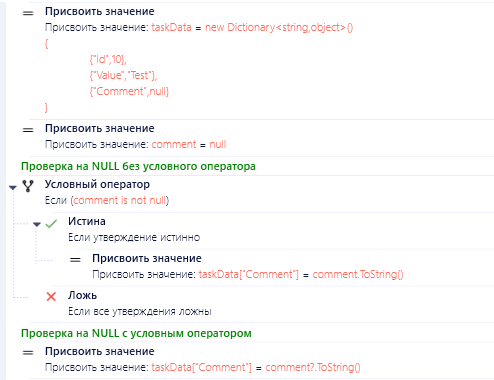
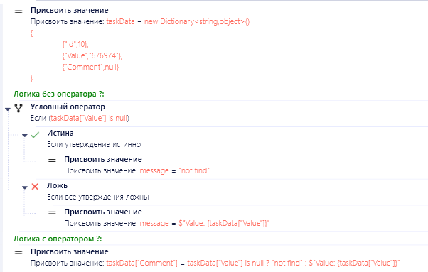
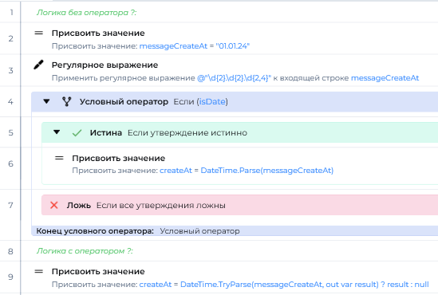
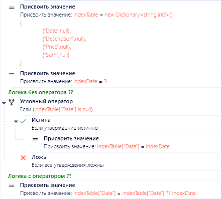
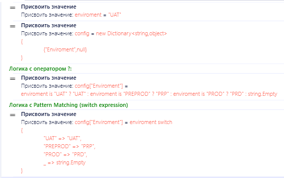

# Условия и условные операторы

<details>
    <summary><b>Эффективное использование условных операторов в PIX RPA (будут добавлены примеры)</b></summary>

Современные версии C# предлагают элегантные условные операторы, которые позволяют писать более компактный и читаемый код в PIX RPA. Использование этих операторов вместо стандартных условных блоков (if-else) и активностей значительно сокращает количество блоков в потоке и упрощает понимание логики.

### Основные условные операторы

#### 1. Оператор условного null-доступа (`?.`)

Позволяет безопасно обращаться к свойствам и методам объектов, которые могут быть null.



**Применение в PIX RPA:**
- Доступ к вложенным свойствам объектов из API
- Безопасная работа с результатами активностей
- Доступ к элементам в коллекциях, которые могут быть пустыми


#### 2. Условный оператор индексации (`?[]`)

Защищает от ошибок при доступе к элементам массивов или коллекций, которые могут быть null.

// Будет пример скрипта, пока пример на С#

```csharp
// Вместо проверки:
string firstServer;
if (config != null && config.Servers != null && config.Servers.Count > 0)
{
    firstServer = config.Servers[0];
}

// Используйте ?[]:
string firstServer = config?.Servers?[0];
```

// Будет пример скрипта

**Применение в PIX RPA:**
- Безопасный доступ к элементам DataTable и Dictionary
- Обработка результатов запросов, которые могут быть пустыми

#### 3. Тернарный условный оператор (`?:`)

Компактная замена простых условных конструкций if-else.



> **Важно:** В PIX RPA контекстные значения являются свойствами C#, поэтому нельзя использовать параметры `out` и `ref` напрямую.



**Применение в PIX RPA:**
- Условная логика в выражениях и присваиваниях
- Форматирование вывода в зависимости от условий
- Выбор значений параметров в зависимости от контекста

#### 4. Операторы объединения со значением null (`??` и `??=`)

Предоставляют значение по умолчанию для null-выражений.



**Применение в PIX RPA:**
- Установка значений по умолчанию
- Инициализация объектов, если они null
- Обработка отсутствующих значений в конфигурациях

#### 5. Pattern matching с switch expression

Современный C# позволяет использовать мощный механизм сопоставления с образцом (pattern matching) для более выразительной обработки условий.
Pattern matching позволяет сопоставлять не только значения, но и типы, свойства и условия.



**Применение в PIX RPA:**
- Маппинг статусов и кодов ошибок
- Обработка разнотипных данных, полученных из разных источников
- Замена сложных условных конструкций
- Валидация и трансформация входных данных

**Преимущества:**
- Более читаемый и компактный код
- Меньше вероятность ошибок при сложной логике
- Легче поддерживать и расширять
- Позволяет деконструировать сложные объекты

### Практические примеры в PIX RPA
// ... existing code ...

### Сравнение производительности условных операторов (Для роботов не критично)

| Оператор | Производительность | Читаемость | Когда использовать |
|----------|-------------------|------------|-------------------|
| Обычные if-else | Высокая | Средняя | Сложная логика с многими действиями |
| Тернарный оператор (?:) | Средняя-высокая | Высокая (для простых случаев) | Простое условное присваивание |
| Null-условный оператор (?.) | Средняя | Высокая | Цепочки проверок на null |
| Null-объединение (??) | Средняя | Высокая | Установка значений по умолчанию |
| Pattern matching (switch expression) | Средняя | Очень высокая | Множественные условия с возвратом значений |

### Рекомендации по использованию

1. **Используйте для простых условий** - условные операторы делают код более компактным, но их чрезмерное вложение может ухудшить читаемость
2. **Предпочитайте `?.` вместо явных проверок на null** для цепочек обращений к свойствам
3. **Комбинируйте `?.` с `??`** для обеспечения значений по умолчанию
4. **Разбивайте сложные выражения** на несколько строк для лучшей читаемости
5. **Используйте тернарный оператор** только для простых условий с понятными результатами

### Когда не использовать

- **Сложная бизнес-логика** с множеством условий и действий
- **Цепочки из нескольких вложенных тернарных операторов** — они становятся трудночитаемыми
- **Когда нужны отладочные точки** внутри условий

### Дополнительная информация
- [Оператор условного null-доступа](https://learn.microsoft.com/ru-ru/dotnet/csharp/language-reference/operators/member-access-operators#null-conditional-operators--and-)
- [Операторы объединения со значением null](https://learn.microsoft.com/ru-ru/dotnet/csharp/language-reference/operators/null-coalescing-operator)
- [Тернарный условный оператор](https://learn.microsoft.com/ru-ru/dotnet/csharp/language-reference/operators/conditional-operator)

**[⬆ К карте разделов](../../README.md#карта-разделов)**

</details>

<details>
    <summary><b>Рекомендации по работе с условиями (В работе)</b></summary>

Эффективная работа с условиями — один из ключевых аспектов качественного кода. Следование определенным принципам делает код более читаемым, поддерживаемым и менее подверженным ошибкам.

## 1. Избегайте глубоких вложений в скриптах

Глубокое вложение условных операторов и циклов существенно усложняет понимание, отладку и поддержку кода. Чем больше уровней вложенности, тем труднее отследить поток выполнения и логику программы.

### Проблемы с глубокими вложениями

1. **Ухудшение читаемости**
   - Сложно визуально отследить вложенные блоки
   - Трудно понять логику и зависимости
   - Код становится визуально перегруженным

2. **Повышение сложности**
   - Увеличивается цикломатическая сложность
   - Растет количество возможных путей выполнения
   - Становится труднее охватить все сценарии

3. **Трудности при отладке**
   - Сложно локализовать ошибки
   - Больше точек потенциальных сбоев
   - Труднее пошагово проследить выполнение

4. **Проблемы поддержки**
   - Внесение изменений становится рискованным
   - Увеличивается вероятность регрессионных ошибок
   - Новым разработчикам сложнее разобраться в коде

### Пример: глубокие вложения (плохая практика)

```csharp
// ❌ Плохо: множество уровней вложенности
public void ProcessOrder(Order order)
{
    if (order != null)
    {
        if (order.IsActive)
        {
            if (order.Items != null && order.Items.Count > 0)
            {
                foreach (var item in order.Items)
                {
                    if (item.IsInStock)
                    {
                        if (item.Quantity > 0)
                        {
                            // Обработка товара
                            decimal price = CalculatePrice(item);
                            if (price > 0)
                            {
                                // Ещё один уровень вложенности...
                                if (customer.HasDiscount)
                                {
                                    // И ещё один...
                                    if (discount > 0)
                                    {
                                        // Финальная логика обработки
                                    }
                                }
                            }
                        }
                    }
                }
            }
        }
    }
}
```

### Решение 1: Guard Clauses (защитные условия)

Guard Clause - это паттерн, при котором проверки выполняются в начале метода, и при несоответствии условиям происходит ранний возврат. Это позволяет избежать глубоких вложений и делает код более плоским и читаемым.

```csharp
// ✅ Хорошо: использование Guard Clauses
public void ProcessOrder(Order order)
{
    // Guard Clauses - ранний возврат при несоответствии условиям
    if (order == null)
        return;
        
    if (!order.IsActive)
        return;
        
    if (order.Items == null || order.Items.Count == 0)
        return;
    
    // Основной поток выполнения после всех проверок
    foreach (var item in order.Items)
    {
        ProcessOrderItem(item);
    }
}

private void ProcessOrderItem(OrderItem item)
{
    // Вложенная логика выделена в отдельный метод с Guard Clauses
    if (!item.IsInStock || item.Quantity <= 0)
        return;
    
    decimal price = CalculatePrice(item);
    if (price <= 0)
        return;
        
    ApplyPricing(item, price);
}

private void ApplyPricing(OrderItem item, decimal price)
{
    // Дальнейшая логика также разбита на методы
    if (!customer.HasDiscount)
    {
        ApplyRegularPrice(item, price);
        return;
    }
    
    if (discount <= 0)
    {
        ApplyRegularPrice(item, price);
        return;
    }
    
    ApplyDiscountedPrice(item, price, discount);
}
```

### Решение 2: Рефакторинг и декомпозиция

Выделение логики в отдельные методы и функции уменьшает вложенность и повышает читаемость:

```csharp
// ✅ Хорошо: декомпозиция на методы
public void ProcessOrder(Order order)
{
    if (!IsValidOrder(order))
        return;
    
    foreach (var item in order.Items)
    {
        if (IsProcessableItem(item))
        {
            ProcessValidItem(item);
        }
    }
}

private bool IsValidOrder(Order order)
{
    return order != null && order.IsActive && order.Items != null && order.Items.Count > 0;
}

private bool IsProcessableItem(OrderItem item)
{
    return item.IsInStock && item.Quantity > 0;
}

private void ProcessValidItem(OrderItem item)
{
    decimal price = CalculatePrice(item);
    if (price <= 0)
        return;
    
    // Дальнейшая логика...
}
```

### Решение 3: Объединение условий

Объединение нескольких проверок в одно условие может существенно уменьшить вложенность:

```csharp
// ✅ Хорошо: объединение условий
public void ProcessOrder(Order order)
{
    bool canProcess = order != null && 
                     order.IsActive && 
                     order.Items != null && 
                     order.Items.Count > 0;
                     
    if (!canProcess)
        return;
    
    foreach (var item in order.Items)
    {
        if (item.IsInStock && item.Quantity > 0)
        {
            decimal price = CalculatePrice(item);
            // Дальнейшая логика...
        }
    }
}
```

## 2. Избегайте отрицательных условий

Использование отрицательных условий (с операторами отрицания) усложняет понимание кода, так как человеческий мозг обрабатывает положительные утверждения легче, чем отрицательные.

### Почему отрицательные условия создают проблемы

1. **Когнитивная нагрузка**
   - Человеческому мозгу требуется больше усилий для обработки отрицаний
   - Двойные отрицания особенно трудны для понимания
   - Негативная логика менее интуитивна

2. **Снижение ясности**
   - Отрицательные условия часто приводят к путанице
   - Утверждения "не не X" требуют дополнительного умственного преобразования
   - Сложнее понять намерение кода

3. **Увеличение вероятности ошибок**
   - Легче допустить логическую ошибку при отрицательной логике
   - Сложнее отлаживать отрицательные условия
   - Больше шансов неправильно интерпретировать условие

### Примеры отрицательных условий

```csharp
// ❌ Плохо: отрицательное условие
if (!isInvalid)
{
    // Выполнить действие
}

// ❌ Плохо: двойное отрицание
if (!customer.IsNotActive)
{
    // Выполнить действие для активного клиента?
}

// ❌ Плохо: отрицание сложного условия
if (!(age >= 18 && hasParentalConsent))
{
    // Сложно быстро понять эту логику
}

// ❌ Плохо: отрицательное условие с оператором else
if (!isValid)
{
    // Обработка невалидного случая
}
else
{
    // Обработка валидного случая
}
```

### Решение: используйте положительные условия

```csharp
// ✅ Хорошо: положительное условие
if (isValid)
{
    // Выполнить действие
}

// ✅ Хорошо: использование понятной переменной
bool isActive = !customer.IsNotActive;
if (isActive)
{
    // Выполнить действие для активного клиента
}

// ✅ Хорошо: переформулировка сложного условия
bool isMinorWithoutConsent = age < 18 || !hasParentalConsent;
if (isMinorWithoutConsent)
{
    // Логика теперь понятнее
}

// ✅ Хорошо: поменять порядок блоков для использования положительного условия
if (isValid)
{
    // Обработка валидного случая
}
else
{
    // Обработка невалидного случая
}
```

### Особые случаи использования отрицания

Существуют ситуации, когда отрицательные условия могут быть уместны:

1. **Guard Clauses (защитные условия)**
   ```csharp
   // Допустимое использование отрицания в защитных условиях
   if (string.IsNullOrEmpty(name))
       return;
   
   // Основная логика метода...
   ```

2. **Проверка на отсутствие или негативный результат**
   ```csharp
   bool isNotFound = !collection.Contains(item);
   if (isNotFound)
   {
       // Четкое значение переменной помогает понять намерение
   }
   ```

3. **Логика предикатов**
   ```csharp
   // Функция-предикат, которая проверяет условие
   bool IsNotEligible(Customer customer) => 
       customer.Balance < 0 || customer.Status != "Active";
   
   // Использование с понятным именем функции
   if (IsNotEligible(customer))
   {
       // Отказ в обслуживании
   }
   ```

## 3. Избегайте громоздких if-else конструкций

Использование громоздких условных операторов (if-else) усложняет понимание и поддержку кода. Существует несколько эффективных подходов к их упрощению.

### Основные проблемы с громоздкими if-else конструкциями

1. **Сложность понимания**
   - Затруднительно быстро определить логику выполнения
   - Повышается когнитивная нагрузка при чтении кода
   - Требуется больше времени на анализ всех ветвлений

2. **Снижение поддерживаемости**
   - Внесение изменений в один блок часто затрагивает другие блоки
   - Сложнее выявить и исправить дефекты
   - Увеличивается время на тестирование при модификациях

3. **Нарушение принципа SRP**
   - Метод с множеством условий обычно делает слишком много
   - Сложнее соблюдать принцип единственной ответственности
   - Возрастает сцепление между разными частями логики

### Примеры громоздких условий

```csharp
// ❌ Плохо: сложный многоуровневый if-else
public string ProcessOrder(Order order)
{
    if (order != null)
    {
        if (order.IsValid)
        {
            if (order.Items.Count > 0)
            {
                if (order.Customer.IsActive)
                {
                    if (order.TotalAmount <= order.Customer.CreditLimit)
                    {
                        // Обработка заказа
                        return "Order processed successfully";
                    }
                    else
                    {
                        return "Credit limit exceeded";
                    }
                }
                else
                {
                    return "Customer is not active";
                }
            }
            else
            {
                return "Order has no items";
            }
        }
        else
        {
            return "Invalid order";
        }
    }
    else
    {
        return "Order is null";
    }
}
```

### Решения для упрощения условных операторов

#### 1. Использование тернарных операторов для простых случаев

```csharp
// ✅ Хорошо: тернарный оператор вместо if-else
// Было
string result;
if (age >= 18)
{
    result = "Взрослый";
}
else
{
    result = "Несовершеннолетний";
}

// Стало
string result = age >= 18 ? "Взрослый" : "Несовершеннолетний";
```

#### 2. Применение паттерна Guard Clauses (защитные условия)

```csharp
// ✅ Хорошо: использование защитных условий
public string ProcessOrder(Order order)
{
    if (order == null)
        return "Order is null";
        
    if (!order.IsValid)
        return "Invalid order";
        
    if (order.Items.Count == 0)
        return "Order has no items";
        
    if (!order.Customer.IsActive)
        return "Customer is not active";
        
    if (order.TotalAmount > order.Customer.CreditLimit)
        return "Credit limit exceeded";
        
    // Основная логика обработки заказа
    return "Order processed successfully";
}
```

#### 3. Использование паттерна Strategy

```csharp
// ✅ Хорошо: вынесение логики в отдельные методы
public string ProcessOrder(Order order)
{
    if (ValidateOrder(order, out string errorMessage))
        return ProcessValidOrder(order);
    
    return errorMessage;
}

private bool ValidateOrder(Order order, out string errorMessage)
{
    errorMessage = string.Empty;
    
    if (order == null)
    {
        errorMessage = "Order is null";
        return false;
    }
    
    if (!order.IsValid)
    {
        errorMessage = "Invalid order";
        return false;
    }
    
    // Другие проверки...
    
    return true;
}

private string ProcessValidOrder(Order order)
{
    // Логика обработки валидного заказа
    return "Order processed successfully";
}
```

#### 4. Использование словарей или обработчиков команд

```csharp
// ✅ Хорошо: замена цепочки if-else на словарь
private static readonly Dictionary<OrderStatus, Func<Order, string>> OrderProcessors = 
    new Dictionary<OrderStatus, Func<Order, string>>
    {
        { OrderStatus.New, order => ProcessNewOrder(order) },
        { OrderStatus.Pending, order => ProcessPendingOrder(order) },
        { OrderStatus.Shipped, order => ProcessShippedOrder(order) },
        { OrderStatus.Delivered, order => ProcessDeliveredOrder(order) },
        { OrderStatus.Cancelled, order => ProcessCancelledOrder(order) }
    };

public string ProcessOrder(Order order)
{
    if (order == null)
        return "Order is null";
        
    if (OrderProcessors.TryGetValue(order.Status, out var processor))
        return processor(order);
        
    return "Unknown order status";
}
```

#### 5. Использование pattern matching (C# 7.0 и выше)

```csharp
// ✅ Хорошо: pattern matching для обработки разных типов
public string ProcessPayment(IPayment payment)
{
    return payment switch
    {
        CreditCardPayment cc => ProcessCreditCard(cc),
        DebitCardPayment dc => ProcessDebitCard(dc),
        BankTransferPayment bt => ProcessBankTransfer(bt),
        CashPayment cp => ProcessCash(cp),
        _ => "Unsupported payment method"
    };
}
```

## Применение в PIX RPA

### 1. В активностях с кодом C#

- Используйте тернарные операторы для коротких условий присваивания
- Применяйте Early Return (защитные условия) для проверок входных данных
- Выносите сложную логику в отдельные методы
- Избегайте глубоких вложений в коде активностей

```csharp
// Пример для PIX RPA (C# активность)
public string GetCustomerStatus(string customerId, int purchaseAmount)
{
    // Защитные условия
    if (string.IsNullOrEmpty(customerId))
        return "Error: Empty customer ID";
        
    // Использование тернарного оператора
    string category = purchaseAmount > 10000 ? "Premium" : "Regular";
    
    // Дальнейшая логика...
    return $"Customer: {customerId}, Category: {category}";
}
```

### 2. В рабочих процессах (Workflows)

- Разделяйте сложные решения на серию простых условий
- Используйте параллельные ветви вместо вложенных условий
- Создавайте отдельные подпроцессы для различных сценариев
- Используйте активность "Если" в начале процесса для раннего выхода
- Располагайте проверки условий в начале последовательности
- При невыполнении условий сразу переходите к финальным шагам

### 3. При работе с переменными

- Используйте промежуточные переменные для упрощения сложных выражений
- Применяйте значимые имена для булевых переменных
- Давайте говорящие имена переменным, которые отражают положительный смысл

```csharp
// Пример для PIX RPA (работа с переменными)
// Вместо сложного условия
if (dataTable != null && dataTable.Rows.Count > 0 && dataTable.Columns.Contains("Status") && dataTable.Rows[0]["Status"].ToString() == "Active")
{
    // Действия...
}

// Используйте промежуточные переменные
bool hasData = dataTable != null && dataTable.Rows.Count > 0;
bool hasStatusColumn = hasData && dataTable.Columns.Contains("Status");
bool isStatusActive = hasStatusColumn && dataTable.Rows[0]["Status"].ToString() == "Active";

if (isStatusActive)
{
    // Действия...
}
```

### 4. Для обработки исключений

```csharp
try
{
    // Проверка предусловий (Guard Clauses)
    if (string.IsNullOrEmpty(filePath))
        throw new ArgumentException("Путь к файлу не может быть пустым");
        
    if (!File.Exists(filePath))
        throw new FileNotFoundException($"Файл не найден: {filePath}");
        
    // Основной код выполняется только при валидных условиях
}
catch (Exception ex)
{
    Log.Error($"Ошибка обработки файла: {ex.Message}");
    // Обработка ошибки
}
```

## Общие рекомендации

1. **Максимальная глубина вложенности**
   - Старайтесь не превышать 2-3 уровня вложенности условий
   - При большей глубине рефакторите код

2. **Именование и переформулировка условий**
   - Переименовывайте переменные и методы с негативным смыслом (вместо `IsNotValid` используйте `IsInvalid`)
   - Используйте законы де Моргана для упрощения: `!(A && B)` эквивалентно `!A || !B`
   - Применяйте значимые имена для переменных: `bool isAdminUser = user.IsActive && user.HasRole("Admin");`

3. **Выбор подхода к упрощению**
   - Для простых условий присваивания используйте тернарный оператор
   - Для цепочек проверок применяйте защитные условия (Guard Clauses)
   - Для сложной логики разделяйте код на методы с чётким назначением

4. **Улучшение читаемости**
   - Используйте скобки для группировки сложных условий
   - Разбивайте сложные логические выражения на строки
   - Извлекайте сложные условия в методы с говорящими именами

5. **Работа с коллекциями**
   - Используйте LINQ для замены вложенных циклов
   - Применяйте Where, Select, Any вместо циклов с условиями
   - При обработке элементов коллекции выделяйте логику в отдельные методы

**[⬆ К карте разделов](../../README.md#карта-разделов)**

</details>
