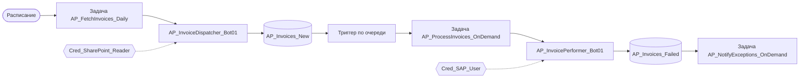

# Интеграция компонентов оркестратора

Эффективная работа экосистемы PIX Master зависит от правильной интеграции всех компонентов: очередей, хостов, агентов, задач и ассетов.

## Содержание

- [Связь между компонентами](#связь-между-компонентами)
- [Сквозной процесс с использованием всех компонентов](#сквозной-процесс-с-использованием-всех-компонентов)
- [Рекомендации по проектированию интеграции](#рекомендации-по-проектированию-интеграции)

## Связь между компонентами

| Компонент 1 | Связь | Компонент 2 | Примечания |
|-------------|-------|-------------|------------|
| Хост | выполняет → | Агент робота | Один хост может исполнять несколько агентов |
| Агент робота | обрабатывает → | Очередь данных | Робот может работать с несколькими очередями |
| Задача | запускает → | Агент робота | По расписанию или триггеру |
| Триггер | активирует → | Задачу | При наступлении события или изменении очереди |
| Ассет | используется → | Агентом робота | Для конфигурации и доступа к системам |
| Очередь данных | активирует → | Триггер | При поступлении новых элементов |

## Сквозной процесс с использованием всех компонентов

1. **Получение данных:**
   - Робот `AP_InvoiceDispatcher_Bot01` на хосте `PROD-MSK-AP-01`
   - Задача `AP_FetchInvoices_Daily` по расписанию `0 8 * * *` (каждый день в 8:00)
   - Использует ассет `Cred_SharePoint_Reader` для доступа к файлам
   - Помещает данные в очередь `AP_Invoices_New`

2. **Обработка транзакций:**
   - Триггер `Trigger_AP_ProcessInvoices` активируется при наличии элементов в очереди
   - Запускает задачу `AP_ProcessInvoices_OnDemand`
   - Задача запускает робота `AP_InvoicePerformer_Bot01` на хосте `PROD-MSK-AP-02`
   - Робот использует ассеты `Cred_SAP_User` и `Config_AP_ValidationRules`
   - Обработанные элементы перемещаются в очередь `AP_Invoices_Processed`
   - Ошибки направляются в очередь `AP_Invoices_Failed`

3. **Обработка исключений:**
   - Триггер `Trigger_AP_HandleExceptions` активируется при появлении элементов в очереди ошибок
   - Запускает задачу `AP_NotifyExceptions_OnDemand`
   - Задача запускает робота `AP_Notification_Bot01`
   - Робот использует ассет `Param_AP_Email_SupportList` для отправки уведомлений

## Рекомендации по проектированию интеграции

- Создавайте схемы и документацию по взаимодействию компонентов
- Обеспечьте непротиворечивую стратегию именования для всех связанных компонентов
- Разработайте план действий при сбоях на каждом этапе процесса
- Регулярно проверяйте целостность всей цепочки взаимодействий
