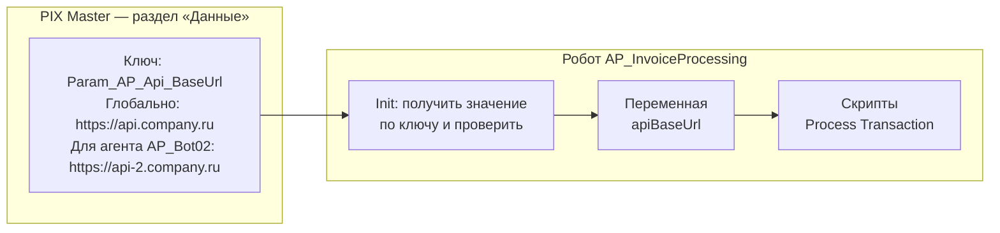

# Конфигурация и конфиденциальные данные

Где хранятся настройки робота, секреты и входные параметры, как называть ассеты в PIX Master и почему значения нельзя зашивать в код.

## Содержание

- [Что такое ассет](#что-такое-ассет)
- [CONFIG-01. Используйте ассеты мастера для хранения конфигурации](#config-01-используйте-ассеты-мастера-для-хранения-конфигурации) — 🔴 Обязательно
- [CONFIG-02. Используйте зашифрованные ассеты для хранения конфиденциальных данных](#config-02-используйте-зашифрованные-ассеты-для-хранения-конфиденциальных-данных) — 🔴 Обязательно
- [CONFIG-03. Используйте входные параметры робота только для значений запуска](#config-03-используйте-входные-параметры-робота-только-для-значений-запуска) — 🔴 Обязательно
- [CONFIG-04. Не коммитьте конфиденциальные данные](#config-04-не-коммитьте-конфиденциальные-данные) — 🔴 Обязательно
- [CONFIG-05. Не используйте жесткое кодирование](#config-05-не-используйте-жесткое-кодирование) — 🔴 Обязательно
- [CONFIG-06. Именуйте ассеты по типу](#config-06-именуйте-ассеты-по-типу) — 🔴 Обязательно
- [CONFIG-07. Организуйте ассеты по проектам](#config-07-организуйте-ассеты-по-проектам) — 🟡 Рекомендуется

## Что такое ассет

**Ассет** — параметр робота, который хранится не в коде, а в PIX Master. Робот получает его значение по ключу во время работы. Так робот узнает адрес системы, путь к папке, получателей отчета, логин и пароль — все, что может отличаться между контурами, агентами или меняться со временем.

> [!NOTE]
> В интерфейсе PIX Master ассеты находятся в разделе **«Данные» (Data)**. В соглашениях используется слово «ассет».

### Ассет в PIX Master

Каждый ассет — элемент раздела «Данные» ([документация PIX Master](https://docs.pixrobotics.com/articles/#!rpa/master-data)):

| Поле | Назначение | Соглашение |
|------|------------|------------|
| Ключ (Key) | Имя, по которому робот находит значение | [CONFIG-06](#config-06-именуйте-ассеты-по-типу) |
| Описание (Description) | Что это за параметр и какой робот его использует | Заполняйте всегда |
| Тип (Type) | Строка, число, учетные данные и т.д. | Секреты — только защищенные типы, [CONFIG-02](#config-02-используйте-зашифрованные-ассеты-для-хранения-конфиденциальных-данных) |
| Значение (Value) | Само значение | — |
| Группа (Group) | Для сортировки и фильтрации списка | [CONFIG-07](#config-07-организуйте-ассеты-по-проектам) |

Значение задается двумя способами:
- **«Значение (глобально)»** — одно значение для всех агентов;
- **значение для агента** — свое значение для конкретного агента. Например, учетные данные: каждый агент входит в учетную систему под своей учетной записью.

Если для агента значение не задано, робот получает глобальное.

### Ассет в роботе

1. **В состоянии Init** робот получает значения ассетов по ключам и сохраняет их в переменные.
2. Там же проверяет, что все нужные ассеты заданы и значения корректны. Если ассета нет, робот завершается с понятной ошибкой до начала обработки транзакций.
3. **Дальше скрипты работают с переменными**, а не обращаются к мастеру за каждым значением повторно.



**Зачем это нужно:**
- Значение меняется в мастере, без изменения и перепубликации робота
- Один и тот же робот работает на DEV, UAT и PROD: ключи на всех контурах одинаковые, различаются значения
- Пароли и токены не попадают в код и Git
- Разные агенты могут работать с разными учетными записями и настройками

**Ассет или входной параметр.** Ассет — настройка, одинаковая для всех запусков на контуре. Входной параметр — значение, которое задается при конкретном запуске: дата отчета, режим работы (см. [CONFIG-03](#config-03-используйте-входные-параметры-робота-только-для-значений-запуска)).

[⬆ К содержанию](#содержание)

## CONFIG-01. Используйте ассеты мастера для хранения конфигурации

🔴 **Обязательно**

### Централизованное управление конфигурацией

Использование ассетов PIX Master для хранения конфигурационных данных роботов - это ключевая практика, которая обеспечивает гибкость, безопасность и стабильность решений.

**Основной принцип:** конфигурация должна быть реализована с использованием ассетов только из мастера-оркестратора.

#### Преимущества централизованного хранения конфигурации:

- **Единая точка управления** — все настройки контролируются в одном месте
- **Оперативное изменение** — обновление параметров без необходимости перекомпиляции кода
- **Контроль версий** — отслеживание изменений в настройках по времени
- **Безопасность** — снижение рисков утечки конфиденциальной информации
- **Упрощение миграции** — легкий перенос роботов между средами

#### Проблемы при использовании других источников конфигурации

Хранение конфигурации в альтернативных местах (файлах, БД) увеличивает количество зависимостей и может привести к сбоям:

* **Excel-файлы** — могут быть недоступны или повреждены
* **Базы данных** — потенциальные проблемы с соединением
* **Сетевые диски** — возможные проблемы с доступом или разрешениями
* **Локальные файлы** — усложнение обновления и синхронизации

---

### Типы конфигурационных параметров

#### 1. Ассеты мастера-оркестратора

Основной и рекомендуемый метод хранения настроек. Доступны следующие типы ассетов:

* **Строка** — для простых текстовых значений
* **Число** — для числовых параметров
* **Логическое значение** — для флагов и переключателей
* **JSON-строка** — для сложных структурированных данных
* **Защищенные данные** — для конфиденциальной информации
* **Учетные данные** — специально для логинов и паролей

#### 2. Входные параметры робота

Дополнительный механизм для передачи изменяемых значений при запуске:

* Все входные параметры имеют тип `string`
* Подходят для передачи динамических значений при запуске
* Используются для параметров, которые могут меняться от запуска к запуску

**Типичные примеры входных параметров:**
* Дата запуска отчета
* Идентификатор бизнес-процесса
* Количество элементов для обработки (если нужно обрабатывать порциями)
* Флаги режима работы

---

### Работа с разными окружениями

PIX Master обеспечивает эффективный механизм работы с несколькими контурами (DEV/UAT/PROD) без изменения кода роботов.

#### Преимущества использования контуров:

* Одинаковые имена ассетов существуют в разных контурах с разными значениями
* Автоматический выбор правильных значений при переносе робота между контурами
* Возможность переопределения значений для конкретных агентов

#### Схема работы с контурами:

```
┌────────────────┐  ┌────────────────┐  ┌────────────────┐
│  DEV Контур    │  │  UAT Контур    │  │  PROD Контур   │
├────────────────┤  ├────────────────┤  ├────────────────┤
│ apiUrl:        │  │ apiUrl:        │  │ apiUrl:        │
│ "dev-api.com"  │  │ "uat-api.com"  │  │ "api.com"      │
└────────────────┘  └────────────────┘  └────────────────┘
         │                  │                   │
         └──────────────────┼───────────────────┘
                            ▼
                    ┌────────────────┐
                    │  Код робота    │
                    │ var apiUrl =   │
                    │ assets["apiUrl"]│
                    └────────────────┘
```

#### Рекомендации по контурам:

* Поддерживайте одинаковую структуру ассетов во всех контурах
* Документируйте назначение и ожидаемые значения ассетов
* Используйте преднастроенные валидаторы для проверки значений

> [!IMPORTANT]
> При проектировании роботов учитывайте необходимость централизованного управления конфигурацией с самого начала. Это существенно упрощает поддержку и развитие решений в долгосрочной перспективе.

[⬆ К содержанию](#содержание)

## CONFIG-02. Используйте зашифрованные ассеты для хранения конфиденциальных данных

🔴 **Обязательно**

### Защита конфиденциальной информации

Безопасное хранение конфиденциальных данных — критически важный аспект разработки RPA-решений. PIX Master предоставляет специальные механизмы для шифрования и защиты чувствительной информации, которые должны использоваться во всех проектах.

**Основной принцип:** Любая конфиденциальная информация (пароли, ключи, токены доступа, персональные данные) должна храниться только в специализированных защищенных ассетах.

#### Типы защищенных ассетов в PIX Master

PIX Master предлагает два специализированных типа ассетов для хранения конфиденциальных данных:

| Тип ассета | Назначение | Особенности |
|------------|------------|-------------|
| **Защищенные данные** | Общая конфиденциальная информация (токены, ключи API, сертификаты) | Шифрование в хранилище, контроль доступа, аудит использования |
| **Учетные данные** | Пары логин/пароль для авторизации | Дополнительная защита, раздельное хранение логина и пароля, специальные методы доступа |

---

### Преимущества использования защищенных ассетов

#### Безопасность:
* **Шифрование в хранилище** — данные хранятся в зашифрованном виде
* **Контроль доступа** — гибкая настройка прав на уровне ролей и пользователей
* **Журналирование** — все обращения к защищенным ассетам фиксируются в системном журнале

#### Управление:
* **Централизация** — единая точка управления всеми учетными данными
* **Ротация** — возможность обновлять учетные данные без изменения кода роботов
* **Версионность** — отслеживание изменений в защищенных данных

#### Соответствие требованиям:
* **Политики безопасности** — соответствие корпоративным требованиям
* **Регуляторные требования** — поддержка требований GDPR, PCI DSS и других стандартов
* **Аудит** — прозрачность для проверок информационной безопасности

---

### Категории данных для защищенного хранения

Следующие типы информации всегда должны храниться в защищенных ассетах:

#### Учетные данные:
* Логины и пароли для информационных систем
* Учетные данные для подключения к базам данных
* Доменные учетные записи для сетевых ресурсов
* Учетные данные для почтовых серверов

#### Ключи и токены:
* API-ключи для внешних сервисов
* OAuth-токены доступа
* JWT-токены
* Ключи шифрования и подписи

#### Конфиденциальная бизнес-информация:
* Персональные данные сотрудников
* Информация о клиентах
* Финансовые данные
* Внутренние идентификаторы систем

#### Сетевая информация:
* Строки подключения к базам данных
* Адреса внутренних серверов
* VPN-конфигурации
* Идентификаторы сетевых ресурсов

---

### Рекомендации по работе с защищенными ассетами

#### Правильное использование:
* **Разделение данных** — храните разные типы данных в отдельных ассетах
* **Говорящие имена** — используйте понятную и стандартизированную систему именования
* **Минимальные привилегии** — предоставляйте доступ только тем, кому он действительно необходим
* **Регулярное обновление** — периодически обновляйте пароли и токены согласно политике безопасности

---

### Последствия нарушения правил безопасности

Несоблюдение принципов защиты конфиденциальных данных может привести к серьезным последствиям:

#### Риски безопасности:
* **Утечка данных** — компрометация конфиденциальной информации
* **Несанкционированный доступ** — возможность внешнего вмешательства в работу систем
* **Нарушение целостности данных** — риск модификации важной информации

#### Организационные проблемы:
* **Нарушение политик** — несоответствие корпоративным требованиям безопасности
* **Регуляторные санкции** — штрафы за нарушение требований законодательства
* **Репутационные потери** — подрыв доверия к компании и её системам

#### Технические сложности:
* **Сложности обновления** — необходимость перекомпиляции при смене паролей
* **Проблемы масштабирования** — затруднения при развертывании в новых средах
* **Ограничения при миграции** — сложности при переносе решений между контурами

[⬆ К содержанию](#содержание)

## CONFIG-03. Используйте входные параметры робота только для значений запуска

🔴 **Обязательно**

Входные параметры робота — это значения, которые задаются **при запуске** и могут отличаться от запуска к запуску: дата отчета, идентификатор процесса, режим работы, размер порции. Не добавляйте во входные параметры рабочие переменные робота и настройки, которые не меняются между запусками.

| Куда | Что | Пример |
|------|-----|--------|
| Входной параметр | Значение, которое задает запуск | `In_ReportDate`, `In_BatchSize`, `In_RunMode` |
| Ассет | Настройка, одинаковая для всех запусков на контуре | адрес API, путь к папке, получатели отчета, таймауты |
| Защищенный ассет | Секрет | пароли, токены |
| Переменная робота | Промежуточное значение внутри запуска | текущая транзакция, счетчик ошибок, загруженная таблица |

**Почему это важно:**
- Каждый входной параметр администратор должен заполнить или проверить при настройке задачи; лишние параметры приводят к ошибкам при запуске
- Переменная, вынесенная во входной параметр, становится частью «контракта» робота: ее уже нельзя переименовать или удалить без изменения задач в мастере
- Настройки во входных параметрах дублируются в каждой задаче и расходятся между ними; в ассете настройка одна

**Правила:**
- Все входные параметры имеют тип `string`: проверяйте и преобразуйте их в Init; некорректное значение — ошибка запуска с понятным сообщением
- Для каждого параметра определите значение по умолчанию или явно сделайте его обязательным
- Именуйте входные параметры с префиксом `In_` (см. [VARIABLE-01](../2-develop/variable.md#variable-01-используйте-pascalcasing-для-параметров-скриптов))
- Перечень входных параметров с описанием фиксируется в SDD и runbook робота

[⬆ К содержанию](#содержание)

## CONFIG-04. Не коммитьте конфиденциальные данные

🔴 **Обязательно**

Конфиденциальные данные хранятся в защищенных ассетах мастера (см. [Конфигурация и конфиденциальные данные](config.md)), а не в коде и файлах проекта.

Никогда не коммитьте в репозиторий:
- Пароли, токены и учетные данные
- Приватные ключи и сертификаты
- Локальные конфигурационные файлы с чувствительными данными
- Временные и логи-файлы
- Тестовые данные с конфиденциальной информацией

**Что делать, если конфиденциальные данные случайно попали в репозиторий:**
1. Немедленно измените все скомпрометированные учетные данные
2. Используйте `git filter-branch` или BFG Repo-Cleaner для удаления данных из истории
3. Создайте новую историю и используйте `git push --force`
4. Обновите .gitignore, чтобы предотвратить повторение ситуации

[⬆ К содержанию](#содержание)

## CONFIG-05. Не используйте жесткое кодирование

🔴 **Обязательно**

Жесткое кодирование (hardcoding) - это внедрение данных и настроек непосредственно в исходный код программы. В PIX RPA жесткое кодирование особенно критично, поскольку роботы должны быть гибкими и легко адаптируемыми к изменениям в бизнес-процессах и окружении.

### Почему это важно для PIX RPA

Роботы часто взаимодействуют с разными системами, используют учетные данные и обрабатывают конфиденциальную информацию. Жесткое кодирование в этом контексте создает риски безопасности и существенно снижает гибкость решений.

### Примеры жестко закодированных значений

| Тип данных | Пример жесткого кодирования | Проблема |
|------------|--------------------------|----------|
| Строки подключения | `"Server=192.168.1.45;Database=CRM;User Id=sa;Password=p@ssw0rd;"` | Пароли в коде, невозможность смены сервера |
| URL API | `"https://api.example.com/v1/customers"` | Сложно переключаться между тестовым и рабочим API |
| Пути к файлам | `@"C:\Users\JohnDoe\Documents\Reports\"` | Код не будет работать на других машинах |
| Учетные данные | `Login("admin", "SuperSecret123")` | Компрометация учетных данных в репозитории |
| Бизнес-правила | `amount > 10000` | Сложно изменить правила без перекомпиляции, плюс непонятно что значит 10000 |
| Адреса email | `boss@company.com` | Нельзя легко изменить получателя |
| Индексы таблиц | `var status = dataTable.Rows[0][7].ToString();` | При изменении структуры таблицы код сломается |
| Имена файлов | `string filename = "Report_2023.xlsx";` | Затруднена обработка файлов с другими именами |
| Строки запросов | `"SELECT * FROM Orders WHERE Status = 'New'"` | Сложно модифицировать запрос для разных условий |
| Таймауты | `await Task.Delay(5000);` | Нет гибкости для разных сценариев выполнения |
| Пороговые значения | `if (errorCount >= 3) { /* ... */ }` | Неочевидный смысл числовых констант |
| Форматы дат | `DateTime.ParseExact("dd.MM.yyyy")` | Проблемы при интернационализации |

### Особая проблема: жестко закодированные индексы

Один из наиболее распространенных и опасных видов жесткого кодирования в PIX RPA — использование числовых индексов для доступа к элементам коллекций, строкам и столбцам таблиц.

```csharp
// Плохо: жестко закодированные индексы
var customerName = dataTable.Rows[0][3].ToString();
var statusCode = resultArray[5];
var firstItem = itemsList[0];

// Хорошо: доступ к столбцу по имени
var customerName = dataTable.Rows[0]["CustomerName"].ToString();

// Допустимо, если у источника нет заголовков: именованная константа вместо «магического» индекса
const int CustomerNameColumnIndex = 3;
var customerName = dataTable.Rows[0][CustomerNameColumnIndex].ToString();
```

**Проблемы с жестко закодированными индексами:**
- Код сломается при изменении структуры данных
- Неочевидное значение индексов затрудняет понимание кода
- Нет проверки на выход за границы массива/коллекции
- Высокая вероятность ошибок при копировании и модификации кода

### Критическая проблема: пересборка и публикация при каждом изменении

Одним из самых серьезных недостатков жесткого кодирования является необходимость:
1. Изменять исходный код
2. Перекомпилировать проект
3. Тестировать обновленную версию
4. Публиковать новую версию
5. Обновлять установленные экземпляры робота

**Последствия для команды разработки:**
- Увеличение времени реакции на изменения требований
- Повышение рисков регрессии при внесении изменений
- Необходимость проведения полного цикла тестирования при минорных изменениях
- Задержки в развертывании критических обновлений
- Усложнение координации между разработчиками и бизнес-пользователями

**Сравнение подходов при изменении бизнес-правила:**

| Действие | С жестким кодированием | С конфигурацией в ассетах |
|----------|----------------------|--------------------------|
| Внесение изменения | Изменение кода | Изменение ассета |
| Время выполнения | ~30-60 минут | ~2-5 минут |
| Требуемые навыки | Разработчик | Администратор/аналитик |
| Тестирование | Полный цикл | Минимальное |
| Риски | Высокие (регрессия) | Низкие (изолированное изменение) |
| Откат изменений | Новая сборка | Возврат значения в ассете |

### Чек-лист для избавления от жесткого кодирования в PIX RPA

- [ ] Проверьте код на наличие "магических строк" и чисел
- [ ] Проанализируйте, какие данные могут изменяться в будущем
- [ ] Используйте ассеты в PIX Master для хранения настроек
- [ ] Используйте зашифрованные ассеты для чувствительных данных
- [ ] Вынесите пути к файлам в конфигурацию
- [ ] Добавьте валидацию конфигурационных данных при старте робота
- [ ] Документируйте структуру и назначение всех настроек

### Преимущества отказа от жесткого кодирования

- **Гибкость**: легко менять параметры без перекомпиляции кода
- **Безопасность**: чувствительные данные не хранятся в исходном коде
- **Масштабируемость**: одна и та же сборка работает в разных средах
- **Тестируемость**: упрощается переключение между тестовыми и рабочими настройками
- **Поддерживаемость**: устраняются "магические числа" и неочевидные значения
- **Централизация**: все настройки собраны в одном месте
- **Быстрое реагирование**: оперативное внесение изменений в конфигурацию без затрагивания кода

[⬆ К содержанию](#содержание)

## CONFIG-06. Именуйте ассеты по типу

🔴 **Обязательно**

- **Учетные данные:** `Cred_{Система}_{Назначение}`
  - Примеры: `Cred_SAP_ReadOnly`, `Cred_Sharepoint_Admin`
- **Значения:** `Param_{Проект}_{Категория}_{Название}`
  - Примеры: `Param_AP_Email_SupportAddress`, `Param_Common_API_BaseURL`
- **Коллекции:** `Config_{Проект}_{Назначение}`
  - Примеры: `Config_FinanceBot_EmailTemplates`, `Config_HRBot_ValidationRules`

Имя ассета одинаково на всех контурах, различаются только значения.

[⬆ К содержанию](#содержание)

## CONFIG-07. Организуйте ассеты по проектам

🟡 **Рекомендуется**

- Группируйте ассеты по проектам или функциональным областям
- Создайте иерархию папок для удобной навигации
- Используйте теги для дополнительной категоризации

**Типы ассетов и их применение:**
- **Строки подключения** (Connection Strings) — для доступа к базам данных; храните как защищенные данные, если содержат пароль
- **Учетные данные** (Credentials) — для аутентификации в системах
- **URL и эндпоинты API** — для интеграций с внешними системами
- **Настройки email** — для отправки уведомлений и отчетов
- **Пути к файлам** — локальные и сетевые пути для хранения данных
- **Бизнес-правила** — параметры для логики обработки

[⬆ К содержанию](#содержание)
