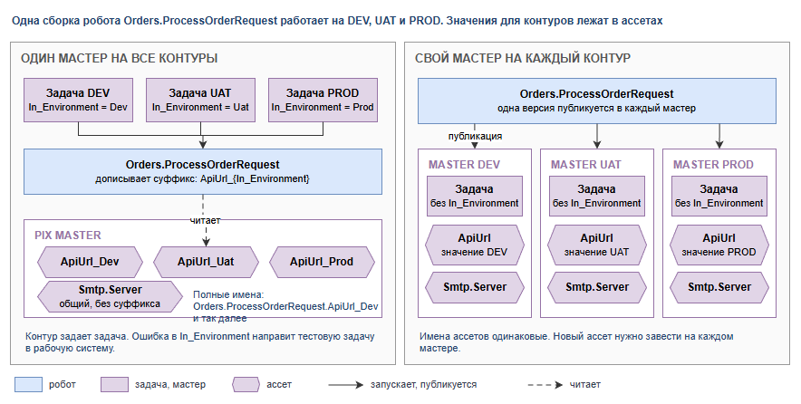
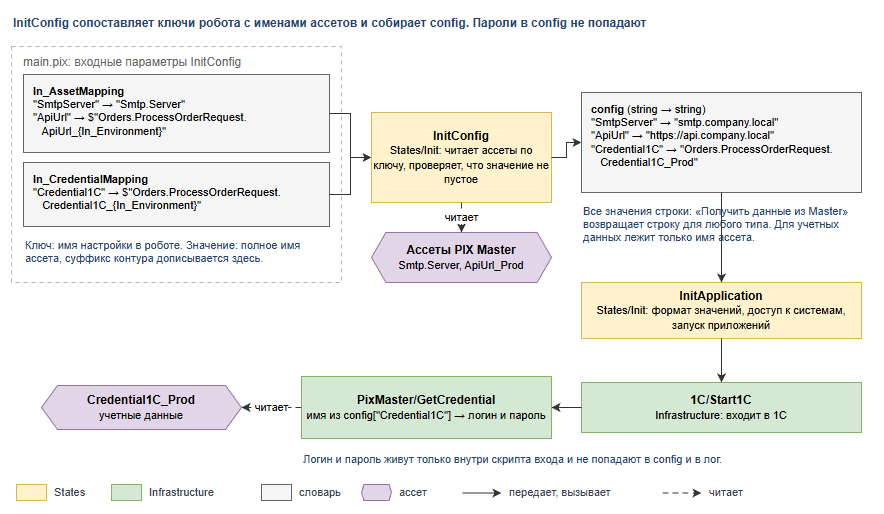

# Конфигурация и конфиденциальные данные

Где робот берет настройки и секреты, как называть ассеты в PIX Master и как собрать их в словарь `config`.

> [!NOTE]
> Раздел описывает робота, который работает с PIX Master. Без мастера настройки и секреты хранят в другом месте: в БД, файле, Excel, Vault или другом хранилище секретов. Где их хранить, решают отдельно для каждого робота.

## Содержание

- [CONFIG-01. Не зашивайте настройки в код](#config-01-не-зашивайте-настройки-в-код) (🔴 Обязательно)
- [CONFIG-02. Храните настройки в ассетах PIX Master](#config-02-храните-настройки-в-ассетах-pix-master) (🔴 Обязательно)
- [CONFIG-03. Называйте ассет по уровню, на котором его используют](#config-03-называйте-ассет-по-уровню-на-котором-его-используют) (🔴 Обязательно)
- [CONFIG-04. Получайте ассеты по ключу](#config-04-получайте-ассеты-по-ключу) (🔴 Обязательно)
- [CONFIG-05. Храните секреты в защищенных ассетах](#config-05-храните-секреты-в-защищенных-ассетах) (🔴 Обязательно)
- [CONFIG-06. Передавайте во входных параметрах только то, что отличает задачу](#config-06-передавайте-во-входных-параметрах-только-то-что-отличает-задачу) (🔴 Обязательно)
- [CONFIG-07. Храните в `config` только настройки](#config-07-храните-в-config-только-настройки) (🟡 Рекомендуется)
- [Что такое ассет](#что-такое-ассет) (📘 Справка)
- [Как собрать `config` из ассетов](#как-собрать-config-из-ассетов) (📘 Справка)

## CONFIG-01. Не зашивайте настройки в код

🔴 **Обязательно**

Значение, которое может поменяться без правки логики, храните в ассете или во входном параметре робота, который заполняет задача ([CONFIG-06](#config-06-передавайте-во-входных-параметрах-только-то-что-отличает-задачу)): адрес сервера, путь к папке, получателей письма, порог суммы, таймаут. Значение в коде меняют новой версией робота: правка, тест, публикация. Ассет и значение параметра в задаче меняют в PIX Master, и робот читает новое значение со следующего запуска.

**Что выносить из кода:**
- адреса систем и API, строки подключения
- пути к рабочим папкам
- адреса получателей отчетов и поддержки
- пороги и лимиты бизнес-правил: вместо `amount > 10000` ассет `Orders.ProcessOrderRequest.MaxAutoApproveAmount`
- таймауты и число повторов
- пароли и токены, только в защищенных ассетах ([CONFIG-05](#config-05-храните-секреты-в-защищенных-ассетах))

**Что оставить в коде.** Значение, которое меняется только вместе с логикой, оставьте в коде и назовите константой: формат даты, который отдает система (`"dd.MM.yyyy"`), текст SQL-запроса с [параметрами](../3-integrations/db.md#db-02-передавайте-значения-в-запросы-только-через-параметры), номер столбца. Имя объясняет, что значит число или строка, а правка остается в одном месте.

Столбец таблицы по возможности берите по имени: `row["CustomerName"]`. Если в таблицу добавят столбец, код с номером возьмет соседний и не заметит ошибки. Номер допустим, если у источника нет заголовков или обращение по имени замедляет цикл по большой таблице. Такой номер тоже назовите константой: `CustomerNameColumnIndex = 3`.

[⬆ К содержанию](#содержание)

## CONFIG-02. Храните настройки в ассетах PIX Master

🔴 **Обязательно**

Настройки робота храните в ассетах PIX Master. То, чем одна задача отличается от другой, задача передает входными параметрами ([CONFIG-06](#config-06-передавайте-во-входных-параметрах-только-то-что-отличает-задачу)). Одна сборка робота работает на DEV, UAT и PROD, а значения для каждого контура лежат в мастере. Справочник, который ведет бизнес, робот читает из системы-источника и в ассет не копирует.

**Чем мешает файл настроек.** Файл рядом с роботом раскладывают на каждую машину, и на одной из них остается старое значение. Поэтому настройки часто держат в одном Excel на сетевой папке, как `Config.xlsx` в REFramework. У такого файла свои сбои:
- Сотрудник открыл файл, чтобы поправить значение, и робот получает ошибку доступа к файлу
- Каждой машине нужен доступ к сетевой папке. Папка недоступна, и робот не запускается
- Ячейки правят руками, и робот падает на опечатке, которую никто не проверил

**Контуры.** Робот работает с одним мастером на все контуры или со своим мастером на каждом контуре.

| | Один мастер на все контуры | Свой мастер на каждый контур |
|-|----------------------------|------------------------------|
| Когда | Второй мастер дорог или избыточен: MVP, мало роботов | Тестовый и рабочий контуры разделены |
| Имя ассета | С суффиксом контура: `Orders.ProcessOrderRequest.ApiUrl_Prod` | Без суффикса: `Orders.ProcessOrderRequest.ApiUrl` |
| Как робот выбирает значение | Задача передает контур входным параметром `in_Environment`, робот дописывает суффикс к имени ассета ([«Как собрать `config`»](#как-собрать-config-из-ассетов)) | Каждый мастер хранит значения своего контура |
| Где ошибаются | Неверный `in_Environment` направит тестовую задачу в рабочую систему | Новый ассет забывают завести на мастере PROD |

Ассет, общий для всех контуров, суффикса не получает: `Smtp.Server`.

> [!IMPORTANT]
> Заводите ассеты с первого дня разработки. Вынести настройки из готового робота потом дольше, чем сразу положить их в ассеты.

[⬆ К содержанию](#содержание)

## CONFIG-03. Называйте ассет по уровню, на котором его используют

🔴 **Обязательно**

Ассет называется по самому узкому уровню, на котором его используют: общий, домен, решение или роль ([«Ассеты и очереди»](naming.md#ассеты-и-очереди)). Последняя часть имени говорит, что лежит в ассете: `ApiUrl`, `ReportRecipients`, `MaxAutoApproveAmount`.

- **Контур.** Если DEV, UAT и PROD работают с одним мастером, значение, которое зависит от контура, получает суффикс `_Dev`, `_Uat` или `_Prod`: `Orders.ProcessOrderRequest.ApiUrl_Prod`. Если у каждого контура свой мастер, суффикс не нужен ([CONFIG-02](#config-02-храните-настройки-в-ассетах-pix-master))
- **Учетные данные** называйте по системе, в которую входит робот: `Smtp.Credential`, `Orders.ProcessOrderRequest.Credential1C`
- **Ключ в `config`** берите из последней части имени ассета, без уровня и суффикса контура: ассет `Orders.ProcessOrderRequest.ApiUrl_Prod` робот читает как `config["ApiUrl"]`. Если последняя часть совпадает у ассетов разных систем, добавьте к ключу систему: `Smtp.Server` в `config["SmtpServer"]`
- **Префикс типа** вроде `Cred_` или `Param_` можно не добавлять: тип ассета мастер показывает в отдельном поле. Если команда уже пишет префиксы, пишите их у всех ассетов одинаково
- **Сложное значение**, например список правил или таблицу соответствий, храните строкой JSON. Отдельного типа для коллекций в PIX Master нет
- **Группа** ассета решает, кто его видит: пользователь без доступа к группе ассет не найдет. Раскладывайте ассеты по группам доступа, чтобы другое подразделение не видело и не правило ваши настройки, а две команды не перезаписали ассеты друг друга. Как делить группы, описывает раздел [PIX Master](../4-master/master.md)

**Что дает имя по уровню.** По имени видно, кто читает ассет. `Smtp.Server` правят осторожно: его читают все роботы. `Orders.ProcessOrderRequest.ApiUrl` касается одного решения.

[⬆ К содержанию](#содержание)

## CONFIG-04. Получайте ассеты по ключу

🔴 **Обязательно**

Активности PIX находят ассет по ID или по ключу. Используйте ключ.

ID присваивает мастер. На другом мастере у того же ассета будет другой ID, а в общем мастере `ApiUrl_Dev` и `ApiUrl_Prod` вообще разные ассеты. Робот с ID в коде перестанет находить ассет на другом контуре. Ключ задаете вы, и робот собирает его из имени и суффикса контура ([CONFIG-03](#config-03-называйте-ассет-по-уровню-на-котором-его-используют)). По ключу в коде к тому же видно, какую настройку читает робот.

[⬆ К содержанию](#содержание)

## CONFIG-05. Храните секреты в защищенных ассетах

🔴 **Обязательно**

Пароли, токены, ключи API, строки подключения и любое значение, которое не стоит показывать каждому, храните в ассетах двух типов. Значение строкового ассета видит каждый пользователь мастера с доступом к группе ассета.

| Тип ассета | Что хранить | Как робот получает |
|------------|-------------|--------------------|
| Учетные данные | Логин и пароль | В момент входа в систему скриптом `PixMaster/GetCredential`. В `config` лежит только имя ассета ([«Как собрать `config`»](#как-собрать-config-из-ассетов)) |
| Защищенные данные | Токен, ключ API, строка подключения, JSON с настройками API, в котором есть ключ или пароль | InitConfig читает в `config`, как обычный ассет |

- Не пишите значения из `config` в лог, только ключ: «Не заполнен ассет для ключа ApiUrl». Защищенные данные лежат в `config` открытой строкой, а по коду `config["ApiToken"]` не отличить от `config["ApiUrl"]` ([LOG-02](../2-develop/log.md#log-02-не-логируйте-конфиденциальные-данные))
- Не храните секреты в коде, файлах проекта и тестовых данных. Локальные файлы настроек и логи закрывает [`robot.gitignore`](../../templates/robot.gitignore)
- Если секрет попал в Git, сразу смените его в системе и в ассете. Копии репозитория уже есть у других, и чистка истории их не удалит
- Персональные данные клиентов и сотрудников это не настройки. Их робот берет из системы-источника ([PRIVACY-01](../2-develop/privacy.md#privacy-01-обрабатывайте-только-необходимые-персональные-данные))

**Что дает защищенный ассет.** Значение защищенных данных и пароль учетных данных в мастере не прочитать, их можно только перезаписать. Робот значение получает, так что от разработчика робота секрет не скрыт. Но его не увидит каждый, кто открыл мастер. Кроме того, пароль меняют в ассете без новой публикации робота, и в историю Git он не попадает.

[⬆ К содержанию](#содержание)

## CONFIG-06. Передавайте во входных параметрах только то, что отличает задачу

🔴 **Обязательно**

Проект робота состоит из скриптов `.pix`. Входные параметры робота это параметры основного скрипта, который запускает проект, обычно `main.pix`. Их заполняет задача в PIX Master ([«Параметры задачи»](https://docs.pixrobotics.com/articles/#!rpa/master-tasks)): значение берется из текста или из данных мастера. Входные параметры работают для робота как переменные окружения или `appsettings.json` одной задачи: две задачи запускают один проект с разными значениями.

Во входной параметр выносите то, чем одна задача отличается от другой. Настройку, общую для всех задач на контуре, храните в ассете.

| Куда | Что | Пример |
|------|-----|--------|
| Входной параметр | Значение, которое задает задача или ручной запуск | `in_Environment` (контур), `in_QueueName` (очередь, которую разбирает робот), `in_MaxRetries`, `in_RobotName` (имя для подписи в письмах), `in_ReportDate` |
| Ассет | Настройка, общая для всех задач на контуре | адрес API, путь к папке, получатели отчета, таймауты |
| Защищенный ассет | Секрет ([CONFIG-05](#config-05-храните-секреты-в-защищенных-ассетах)) | пароли, токены, строки подключения |
| Переменная робота | Промежуточное значение внутри запуска | текущая транзакция, счетчик ошибок, загруженная таблица |

**Почему не все во входные параметры.** Значение параметра легко поменять в задаче, и в параметр тянет вынести любую настройку. Но каждый лишний параметр стоит дорого:
- Каждый входной параметр администратор заполняет или проверяет при настройке задачи. Лишний параметр означает лишнюю ошибку при запуске
- Входной параметр становится частью контракта робота: его уже нельзя переименовать или удалить, не меняя задачи в мастере
- Настройка, общая для всех задач, повторяется в каждой задаче, и значения расходятся. В ассете она одна

**Как оформлять:**
- Не передавайте секрет текстом во входном параметре: значение видит каждый, кто открывает задачу
- Все входные параметры имеют тип `string`: проверяйте и преобразуйте их в Init. Если значение некорректно, робот завершает запуск с понятным сообщением
- Входные параметры можно добавить в `config` после InitConfig, тогда скрипты читают все настройки из одного словаря. Пример есть в шаблонах [pix-templates](https://github.com/TheMrDJek/pix-templates)
- Для каждого параметра определите значение по умолчанию или явно сделайте его обязательным
- Начинайте имя входного параметра с префикса `in_`. У робота бывают и выходные параметры `out_`: процессы мастера передают их следующему роботу в цепочке, и по префиксу видно направление ([VARIABLE-01](../2-develop/variable.md#variable-01-используйте-pascalcasing-для-параметров-скриптов))

[⬆ К содержанию](#содержание)

## CONFIG-07. Храните в `config` только настройки

🟡 **Рекомендуется**

`config` собирается в Init и доходит до каждого скрипта, поэтому в него тянет положить что-то еще: логин и пароль из учетных данных, `HttpClient`, подключение к БД или почтовому серверу, список заказов, номер текущего заказа, флаг «письмо уже отправлено». Ради этого словарь меняют на `string → object`, и `config` становится общим складом робота. Кладите в него только настройки, а остальное держите отдельно:
- логин и пароль получайте скриптом `PixMaster/GetCredential` в момент входа в систему, в `config` лежит только имя ассета ([CONFIG-05](#config-05-храните-секреты-в-защищенных-ассетах))
- клиенты и подключения создавайте в Init, храните в [переменных `main.pix`](template.md#переменные-mainpix) и передавайте в скрипты параметрами ([INTEGRATION-03](../3-integrations/integration.md#integration-03-создавайте-httpclient-один-раз-на-запуск-робота))
- данные транзакции передавайте входными и выходными параметрами скриптов
- состояние робота, например счетчик ошибок, держите в переменных `main.pix`

`config` меняет только Init, один раз за запуск.

**Чем мешают чужие данные в `config`:**
- **Данные переживают транзакцию.** Скрипт положил в `config["OrderNumber"]` номер заказа. Следующая транзакция упала раньше, чем перезаписала ключ, и письмо о сбое ушло с номером прошлого заказа
- **Связь между скриптами не видна.** Скрипт читает ключ, который положил другой скрипт, а по входным параметрам этого не понять. После перестановки вызовов робот падает с `KeyNotFoundException` в неожиданном месте
- **Типы приходится приводить.** Из словаря `string → object` клиент достают приведением `(HttpClient)config["CrmClient"]`. Ошибку в ключе или типе компилятор не поймает, робот упадет на этой строке

[⬆ К содержанию](#содержание)

## Что такое ассет

📘 **Справка**

Ассет это настройка или секрет, которые хранятся в PIX Master и которые робот читает по ключу. С входными и выходными параметрами скриптов ассет не связан. В интерфейсе мастера ассеты лежат в разделе [«Данные» (Data)](https://docs.pixrobotics.com/articles/#!rpa/master-data).

**Ассет в мастере.** У ассета есть ключ, описание, тип, значение и группа. Типов пять: строка, число, логическое значение, защищенные данные и учетные данные. Тип ассета не ограничивает, в каком виде робот его получит: защищенные данные можно прочитать и строкой, и SecureString. Вид выбирает разработчик, когда выбирает активность. Учетные данные приходят двумя полями, логином и паролем.

Значение задают глобально или отдельно для агента. Если для агента значения нет, робот получит глобальное. Отдельные значения нужны, например, для учетных записей: каждый агент входит в систему под своей.

**Ассет в роботе.** Робот читает ассеты в состоянии Init и собирает их в словарь `config` ([«Как собрать `config` из ассетов»](#как-собрать-config-из-ассетов)). Дальше скрипты берут значения из `config`.

| Что нужно в роботе | Активность PIX | Что вернет |
|--------------------|----------------|------------|
| Значение любого ассета, кроме учетных данных | [«Получить данные из Master по ключу»](https://docs.pixrobotics.com/articles/#!rpa/actions-data-getdatabykeyactivity), варианты «Текст», «Число», «Логический тип» | String, Int32 или Boolean |
| Логин и пароль | [«Получить данные авторизации из Master в виде SecureString»](https://docs.pixrobotics.com/articles/#!rpa/actions-data-getdataascredentials) | Логин и пароль: String или SecureString |

Число и логическое значение активность сразу отдает нужного типа в вариантах «Число» и «Логический тип». В `config` они все равно лежат строкой ([«Как собрать `config`»](#как-собрать-config-из-ассетов)). Парная активность «Получить данные из Master по Id» ищет ассет по ID, ее не используйте ([CONFIG-04](#config-04-получайте-ассеты-по-ключу)).

Значение как SecureString роботу обычно не нужно: токен или пароль он все равно развернет в строку для запроса или строки подключения ([«Почему секреты в `config` строкой»](#как-собрать-config-из-ассетов)). Если следующая активность принимает SecureString без разворачивания, получите значение активностью [«Получить данные из Master в виде SecureString»](https://docs.pixrobotics.com/articles/#!rpa/actions-data-getdataassecurestring).

Робот может и записывать ассеты активностями «Записать данные в Master» и «Записать данные авторизации в Master». Запись меняет глобальное значение для всех роботов, которые читают этот ассет. Используйте ее, только если это часть процесса, например робот сам меняет пароль по расписанию.

Ассет хранит настройку, общую для всех задач на контуре. То, чем одна задача отличается от другой, передавайте [входным параметром](#config-06-передавайте-во-входных-параметрах-только-то-что-отличает-задачу).

[⬆ К содержанию](#содержание)

## Как собрать `config` из ассетов

📘 **Справка**

Дополняет [CONFIG-03](#config-03-называйте-ассет-по-уровню-на-котором-его-используют) и [CONFIG-05](#config-05-храните-секреты-в-защищенных-ассетах). Так собирает настройки шаблон из [pix-templates](https://github.com/TheMrDJek/pix-templates). Похоже устроен Config в REFramework: на листе Assets ключ сопоставлен с именем ассета в Orchestrator.

Скрипт `InitConfig` получает два словаря `string → string`. Ключ в них это имя настройки в роботе, значение это полное имя ассета в PIX Master:
- `in_AssetMapping`: строки, числа, логические значения и защищенные данные. InitConfig читает каждый ассет, защищенные данные тоже, активностью «Получить данные из Master по ключу» в варианте «Текст», проверяет, что значение не пустое, и кладет его в `config` под тем же ключом
- `in_CredentialMapping`: учетные данные. InitConfig их не читает и кладет в `config` только имя ассета

Словари заполнены во входных параметрах InitConfig в `main.pix` шаблона. Там же к имени ассета, который зависит от контура, дописывают суффикс из `in_Environment`.

Логин и пароль робот получает в момент входа. `1C/Start1C` вызывает `PixMaster/GetCredential` с именем ассета из `config["Credential1C"]`, и тот возвращает логин и пароль активностью «Получить данные авторизации из Master в виде SecureString».

После InitConfig запускается `InitApplication`, как InitAllApplications в REFramework. Он проверяет формат значений, доступ к системам и запускает приложения ([TEMPLATE-03](template.md#template-03-проверяйте-в-init-настройки-и-доступ-ко-всем-системам-робота)).

**Почему словарь `string → string`, а не `string → object`.** Ассет любого типа робот может получить строкой. В словаре `object` каждое значение пришлось бы приводить обратно, `(string)config["ApiUrl"]` или `config["ApiUrl"].ToString()`, а число упаковывать в `object` и распаковывать. Из словаря строк скрипт берет `config["ApiUrl"]` как есть. Число или дату скрипт преобразует там, где они нужны, а формат InitApplication проверяет заранее.

**Почему секреты в `config` строкой, а не SecureString.** Защищенные данные можно прочитать и как SecureString, но в `config` они лежат строкой, как остальные значения. Строка живет только в памяти робота, пока идет запуск: в файлы и в Git она не попадает, а в лог значения из `config` не пишут ([CONFIG-05](#config-05-храните-секреты-в-защищенных-ассетах)). SecureString защитил бы ненамного больше. Токен все равно становится строкой, когда робот кладет его в заголовок запроса или в строку подключения, а Microsoft [не советует](https://learn.microsoft.com/dotnet/api/system.security.securestring#remarks) использовать SecureString в новом коде.

**Плюсы:**
- Полное имя ассета записано в одном месте. Переименовали ассет в мастере, поправили одну строку во входных параметрах InitConfig, а скрипты по-прежнему читают `config["ApiUrl"]`
- Все настройки робота видны в одном месте. По входным параметрам InitConfig понятно, какие ассеты завести на новом контуре
- Ассеты читает один цикл в InitConfig, а не активность «Получить данные из Master по ключу» в каждом скрипте
- Логин и пароль не лежат в `config` и не попадут в лог вместе с ним

**Минусы:**
- Опечатку в ключе (`config["ApiUlr"]`) компилятор не поймает: робот упадет с `KeyNotFoundException`, когда дойдет до этой строки. Копируйте ключи из входных параметров InitConfig
- Защищенные данные лежат в памяти робота открытой строкой, поэтому значения из `config` в лог не пишут, только ключи ([CONFIG-05](#config-05-храните-секреты-в-защищенных-ассетах))

[⬆ К содержанию](#содержание)
