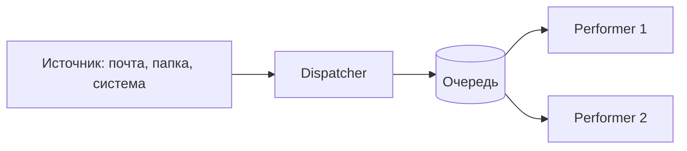
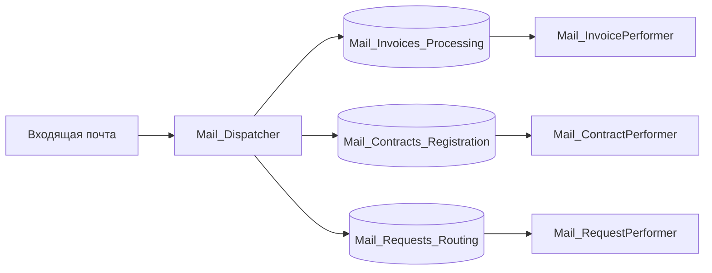

# Структура проекта

> [!NOTE]
> **Область применения.** Раздел описывает Unattended-роботов, которые работают в связке с PIX Master (оркестратором) и обрабатывают **транзакционные** процессы по шаблону State Machine. Для других типов процессов и Attended-роботов правила применимы частично — см. таблицу ниже и [другие шаблоны](#другие-шаблоны).

Прежде чем выбирать структуру робота, определите тип процесса:

| Тип процесса | Как устроен | Поведение при ошибке | Подходящий шаблон |
|--------------|-------------|----------------------|-------------------|
| **Линейный** | Шаги выполняются последовательно, один раз за запуск | Требуется повторный запуск целиком | Простой последовательный процесс, State Machine избыточен |
| **Итеративный** | Одни и те же шаги повторяются для разных наборов данных | Ошибка может остановить обработку до завершения всех операций | State Machine; если элементы независимы — переводите в транзакционный |
| **Транзакционный** | Каждый элемент данных обрабатывается независимо | Ошибка в одной транзакции не мешает обработать остальные | State Machine на транзакциях ([PROJECT-02](#project-02-используйте-шаблон-на-основе-state-machine)), при необходимости Dispatcher/Performer ([PROJECT-06](#project-06-разделяйте-загрузку-и-обработку-транзакций-dispatcher--performer)) |

Большинство бизнес-процессов, которые автоматизируют роботами (обработка счетов, заявок, писем), — транзакционные. Если процесс можно разложить на независимые транзакции, делайте это: так робот устойчивее к ошибкам и его можно масштабировать.

## Содержание

- [PROJECT-01. Разделяйте проект на слои](#project-01-разделяйте-проект-на-слои) — 🔴 Обязательно
- [PROJECT-02. Используйте шаблон на основе State Machine](#project-02-используйте-шаблон-на-основе-state-machine) — 🔴 Обязательно
- [PROJECT-03. Используйте состояния по назначению](#project-03-используйте-состояния-по-назначению) — 🔴 Обязательно
- [PROJECT-04. Храните шаблоны и прочие файлы в самом проекте робота](#project-04-храните-шаблоны-и-прочие-файлы-в-самом-проекте-робота) — 🔴 Обязательно
- [PROJECT-05. Подключайте общие компоненты только как версионированную библиотеку](#project-05-подключайте-общие-компоненты-только-как-версионированную-библиотеку) — 🟡 Рекомендуется
- [PROJECT-06. Разделяйте загрузку и обработку транзакций (Dispatcher / Performer)](#project-06-разделяйте-загрузку-и-обработку-транзакций-dispatcher--performer) — 🟡 Рекомендуется
- [PROJECT-07. Организуйте бизнес-логику транзакции по паттерну Transaction Script](#project-07-организуйте-бизнес-логику-транзакции-по-паттерну-transaction-script) — 🟡 Рекомендуется
- [Другие шаблоны](#другие-шаблоны)

## PROJECT-01. Разделяйте проект на слои

🔴 **Обязательно**

### Архитектурный подход

Разделение проекта на слои — это архитектурный подход, при котором код организуется в логические группы (слои) в соответствии с их ответственностью. 

#### Преимущества:
- **Улучшение организации кода** — каждый компонент находится в своем логическом месте
- **Упрощение поддержки и масштабирования** — изменения вносятся локально в соответствующем слое
- **Четкое разделение ответственности** — каждый слой решает свои специфические задачи
- **Облегчение тестирования** — возможность изолированной проверки каждого слоя
- **Повышение переиспользования кода** — модули могут применяться в разных частях системы

---

### Структура проекта

```console
├───Common (слой шаблонов и прочих файлов)
├───Helpers (слой независимых функций)
├───Infrastructure (слой работы с сервисами/интеграциями)
│   ├───DataBase (работа с бд)
│   ├───Mail (работа с почтой)
│   └───HttpClient (работа с API сервиса)
├───States (слой состояний)
│   ├───Init
│   │   └───Transactions
│   ├───GetSetTransaction
│   │   └───Transactions
│   ├───Process
│   │   └───Transactions
│   └───EndProcess
└───Tests (слой тестов)
    ├───IntegrationTests
    └───UnitTests
```

---

### Описание слоев

#### 1. Common
Содержит общие компоненты проекта, которые используются во всех остальных слоях:

* Шаблоны документов
* Общие ресурсы

#### 2. Helpers
Включает вспомогательные функции и утилиты, не зависящие от бизнес-логики:

* Утилиты для работы с данными
* Вспомогательные методы
* Общие алгоритмы

#### 3. Infrastructure
Слой для работы с внешними системами и сервисами:

* Подключение к базам данных
* Работа с почтой
* Интеграции Http, SOAP Client

#### 4. States
Основной слой бизнес-логики, организованный по состояниям процесса:

| Состояние | Ответственность |
|-----------|-----------------|
| INIT | Инициализация и подготовка данных для обработки |
| GET/SET TRANSACTION | Работа с транзакциями и управление данными |
| PROCESS | Обработка данных и бизнес-логика |
| END PROCESS | Завершение работы и очистка ресурсов |

#### 5. Tests
Слой для тестирования всех остальных компонентов системы:

* E2E тесты (сквозное тестирование)
* Интеграционные тесты (проверка взаимодействия компонентов)
* Модульные тесты (проверка отдельных классов и методов)

[⬆ К содержанию](#содержание)

## PROJECT-02. Используйте шаблон на основе State Machine

🔴 **Обязательно** для транзакционных и итеративных процессов

[Список шаблонов](https://github.com/TheMrDJek/pix-templates)

**Преимущества использования State Machine:**
- Четкое разделение логики на состояния
- Упрощение отладки и мониторинга
- Возможность остановки и возобновления процесса
- Улучшенная обработка ошибок
- Масштабируемость решения

**Недостатки State Machine:**
- **Избыточность для простых процессов.** Для линейного процесса из нескольких шагов, который выполняется раз в день, четыре состояния и переходы между ними добавляют больше кода, чем логики
- **Порог входа.** Разработчику нужно понимать переходы между состояниями и где размещать какую логику ([PROJECT-03](#project-03-используйте-состояния-по-назначению)); без этого логика «размазывается» по состояниям
- **Сложнее читать линейный сценарий.** Последовательность действий распределена по состояниям, ее не видно на одной схеме
- **Состояние передается через переменные.** Данные между состояниями передаются через переменные робота, их легко перезаписать не в том месте

**Когда можно не использовать State Machine:**
- Линейный процесс без транзакций: сформировать и отправить один отчет, выгрузить справочник
- Attended-робот, который выполняет одно действие по команде пользователя
- Вспомогательный робот-утилита (очистка папок, перезапуск служб)
- Прототип для проверки гипотезы, который не пойдет в прод

Даже без State Machine соблюдайте разделение на инициализацию, основную работу и гарантированное завершение (закрытие приложений, удаление временных файлов). Отказ от шаблона фиксируется в ТП с обоснованием.

[⬆ К содержанию](#содержание)

## PROJECT-03. Используйте состояния по назначению

🔴 **Обязательно**

### Преимущества четкого разделения состояний

**Правильное разделение на состояния позволяет:**
- Улучшить читаемость кода и структуру проекта
- Упростить отладку и изоляцию проблем
- Обеспечить повторное использование компонентов
- Реализовать более эффективный контроль над процессом
- Упростить тестирование отдельных частей системы

---

### Основные состояния робота

Каждый робот должен состоять минимум из 3 основных состояний, которые четко разделяют его жизненный цикл и зоны ответственности.

#### Базовая структура (3 состояния):
1. **Init** — инициализация и подготовка системы
2. **ProcessTransaction** — выполнение основной бизнес-логики
3. **EndProcess** — завершение работы и освобождение ресурсов

#### Расширенная структура (4 состояния):
Для бизнес-процессов с транзакциями/циклами/коллекциями рекомендуется использовать:

1. **Init** — инициализация и подготовка системы
2. **Get/SetTransaction** — получение данных для обработки
3. **ProcessTransaction** — обработка полученных данных
4. **EndProcess** — завершение работы и освобождение ресурсов

---

### Детальное описание состояний

#### Init

Состояние используется для инициализации робота и подготовки окружения:

* Сброс ошибок предыдущих попыток
* Инициализация конфигурации и параметров
* Проверка доступов (БД, файловая система, API)
* Запуск и авторизация в приложениях (для UI-автоматизации)
* Парсинг входных данных (если не используются очереди)

#### Get/Set Transaction

Состояние используется для получения транзакции — минимального набора данных для обработки:

* Получение элемента из очереди/коллекции
* Обработка сигнала остановки от мастера-оркестратора
* Подготовка данных для следующего этапа

> [!NOTE]
> **Транзакция в роботе** — минимальный набор данных для обработки сущностей/домена.

**Примеры транзакций:**
* Элемент очереди — если робот обрабатывает очередь
* Письмо — если робот обрабатывает почту
* Файл — если робот обрабатывает документы в папке

#### Processing Transaction

Состояние используется для обработки транзакции:

* Выполнение бизнес-логики для конкретной транзакции
* Обработка специфических для транзакции ошибок
* Сохранение результатов обработки

> [!IMPORTANT]
> Не размазывайте бизнес-логику, связанную с транзакцией, по другим состояниям. Операции вроде отправки писем, сохранения значений, отправки отчетов по транзакции должны выполняться в этом состоянии и его ветках.

#### End Process

Состояние используется для корректного завершения работы робота:

* Отключение соединений с внешними системами
* Закрытие приложений (если необходимо)
* Проверка и логирование ошибок
* Удаление временных файлов и папок

> [!IMPORTANT]
> Не игнорируйте ошибки. Если в каком-либо состоянии произошла техническая ошибка, робот должен корректно завершиться с соответствующим статусом и логом.

[⬆ К содержанию](#содержание)

## PROJECT-04. Храните шаблоны и прочие файлы в самом проекте робота

🔴 **Обязательно**

Не используйте сетевые, временные папки для хранения шаблонов. в PIX можно хранить подобные файлы в самом проекте робота


**Преимущества хранения файлов в проекте:**
- Упрощение развертывания
- Улучшенная версионность
- Отсутствие внешних зависимостей
- Упрощение миграции
- Улучшенная изоляция проекта

[⬆ К содержанию](#содержание)

## PROJECT-05. Подключайте общие компоненты только как версионированную библиотеку

🟡 **Рекомендуется**

Общий код (утилиты для Excel, почты, работы с датами, клиенты API) удобно переиспользовать между роботами. Проблемы начинаются, когда роботы ссылаются на **одну изменяемую копию** этого кода: сетевую папку со скриптами, общий проект без версий, «последнюю» DLL. Тогда любое изменение библиотеки неявно меняет поведение всех роботов, которые ее используют, и ломает их без повторного тестирования.

Проблема не в самом переиспользовании кода, а в отсутствии версий. Копирование утилит из проекта в проект, наоборот, нарушает DRY: исправление ошибки приходится вручную переносить в каждый робот.

**Правила:**
- Общий код оформляйте как отдельную библиотеку (DLL) с собственным репозиторием, владельцем и CHANGELOG
- Версионируйте библиотеку по SemVer (`MAJOR.MINOR.PATCH`); несовместимые изменения — только с увеличением MAJOR
- Подключайте библиотеку в робот как файл конкретной версии в Dependencies проекта, а не ссылкой на сетевую папку
- Обновляйте версию библиотеки в роботе осознанно: отдельной задачей, с регрессионным тестированием и записью в CHANGELOG робота
- В библиотеку выносите только стабильный инфраструктурный код без бизнес-логики конкретного процесса


**Если инфраструктуры для версионированной библиотеки нет,** допустимо скопировать нужный код в проект робота (слой `Helpers` или `Infrastructure`) и дальше развивать его в рамках этого проекта. В этом случае укажите в комментарии или README робота, из какого источника и какой версии взят код.

**Преимущества:**
- Роботы не ломаются от изменений, которые в них не тестировались
- Исправление ошибки в общем коде доступно всем роботам через обновление версии
- Понятно, какая версия общего кода работает в каждом роботе в проде

[⬆ К содержанию](#содержание)

## PROJECT-06. Разделяйте загрузку и обработку транзакций (Dispatcher / Performer)

🟡 **Рекомендуется**

Dispatcher / Performer — не шаблон проекта, а схема: процесс делится на две стороны, связанные очередью. Одна кладет транзакции в очередь, другая забирает их по одной и обрабатывает. Каждый робот при этом строится по своему шаблону, обычно по State Machine ([PROJECT-02](#project-02-используйте-шаблон-на-основе-state-machine)).

- **Dispatcher (поставщик)** — читает источник, формирует элементы очереди и кладет их в очередь. Бизнес-логики обработки не содержит
- **Performer (обработчик)** — берет элементы из очереди и обрабатывает



Схема пришла из интеграций и микросервисов, поэтому встречается под разными названиями:

| Название | Где встречается |
|----------|-----------------|
| Dispatcher / Performer | UiPath и RPA в целом |
| Producer / Consumer (поставщик / потребитель) | Брокеры сообщений, микросервисы |
| Competing Consumers (конкурирующие потребители) | Несколько обработчиков разбирают одну очередь |

Не путайте со схемой Publisher / Subscriber: там одно сообщение получают все подписчики, а здесь каждый элемент забирает ровно один обработчик.

**Кто поставщик и какая очередь.** Поставщиком не обязательно должен быть робот: элементы кладут чат-бот или внешняя система через API PIX Master, процесс мастера, другой робот. Очередью может быть брокер сообщений (RabbitMQ, Kafka) или таблица в БД. Чаще всего берут очередь данных PIX Master: в элемент кладут входные и выходные данные, таблицу и файлы, а повторы, таймауты, защита от дублей и статистика уже встроены. Как с ней работать: [QUEUE-09](../3-integrations/queue.md#queue-09-задавайте-элементу-очереди-уникальную-ссылку)–[QUEUE-12](../3-integrations/queue.md#queue-12-запускайте-обработку-очереди-по-событию-и-подстраховывайте-процессом).

**Плюсы:**
- **Сбои изолированы.** Ошибка обработки не мешает загрузке, а загруженные транзакции не теряются
- **Масштабирование.** Несколько обработчиков на разных агентах разбирают одну очередь. Второго обработчика можно подключать, когда очередь растет
- **Разные расписания и триггеры.** Загрузка идет по расписанию, обработка запускается по событию очереди
- **Встроенные механики вместо своего кода.** Повторы, отложенные элементы, таймауты, SLA, уникальность ссылок, разделение бизнес- и технических ошибок уже есть в мастере
- **Проще разбирать ошибки.** Видна каждая транзакция: статус, ошибка, число попыток. Упавший элемент повторяет очередь или поддержка клонированием, а не пересоздает вручную
- **Слабая связь.** Обработчик не знает, откуда пришли данные. Поставщика можно заменить, например робота на чат-бота, не трогая обработчика
- **Сглаживание нагрузки.** Всплеск заявок ложится в очередь, обработчик разбирает его в своем темпе

**Минусы:**
- **Больше компонентов.** Два проекта, две задачи, очередь и триггеры. На каждом контуре больше настройки
- **Сложнее мониторинг.** Робот по расписанию либо отработал, либо упал, и это сразу видно. Здесь кроме роботов нужно следить за очередями: обрабатываются ли элементы, не зависают ли, срабатывают ли триггеры. Если этапов несколько, очередей тоже несколько
- **Больше кода в роботах.** Работа с очередью, подтверждение элементов в любом исходе, защита от зависших элементов ([QUEUE-11](../3-integrations/queue.md#queue-11-ограничивайте-время-элемента-в-статусах-new-и-processing))
- **Контракт данных.** Структуру элемента меняют одновременно у поставщика и у обработчика ([QUEUE-08](../3-integrations/queue.md#queue-08-документируйте-структуру-данных-очереди))
- **Сложнее контролировать идемпотентность.** Элемент может прийти к обработчику повторно, поэтому обработчик обязан быть идемпотентным ([RECOVERY-01](../2-develop/recovery.md#recovery-01-делайте-обработку-транзакции-идемпотентной), [QUEUE-10](../3-integrations/queue.md#queue-10-отмечайте-в-элементе-очереди-выполненные-необратимые-шаги)), а поставщик не должен создавать дублей ([QUEUE-09](../3-integrations/queue.md#queue-09-задавайте-элементу-очереди-уникальную-ссылку))
- **Порядок не гарантирован**, если обработчиков несколько

**Асинхронность** сама по себе не минус. Обработка начинается не сразу после загрузки, и это удобно, когда источнику не нужен ответ: пользователь оставил заявку и занимается своими делами. Если ответ нужен, добавьте вторую очередь, в которую обработчик кладет результат.

**Когда не нужно:** объем небольшой, загрузка занимает секунды, а обработка простая, например прочитать письма и сохранить из них данные. Такой процесс проще сделать одним роботом: получение транзакции остается в состоянии Get Transaction. Схема не нужна и тогда, когда источник уже является очередью.

### Доменный формат

Если несколько процессов работают в одном бизнес-домене (например, домен «Почта»: разбор входящих писем, рассылка по разным очередям, отправка уведомлений), организуйте роботов по доменам: один Dispatcher отвечает за источник домена и раскладывает транзакции по очередям, для каждой задачи домена — свой Performer.



- Имена роботов, очередей и ассетов начинаются с кода домена (см. [Соглашение об администрировании PIX Master](../4-master/master.md#общий-формат-имен))
- Робот отвечает за один домен и не обрабатывает транзакции чужого домена
- Правила маршрутизации Dispatcher'а (какой тип письма в какую очередь) храните в ассетах

[⬆ К содержанию](#содержание)

## PROJECT-07. Организуйте бизнес-логику транзакции по паттерну Transaction Script

🟡 **Рекомендуется**

Transaction Script (сценарий транзакции) — паттерн из каталога Мартина Фаулера, в DDD его относят к простым способам организовать бизнес-логику. Логика строится из процедур: каждая процедура реализует одну операцию системы от начала до конца. Она получает данные, проверяет их, выполняет действия и сохраняет результат.

Для робота операция — это тип транзакции. Если робот получает заявки «добавить позицию в заказ», «изменить количество», «отменить заказ», у каждой операции свой сценарий.

**Не пишите сценарий одним скриптом на сотни активностей.** Сценарий — короткий скрипт, который по порядку вызывает шаги. Каждый шаг — отдельный скрипт с понятным именем: он делает одно действие и возвращает результат. Сценарий читается сверху вниз, как описание процесса в ТЗ.

**Пример.** Из чат-бота пришла заявка: добавить товар в заказ клиента в 1С.

```text
States/Process/Transactions/
├── AddOrderItem            ← сценарий операции «добавить позицию»
├── UpdateOrderItemQty      ← сценарий операции «изменить количество»
├── CancelOrder             ← сценарий операции «отменить заказ»
└── Shared/                 ← шаги, общие для нескольких сценариев
    ├── Ensure1CRun
    ├── FindAndOpenOrder
    ├── OpenOrderWarehouse
    ├── FindNomenclatureBySku
    ├── Carrying
    └── DownloadOrderReport
```

Сценарий `AddOrderItem` состоит только из вызовов шагов:

```text
AddOrderItem
1. Ensure1CRun              ← открыть 1С, если она не открыта
2. FindAndOpenOrder         ← найти карточку заказа; не нашли — бизнес-исключение
3. OpenOrderWarehouse       ← перейти на склад, привязанный к заказу
4. FindNomenclatureBySku    ← найти товар по SKU из заявки; нет в 1С — бизнес-исключение
5. AddItemAndCheck          ← добавить позицию и проверить, что она появилась в заказе
6. Carrying                 ← провести документ и поставить метку «проведено» (QUEUE-10)
7. DownloadOrderReport      ← сохранить отчет по заказу
8. SendResult               ← Infrastructure: отправить ответ
```

**Как делить на шаги:**
- Один шаг — одно действие, которое называется глаголом: найти заказ, открыть склад, провести документ
- Шаг получает данные через параметры и возвращает результат, а не читает переменные сценария
- Шаги, нужные нескольким сценариям, лежат в общей папке, а не копируются ([CODE-02](../2-develop/code.md#code-02-не-повторяйтесь-dry))
- Работа с системами (API, БД, почта) вынесена в слой Infrastructure, функции без бизнес-логики — в Helpers ([PROJECT-01](#project-01-разделяйте-проект-на-слои))
- Бизнес-исключение вызывает тот шаг, который обнаружил проблему: «заказ не найден», «SKU нет в 1С» ([ERROR-06](../2-develop/error.md#error-06-разделяйте-бизнес-исключения-и-технические-исключения))
- У каждого типа транзакции свой сценарий, а не одна процедура с ветвлениями по типу. Сценарий по типу заявки выбирается в одном месте

**Почему так:**
- Сценарий читается как ТЗ: ревьюер и аналитик видят шаги процесса без деталей работы с интерфейсом
- По логу и источнику исключения сразу видно, на каком шаге упал робот ([ERROR-07](../2-develop/error.md#error-07-указывайте-источник-исключения))
- Шаг отлаживается и тестируется отдельно ([TEST-01](../2-develop/test.md#test-01-покрывайте-тестами-скрипты-с-бизнес-логикой-и-преобразованием-данных))
- Если изменился интерфейс 1С, правится один шаг, а не все сценарии
- Необратимый шаг выделен отдельно, поэтому метку после него легко поставить в нужном месте ([QUEUE-10](../3-integrations/queue.md#queue-10-отмечайте-в-элементе-очереди-выполненные-необратимые-шаги))

**Когда паттерна недостаточно:** если правила обработки сложные, пересекаются между сценариями и один и тот же код проверки копируется в разные сценарии, выносите общие правила в отдельные скрипты-правила слоя Helpers (см. [CODE-02](../2-develop/code.md#code-02-не-повторяйтесь-dry)).

[⬆ К содержанию](#содержание)

## Другие шаблоны

> [!NOTE]
> 🚧 **Раздел в работе** ([issue #18](https://github.com/TheMrDJek/PixRpaDevelopmentConventions/issues/18)). Описания будут добавлены.

| Шаблон | Для чего | Статус |
|--------|----------|--------|
| Универсальный шаблон (ШАР — шаблон архитектуры робота) | Транзакционные процессы на State Machine | Описан в этом разделе |
| Robotic Enterprise Framework (PIX REFramework) | Транзакционные процессы с встроенной обработкой бизнес- и технических исключений и повторов | Будет добавлено |
| Шаблон ЦК PIX | — | Будет добавлено |
| Шаблон интеграции с базой данных | — | Будет добавлено |
| Шаблон для робота-помощника | Attended-роботы | Будет добавлено |
| Шаблон универсальной системы оповещений | — | Будет добавлено |
| State Machine для фоновых процессов | Background-процессы | Будет добавлено |

Исходники шаблонов: [pix-templates](https://github.com/TheMrDJek/pix-templates).

[⬆ К содержанию](#содержание)
