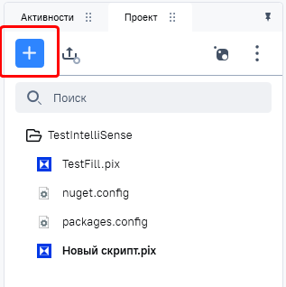
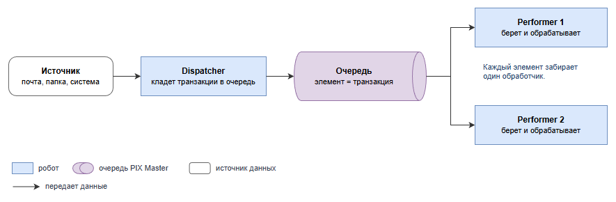
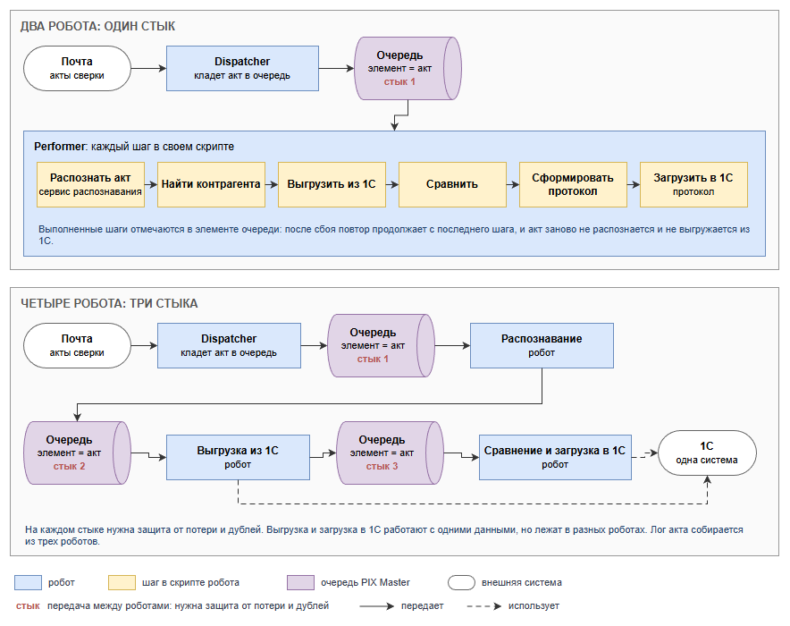
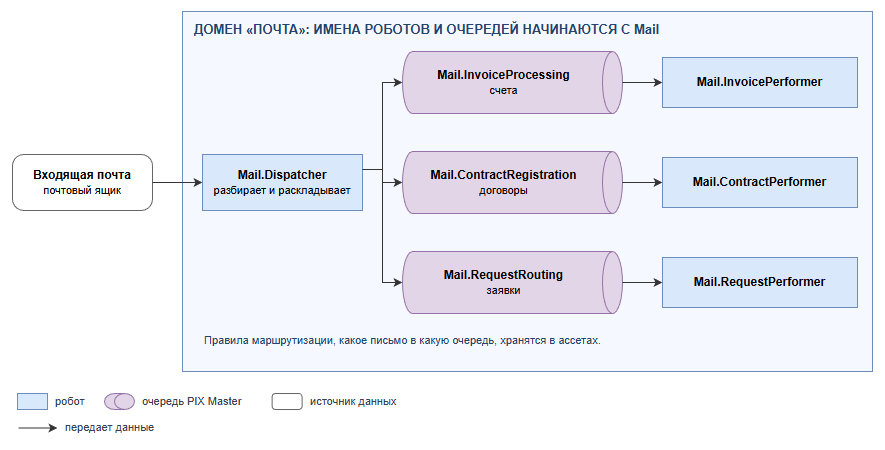

# Проект робота

Правила для проекта любого робота: как выбрать шаблон по типу процесса, где хранить ресурсы робота (шаблоны отчетов и писем) и как подключать общий код. Устройство самого шаблона описано в разделе [«Шаблон на State Machine»](template.md).

## Содержание

- [PROJECT-01. Выбирайте шаблон по типу процесса](#project-01-выбирайте-шаблон-по-типу-процесса) (🔴 Обязательно)
- [PROJECT-02. Храните ресурсы робота в самом проекте](#project-02-храните-ресурсы-робота-в-самом-проекте) (🔴 Обязательно)
- [PROJECT-03. Согласуйте подключение собственной библиотеки](#project-03-согласуйте-подключение-собственной-библиотеки) (🔴 Обязательно)
- [Плюсы и минусы State Machine](#плюсы-и-минусы-state-machine) (📘 Справка)
- [Когда делить решение на роботов: Dispatcher / Performer и цепочки](#когда-делить-решение-на-роботов-dispatcher--performer-и-цепочки) (📘 Справка)
- [Подключение NuGet-пакетов в PIX Studio](#подключение-nuget-пакетов-в-pix-studio) (📘 Справка)

## PROJECT-01. Выбирайте шаблон по типу процесса

🔴 **Обязательно**

Перед разработкой определите тип процесса: от него зависит, на каком шаблоне строить робота и из скольких состояний он состоит. Ответьте на вопрос: повторяет ли робот одни и те же шаги для разных данных? Если нет, процесс **линейный**, если да, **транзакционный**.

| Тип процесса | Пример | Если робот упал | Как строить |
|--------------|--------|-----------------|-------------|
| **Линейный** | Выгрузить отчет из 1С и отправить на почту | Запуск повторяют целиком | State Machine из трех состояний: Init → Process Transaction → End Process |
| **Транзакционный** | Обработать счета, заявки, письма | Упавший элемент повторяется отдельно, остальные обрабатываются | State Machine из четырех состояний. При большом объеме можно запустить несколько роботов на одной очереди ([Dispatcher / Performer](#когда-делить-решение-на-роботов-dispatcher--performer-и-цепочки)) |

Для обоих типов берите [шаблон на State Machine](template.md). После каждого исхода робот на нем переходит в заранее заданное состояние: успех, бизнес-исключение, техническое исключение, транзакций больше нет. Плюсы и минусы такого шаблона собраны в справке [«Плюсы и минусы State Machine»](#плюсы-и-минусы-state-machine).

Нового робота создавайте из шаблона репозитория [pix-templates](https://github.com/TheMrDJek/pix-templates). Там подробно описано, для каких процессов и зачем нужен каждый шаблон, и лежит готовый проект [PIX-StateMachines-template](https://github.com/TheMrDJek/pix-templates/tree/master/PIX-StateMachines-template). Не начинайте с копии другого робота: копия тянет за собой чужие переменные, ассеты и скрипты, которые новому роботу не нужны.

> [!IMPORTANT]
> State Machine можно собрать по-разному. Берите вариант на переходах активностью «Перейти на шаг», как в шаблоне: все переходы видны в `main.pix`, и каждый ведет в заданное состояние ([TEMPLATE-02](template.md#template-02-выполняйте-в-каждом-состоянии-только-его-работу)). За пределами `main.pix` переходы по шагу уместны не везде, об этом [LOOP-04](../2-develop/loop.md#loop-04-избегайте-использования-goto). Не собирайте State Machine на бесконечном цикле `while (true)` с выбором состояния: если ветка не выйдет из цикла, робот зависнет ([LOOP-01](../2-develop/loop.md#loop-01-ограничивайте-каждый-цикл-таймаутом-или-числом-итераций)).

### Когда можно обойтись без State Machine

- в Attended-роботе, который выполняет одно действие по команде пользователя
- в роботе-утилите: очистка папок, перезапуск служб
- в прототипе, который не пойдет в PROD

Даже без State Machine разделяйте инициализацию, основную работу и гарантированное завершение: закрытие приложений, удаление временных файлов. Если отказываетесь от шаблона, напишите в README робота почему.

[⬆ К содержанию](#содержание)

## PROJECT-02. Храните ресурсы робота в самом проекте

🔴 **Обязательно**

Роботу часто нужны готовые файлы: шаблон письма HTML, форма Excel, которую он заполняет, образец отчета Word. Такие файлы называют ресурсами робота. Добавляйте их в проект робота, а не в сетевую папку. В шаблоне на State Machine для них есть папка `Common` ([TEMPLATE-01](template.md#template-01-раскладывайте-скрипты-по-папкам-по-роли)).

Чтобы добавить файл, нажмите «+» в панели «Проект».

**Чем проект лучше сетевой папки:**
- **Робот не зависит от окружения.** Ему не нужны сетевая папка, права учетной записи робота на нее и одинаковый путь на каждой машине. Робот не упадет, если папку переименовали или машина потеряла к ней доступ
- **Файл не окажется занят.** Файл на общей папке может открыть сотрудник, другой робот или процесс, и тогда робот не сможет его прочитать
- **Ресурс меняется только вместе с роботом.** На общей папке файл может поправить кто угодно, и робот сломается на следующем запуске. Ресурс в проекте лежит в Git и публикуется в PIX Master вместе с роботом, поэтому на UAT и PROD робот получает тот же файл, что и на DEV

**Что считать ресурсом.** Небольшой файл, который меняется редко и только вместе с логикой робота: если поменялась форма отчета, меняется и код, который ее заполняет.

**Что ресурсом не считать:**
- Входные и выходные файлы: выписки, реестры, готовые отчеты. Они свои в каждом запуске, робот берет и кладет их в рабочие папки ([FILE-01](../2-develop/file.md#file-01-не-используйте-жестко-заданные-пути-и-конкатенацию-строк-для-путей))
- Файлы, которые бизнес меняет без разработчика: справочник, список получателей. Их место в ассете или в системе-источнике ([CONFIG-02](config.md#config-02-храните-настройки-в-ассетах-pix-master))
- Шаблоны документов, которые правят пользователи: договор, который обновляют юристы, письмо клиенту, текст которого меняет отдел продаж. Они лежат в папке или системе, которую ведет бизнес, и робот берет их как входной файл
- Большие файлы: архивы, базы, видео. Они раздувают проект в Git и каждую версию робота в PIX Master

**Когда общий шаблон лучше держать в одном месте.** Один шаблон, например фирменный бланк письма, может использовать десяток роботов. Если его часто правят, обновлять его в каждом проекте долго, и какой-то робот останется со старой версией. Тогда держите шаблон в одной папке, а путь к ней робот берет из ассета ([CONFIG-02](config.md#config-02-храните-настройки-в-ассетах-pix-master)). Цена такого решения: возвращаются минусы общей папки, а неудачная правка шаблона ломает сразу всех роботов, хотя их код не менялся. Выбирайте по тому, что для вас дороже: обновлять шаблон в каждом проекте или рисковать ошибкой у всех роботов сразу. Решение согласуйте с тимлидом или ревьюером.

**Если файл лежит на общей папке,** он может оказаться занят: Excel без режима общего доступа открыт у пользователя или его держит другой процесс. Небольшой файл робот копирует во временную папку и читает копию ([FILE-03](../2-develop/file.md#file-03-копируйте-файлы-перед-обработкой)).

Робот не меняет ресурс. Чтобы заполнить форму, он сначала копирует ее во временную папку ([FILE-03](../2-develop/file.md#file-03-копируйте-файлы-перед-обработкой)).

[⬆ К содержанию](#содержание)

## PROJECT-03. Согласуйте подключение собственной библиотеки

🔴 **Обязательно**

Собственные библиотеки, в том числе пакеты собственных активностей, использовать можно. Их пишет ваша команда, другой отдел или подрядчик, а роботы подключают [NuGet-пакетом](../glossary.md#робот-и-проект). Прежде чем подключить библиотеку к роботу, согласуйте это с тимлидом или ревьюером и приведите аргументы, почему библиотека лучше скрипта в роботе или примера из pix-templates: каким роботам уже нужен этот код, почему он стабилен, кто будет его сопровождать. Тимлид или ревьюер сверяет их со списком «Выносите код в библиотеку, если» ниже. На ревью новую библиотеку видно по `packages.config` робота. Публичные пакеты с nuget.org, которые расширяют возможности .NET (ClosedXML, MailKit), устроены иначе, о них в конце правила.

**Плюсы библиотеки:**
- **Код пишут один раз.** Утилиты для Excel, почты, дат, клиент API внутренней системы не повторяются в каждом роботе ([CODE-02](../2-develop/code.md#code-02-не-повторяйтесь-dry))
- **Код меняют в одном месте.** Исправление ошибки или доработку разработчик вносит один раз в библиотеку и выпускает новую версию, а роботы получают ее, когда обновятся. Одну и ту же правку не нужно повторять в десяти проектах

**Минусы, когда одну библиотеку или активность используют несколько роботов:**
- **Одна ошибка роняет сразу несколько роботов.** Ошибка в новой версии ломает каждого робота, который на нее обновился. Новую версию приходится проверять на всех роботах, которые ее используют
- **Правка под одного робота задевает остальных.** Разработчик меняет метод или активность под свой робот и выпускает новую версию. Другие роботы получат это изменение, когда обновятся, и могут сломаться, хотя их разработчики ничего не меняли

**Минусы даже для одного робота:**
- **Код робота не виден целиком.** В проекте робота лежит только вызов метода или активности, исходники лежат в другом репозитории. Чтобы найти ошибку, разработчик ищет исходники нужной версии
- **Приходят чужие зависимости.** Библиотека тянет в робот свои пакеты, например ClosedXML или MailKit. Если двум библиотекам нужны разные версии одного пакета, возникает конфликт версий

**Сначала проверьте, не хватит ли примера скрипта.** Часто встречающийся код можно положить примером в репозиторий [pix-templates](https://github.com/TheMrDJek/pix-templates), а не выносить в библиотеку. Разработчик копирует пример в `Helpers` или `Infrastructure` своего робота и указывает в комментарии или README робота, откуда и какой версии он взят. Копию можно править под свой робот, и остальные роботы этого не заметят. Зато исправление ошибки в примере не доходит до роботов само: его переносят в каждого робота вручную. Пример подходит для небольших утилит и кода, который роботы подстраивают под себя, библиотека нужна для стабильного кода из списка ниже.

**Выносите код в библиотеку, если:**
- он уже нужен нескольким роботам, а не «может пригодиться»
- он стабилен и не содержит правил отдельного процесса: разбор дат, клиент API, работа с файлами, общий расчет НДС
- в команде есть человек, который будет ее сопровождать

**Бизнес-логика в библиотеке.** Выносить ее можно, если правило общее для всех процессов компании и меняется для всех сразу. Если у каждого процесса правило может стать своим, держите его в роботе. Два примера:

- **Можно: расчет суммы с НДС.** Формула одна для всех роботов компании, и меняется в ней только ставка: в 2026 году она выросла с 20 до 22 %. Формулу вынесите в библиотеку, а ставку храните в ассете или в системе-источнике ([CONFIG-02](config.md#config-02-храните-настройки-в-ассетах-pix-master)). Тогда бизнес меняет ставку один раз, все роботы читают новое значение с одного дня, и новая версия библиотеки не нужна. Если бы ставка лежала в библиотеке, роботы перешли бы на новую ставку в разное время, а ошибка в новой версии сломала бы каждого, кто на нее обновился (минус «Одна ошибка роняет сразу несколько роботов»)
- **Нельзя: скидка клиенту.** Три робота считают скидку по одной формуле, и разработчик выносит расчет в пакет `Orders.Rules`. Через месяц бизнес меняет формулу для одного процесса. Теперь разработчик либо правит пакет и заново проверяет всех трех роботов, либо пишет в пакете «если робот такой-то, считать иначе» (минус «Правка под одного робота задевает остальных»). Роботы формально отдельные, но выпускать их приходится вместе: в микросервисах такую систему называют распределенным монолитом. Держите такое правило в папке `States` каждого робота, тогда правило одного процесса меняется без выпуска остальных

**Публичные пакеты с nuget.org** расширяют возможности робота, и сопровождает их не ваша команда, поэтому согласование им не нужно. Но и они добавляют зависимость: подключайте конкретную версию, проверьте лицензию (у EPPlus, например, она коммерческая, см. [EXCEL-01](../3-integrations/excel.md#excel-01-не-используйте-excel-interop-и-com)) и не подключайте пакет ради одной функции, которую можно написать в `Helpers`.

Как подключить пакет в Studio, описано в справке [«Подключение NuGet-пакетов в PIX Studio»](#подключение-nuget-пакетов-в-pix-studio).

[⬆ К содержанию](#содержание)

## Плюсы и минусы State Machine

📘 **Справка**

Дополняет [PROJECT-01](#project-01-выбирайте-шаблон-по-типу-процесса).

### Что дает State Machine

- **Робот устроен так, как ожидают разработчик и поддержка.** Схему из состояний Init, Get Transaction, Process Transaction и End Process используют вендоры RPA: у UiPath это REFramework, у других платформ его аналоги. Поэтому даже робот на старой версии шаблона или на шаблоне вендора узнается сразу: видно, где запуск приложений, где обработка транзакции, где завершение. Если вся команда работает на одном шаблоне, разработчик и поддержка открывают любой проект и сразу находят нужное место
- **Ошибки обрабатываются в одном месте.** Бизнес-исключение не останавливает робота, а техническое ведет к повтору или к штатной остановке, а не к падению посреди процесса
- **Сбой обрабатывается по готовой схеме.** После технического исключения робот перезапускает приложения и повторяет транзакцию, End Process закрывает приложения при любом исходе, а по сигналу остановки робот доделывает транзакцию и завершает работу ([TEMPLATE-02](template.md#template-02-выполняйте-в-каждом-состоянии-только-его-работу))
- **Новый робот начинается не с нуля.** Обработка ошибок, повторы и логирование уже есть в шаблоне

### Чем State Machine неудобен

- **Шаблон нужно понимать.** Если разработчик не знает, что где лежит и как работают переходы, он кладет логику не в то состояние: обработку в Init, закрытие приложений в Process Transaction. Такой робот сложнее линейного скрипта и при этом так же ненадежен. Перед первым роботом на шаблоне разберите [TEMPLATE-01](template.md#template-01-раскладывайте-скрипты-по-папкам-по-роли) и [TEMPLATE-02](template.md#template-02-выполняйте-в-каждом-состоянии-только-его-работу)
- **Для маленького процесса шаблон тяжеловат.** В роботе из трех шагов большую часть кода занимает обвязка состояний. Поэтому у PROJECT-01 есть исключения ([«Когда можно обойтись без State Machine»](#когда-можно-обойтись-без-state-machine))
- **Переход может вести не туда.** Подпись шага в активности «Перейти на шаг» не связана с его целью, и шаг «Переход на Init» может вести в End Process. Если собирать переходы с нуля, такую ошибку легко пропустить, поэтому берите готовый шаблон из [pix-templates](https://github.com/TheMrDJek/pix-templates): переходы в нем уже проверены. Свои переходы подписывайте именем целевого блока ([TEMPLATE-02](template.md#template-02-выполняйте-в-каждом-состоянии-только-его-работу))

[⬆ К содержанию](#содержание)

## Когда делить решение на роботов: Dispatcher / Performer и цепочки

📘 **Справка**

Подходит для решения из нескольких роботов. Самая частая схема делит его на две стороны, связанные очередью:

- **Dispatcher (поставщик)** читает источник и кладет транзакции в очередь. Бизнес-логики обработки не содержит
- **Performer (обработчик)** берет элементы из очереди по одному и обрабатывает

Каждый робот при этом строится по своему шаблону, обычно по State Machine. Схему также называют Producer / Consumer и Competing Consumers. Не путайте ее с Publisher / Subscriber: там одно сообщение получают все подписчики, а здесь каждый элемент забирает ровно один обработчик.

Поставщиком не обязательно должен быть робот. В примере из [«Шаблона на State Machine»](template.md) заявки кладет чат-бот через API PIX Master, а робот `Orders.ProcessOrderRequest` их обрабатывает. Ответ он кладет во вторую очередь, из которой его забирает чат-бот. Очередью может быть брокер сообщений или таблица в БД, но чаще всего берут очередь данных PIX Master: повторы, таймауты, защита от дублей и статистика в ней уже есть ([QUEUE-09](../3-integrations/queue.md#queue-09-задавайте-элементу-очереди-уникальную-ссылку)–[QUEUE-12](../3-integrations/queue.md#queue-12-запускайте-обработку-очереди-по-событию-и-подстраховывайте-процессом)).

### Плюсы и минусы разделения

Пункты ниже верны для любого решения из нескольких роботов, связанных очередью: и для пары Dispatcher и Performer, и для цепочки из трех-четырех роботов. Делить решение стоит, когда плюсы для вашего процесса перевешивают работу из минусов.

**Плюсы:**
- **Сбои изолированы.** Ошибка обработки не мешает загрузке, загруженные транзакции не теряются
- **Масштабирование.** Несколько обработчиков на разных агентах разбирают одну очередь. Медленный этап, например распознавание документов, запускают на трех агентах, а быстрый остается на одном. Число агентов на этап подбирают по нагрузке
- **Разное расписание.** Поставщик забирает почту каждые 5 минут круглосуточно, а обработчик загружает данные в CRM только в рабочее время. Ночью элементы копятся в очереди
- **Разные машины и права.** Каждому роботу нужна только своя система, поэтому у него своя машина и учетная запись только с нужными ему правами
- **Слабая связь.** Поставщика можно заменить, например робота на чат-бота, не трогая обработчика

**Минусы.** Каждый робот, на которого делят решение, добавляет работу при разработке и сопровождении. Все пункты ниже решаются, но время на них нужно заложить в оценку:
- **Больше компонентов.** Два проекта, две задачи, очередь и триггеры на каждом контуре
- **Мониторинг очередей.** Кроме роботов следят за очередями: не зависают ли элементы, срабатывают ли триггеры
- **Контракт данных.** Структуру элемента описывают ([QUEUE-08](../3-integrations/queue.md#queue-08-документируйте-структуру-данных-очереди)) и меняют одновременно у поставщика и обработчика
- **Защита каждого стыка.** Стык это передача элемента от робота к роботу. На каждом стыке элемент может прийти повторно, поэтому поставщик задает уникальную ссылку ([QUEUE-09](../3-integrations/queue.md#queue-09-задавайте-элементу-очереди-уникальную-ссылку)), а обработчик делается идемпотентным ([RECOVERY-01](../2-develop/recovery.md#recovery-01-делайте-обработку-транзакции-идемпотентной)). У Dispatcher и Performer один стык, у цепочки из четырех роботов три. Для стыка через брокер сообщений есть шаблоны [Outbox и Inbox](https://microservices.io/patterns/data/transactional-outbox.html) из микросервисов. Роботам они нужны редко: только когда дубль обходится очень дорого, а сделать обработку идемпотентной нельзя. В этих шаблонах отправитель записывает сообщение в таблицу outbox в одной транзакции с данными, а получатель хранит в таблице inbox идентификаторы обработанных сообщений и отбрасывает повторы. С [очередью данных PIX Master](https://docs.pixrobotics.com/articles/#!rpa/master-queues) они не нужны: проверку уникальности ссылки, повторы с задержкой между попытками, таймауты и SLA элемента настраивают в свойствах очереди
- **Разбор через несколько роботов.** Лог элемента собирают по его уникальной ссылке из логов всех роботов цепочки. Для ручного повтора описывают, в какую очередь вернуть элемент на каждом этапе
- **Порядок не гарантирован,** если обработчиков несколько: элемент, положенный в очередь позже, может обработаться раньше

**Когда не нужно:** объем небольшой, загрузка занимает секунды, а обработка простая. Такой процесс проще сделать одним роботом, загрузка остается в Get Transaction. Схема не нужна и тогда, когда источник уже очередь.

### Где делить решение на роботов

Делите по границе ресурса, а не по шагам. Отдельный робот нужен этапу, которому нужен другой ресурс: этап работает без интерфейса и без 1С или на другой машине, например распознавание в отдельном сервисе. Шаги, которые работают с одним ресурсом и постоянно передают друг другу данные, оставляйте в одном роботе. При хорошем делении роботы почти не зависят друг от друга, а шаги внутри одного робота тесно связаны. Этот принцип называют low coupling, high cohesion. Если разнести такие шаги по разным роботам, менять и перезапускать этих роботов придется вместе.

**Пример: сверка актов.** Поставщики и покупатели присылают акты сверки взаиморасчетов. Робот сверяет каждый акт с данными 1С и загружает в 1С протокол разногласий. Решение можно собрать из двух роботов или из четырех, шаги и очереди обоих вариантов показаны на схеме:

Масштабируются оба варианта: Performer или медленный этап запускают на нескольких агентах, поэтому скорость не решает, сколько роботов делать. Варианты различаются стыками и связями между роботами. Модульность в варианте с двумя роботами остается внутри Performer: каждый шаг лежит в своем скрипте ([сценарий транзакции](template.md#сценарий-транзакции-паттерн-transaction-script)), а выполненные шаги отмечаются в элементе очереди ([QUEUE-10](../3-integrations/queue.md#queue-10-отмечайте-в-элементе-очереди-выполненные-необратимые-шаги)).

Начинайте с Dispatcher и Performer. Этап выделяйте в отдельного робота, когда он уходит с общего ресурса: например, распознавание переехало в сервис, которому не нужна 1С.

**Сравнивайте варианты.** Готового ответа нет: у одного робота, у Dispatcher и Performer и у цепочки из нескольких роботов свои плюсы и минусы. Перед выбором распишите два-три варианта для своего процесса и сравните их по одним критериям:
- сколько стыков между роботами и как защищен каждый
- как робот продолжает работу после сбоя и как элемент перезапускают вручную
- как собрать лог одного элемента
- какие этапы нужно масштабировать отдельно и какие должны работать, когда соседний этап упал

В примере со сверкой актов по этим критериям выиграли два робота. Для другого процесса, например с распознаванием в отдельном сервисе и загрузкой в недоступную по ночам систему, выиграет цепочка.

### Доменный формат

Если несколько процессов работают в одном бизнес-домене, один Dispatcher отвечает за источник домена и раскладывает транзакции по очередям, а у каждой задачи домена свой Performer.

- Имена роботов, очередей и ассетов начинаются с кода домена ([«Общий формат имен»](../4-master/master.md#общий-формат-имен))
- Робот не обрабатывает транзакции чужого домена
- Правила маршрутизации (какое письмо в какую очередь) храните в ассетах

[⬆ К содержанию](#содержание)

## Подключение NuGet-пакетов в PIX Studio

📘 **Справка**

Дополняет [PROJECT-03](#project-03-согласуйте-подключение-собственной-библиотеки). Пакеты подключаются в панели «Проект» ([документация PIX](https://docs.pixrobotics.com/articles/#!rpa/studio-nugetmanager)):
- **Nuget менеджер:** выберите источник, найдите пакет, выберите версию и установите. Тем же окном обновляют пакет: выберите пакет, новую версию и нажмите «Обновить»
- **Менеджер зависимостей:** пакеты из хранилища зависимостей PIX Master. Это основное хранилище организации, собственные библиотеки команды берите оттуда

Studio записывает пакеты проекта и их версии в `packages.config`, а источники пакетов в `nuget.config`. Оба файла лежат в проекте и попадают в Git, поэтому версия пакета закреплена за версией робота. Источник, которого нет в списке, например внутренний NuGet-сервер компании, добавляют в Nuget менеджере через «Редактор источников…».

[⬆ К содержанию](#содержание)
