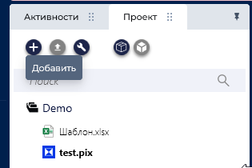
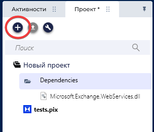
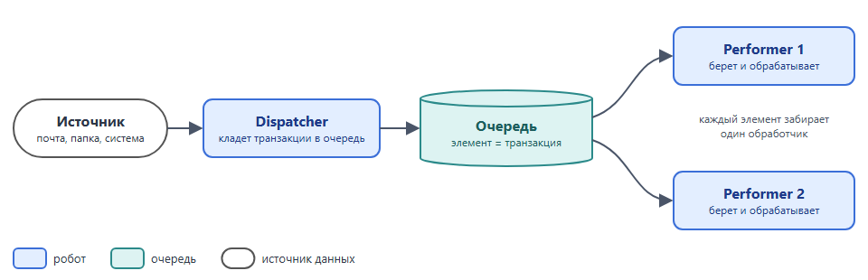
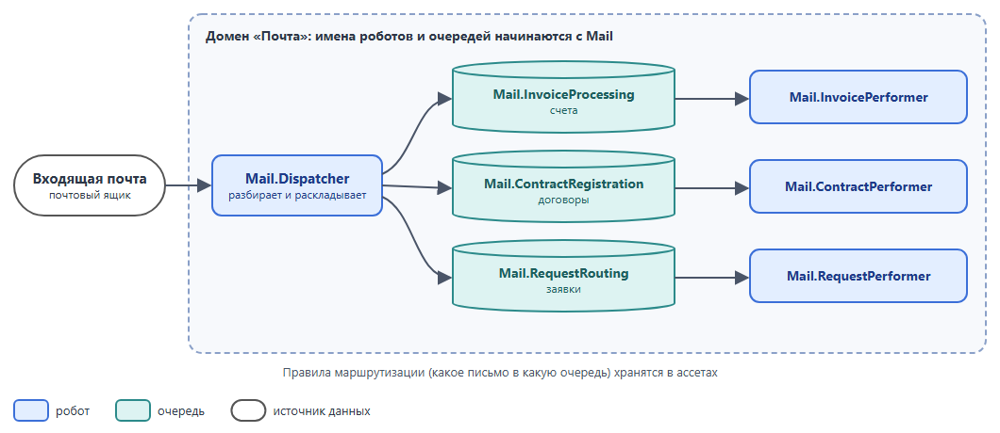

# Проект робота

Правила для проекта любого робота: как выбрать шаблон по типу процесса, где хранить ресурсы робота (шаблоны отчетов и писем) и как подключать общий код. Устройство самого шаблона описано в разделе [«Шаблон на State Machine»](template.md). В конце раздела есть справка о том, когда делить процесс на несколько роботов.

## Содержание

- [PROJECT-01. Выбирайте шаблон по типу процесса](#project-01-выбирайте-шаблон-по-типу-процесса) (🔴 Обязательно)
- [PROJECT-02. Храните ресурсы робота в самом проекте](#project-02-храните-ресурсы-робота-в-самом-проекте) (🔴 Обязательно)
- [PROJECT-03. Взвешивайте связанность, прежде чем подключать библиотеку](#project-03-взвешивайте-связанность-прежде-чем-подключать-библиотеку) (🟡 Рекомендуется)
- [Dispatcher / Performer: когда делить процесс на несколько роботов](#dispatcher--performer-когда-делить-процесс-на-несколько-роботов)
- [Другие шаблоны](#другие-шаблоны)

## PROJECT-01. Выбирайте шаблон по типу процесса

🔴 **Обязательно**

Перед разработкой определите тип процесса: от него зависит, на каком шаблоне строить робота и из скольких состояний он состоит. Ответьте на вопрос: повторяет ли робот одни и те же шаги для разных данных? Если нет, процесс **линейный**, если да, **транзакционный**.

| Тип процесса | Пример | Если робот упал | Как строить |
|--------------|--------|-----------------|-------------|
| **Линейный** | Выгрузить отчет из 1С и отправить на почту | Запуск повторяют целиком | State Machine из трех состояний: Init → Process Transaction → End Process |
| **Транзакционный** | Обработать счета, заявки, письма | Упавший элемент повторяется отдельно, остальные обрабатываются | State Machine из четырех состояний. При большом объеме можно запустить несколько роботов на одной очереди ([Dispatcher / Performer](#dispatcher--performer-когда-делить-процесс-на-несколько-роботов)) |

Для обоих типов берите [шаблон на State Machine](template.md). После каждого исхода робот на нем переходит в заранее заданное состояние: успех, бизнес-исключение, техническое исключение, транзакций больше нет. Другие шаблоны перечислены в разделе [«Другие шаблоны»](#другие-шаблоны).

### Если элементы зависят друг от друга

Например, документы проводятся по порядку и каждый меняет остаток для следующего. Тогда упавший элемент нельзя пропустить: робот берет элементы строго по порядку и на первой ошибке останавливается. При следующем запуске он продолжает с упавшего элемента. Несколько роботов на одну такую очередь не ставьте, они нарушат порядок.

Если зависимость можно убрать, например заранее рассчитать остаток для каждого документа, уберите ее: тогда упавший элемент не останавливает остальные.

### Что дает State Machine

- **Все роботы команды устроены одинаково.** Поддержка открывает чужой проект и сразу знает, где запуск приложений, где обработка транзакции, где завершение
- **Ошибки обрабатываются в одном месте.** Бизнес-исключение не останавливает робота, а техническое ведет к повтору или к штатной остановке, а не к падению посреди процесса
- **Робот восстанавливается после сбоя.** После технического исключения он закрывает приложения, запускает их заново и повторяет транзакцию ([RECOVERY-03](../2-develop/recovery.md#recovery-03-восстанавливайте-приложения-после-технического-исключения))
- **Робот убирает за собой.** End Process закрывает приложения и удаляет временные файлы при любом исходе, даже если робот упал
- **Робот останавливается штатно.** По сигналу из PIX Master он доделывает текущую транзакцию и завершает работу ([RECOVERY-06](../2-develop/recovery.md#recovery-06-проверяйте-сигнал-остановки-от-мастера))
- **Новый робот начинается не с нуля.** Обработка ошибок, повторы и логирование уже есть в шаблоне

### Чем State Machine неудобен

- **Шаблон нужно понимать.** Если разработчик не знает, что где лежит и как работают переходы, он кладет логику не в то состояние: обработку в Init, закрытие приложений в Process Transaction. Такой робот сложнее линейного скрипта и при этом так же ненадежен. Перед первым роботом на шаблоне разберите [TEMPLATE-01](template.md#template-01-разделяйте-проект-на-слои) и [TEMPLATE-02](template.md#template-02-используйте-состояния-state-machine-по-назначению)
- **Процесс не видно целиком.** Шаги разложены по состояниям и скриптам. Чтобы понять, что робот делает с транзакцией, и чтобы отладить его, приходится переходить между `main.pix` и несколькими файлами
- **Переменные `main.pix` видят все состояния.** Любое состояние может перезаписать `config` или текущую транзакцию, и где это случилось, находится только поиском. Для каждой такой переменной договоритесь, какое состояние ее меняет ([«Переменные main.pix»](template.md#переменные-mainpix))
- **Повтор начинается с Init.** После технического исключения робот перезапускает приложения и обрабатывает транзакцию с начала. Если он упал на последнем шаге, все предыдущие шаги выполнятся еще раз, поэтому обработка должна быть идемпотентной ([RECOVERY-01](../2-develop/recovery.md#recovery-01-делайте-обработку-транзакции-идемпотентной)). А перезапуск тяжелого приложения вроде 1С занимает минуты
- **Для маленького процесса шаблон тяжеловат.** В роботе из трех шагов большую часть кода занимает обвязка шаблона
- **Шаблон расходится между роботами.** Каждый разработчик немного правит шаблон под свой робот, и через год роботы устроены по-разному. Правки шаблона вносите в общий шаблон команды, а не в одного робота

### Когда можно обойтись без State Machine

- в Attended-роботе, который выполняет одно действие по команде пользователя
- в роботе-утилите: очистка папок, перезапуск служб
- в прототипе, который не пойдет в PROD

Даже без State Machine разделяйте инициализацию, основную работу и гарантированное завершение: закрытие приложений, удаление временных файлов. Отказ от шаблона фиксируется в ТП с обоснованием.

[⬆ К содержанию](#содержание)

## PROJECT-02. Храните ресурсы робота в самом проекте

🔴 **Обязательно**

Роботу часто нужны готовые файлы: шаблон письма HTML, форма Excel, которую он заполняет, образец отчета Word. Такие файлы называют ресурсами робота. Добавляйте их в проект робота, а не в сетевую папку. В шаблоне на State Machine для них есть папка `Common` ([TEMPLATE-01](template.md#template-01-разделяйте-проект-на-слои)).

**Что считать ресурсом.** Небольшой файл, который меняется редко и только вместе с логикой робота: если поменялась форма отчета, меняется и код, который ее заполняет.

**Что ресурсом не считать:**
- Входные и выходные файлы: выписки, реестры, готовые отчеты. Они свои в каждом запуске, робот берет и кладет их в рабочие папки ([FILE-01](../2-develop/file.md#file-01-не-используйте-жестко-заданные-пути-и-конкатенацию-строк-для-путей))
- Файлы, которые бизнес меняет без разработчика: справочник, список получателей. Их место в ассете или в системе-источнике ([CONFIG-01](config.md#config-01-используйте-ассеты-мастера-для-хранения-конфигурации))
- Большие файлы: архивы, базы, видео. Они раздувают проект в Git и каждую версию робота в PIX Master

Робот не меняет ресурс. Чтобы заполнить форму, он сначала копирует ее во временную папку ([FILE-03](../2-develop/file.md#file-03-копируйте-файлы-перед-обработкой)).

**Почему:**
- **Робот не зависит от окружения.** Ему не нужны сетевая папка, права учетной записи робота на нее и одинаковый путь на каждой машине. Робот не упадет, если папку переименовали или машина потеряла к ней доступ
- **Файл не окажется занят.** Шаблон на общей папке может открыть сотрудник или другой робот, и тогда робот не прочитает и не скопирует его
- **Шаблон не поменяют втихую.** На общей папке файл может поправить кто угодно, и робот сломается на следующем запуске. Ресурс в проекте меняется только новой версией робота
- **Версия шаблона совпадает с версией робота.** Ресурс публикуется в PIX Master вместе с роботом и лежит в Git. На UAT и PROD робот получает тот же файл, что и на DEV

[⬆ К содержанию](#содержание)

## PROJECT-03. Взвешивайте связанность, прежде чем подключать библиотеку

🟡 **Рекомендуется**

Общий код (утилиты для Excel, почты, дат, клиент API внутренней системы) можно вынести в библиотеку (DLL) и подключить к нескольким роботам. Тогда ошибку исправляют в одном месте, а не в каждом роботе ([CODE-02](../2-develop/code.md#code-02-не-повторяйтесь-dry)). Но библиотека связывает роботов друг с другом, и за это приходится платить.

**Что добавляет библиотека:**
- **Роботы зависят друг от друга.** Правка библиотеки под один робот может сломать остальные. Новую версию придется проверить на всех роботах, которые ее используют, или оставить их на старой
- **Появляется еще один продукт.** Библиотеке нужны свой репозиторий, владелец, версии и CHANGELOG. Без владельца ее правит кто угодно, и через год никто не помнит, что и зачем в ней менялось
- **Код робота не виден целиком.** В проекте робота лежит только вызов, исходники лежат в другом репозитории. Чтобы найти ошибку, разработчик ищет исходники нужной версии
- **Приходят чужие зависимости.** Библиотека тянет в робот свои пакеты, например ClosedXML или MailKit. Если двум библиотекам нужны разные версии одного пакета, возникает конфликт версий

**Выносите код в библиотеку, если:**
- он уже нужен нескольким роботам, а не «может пригодиться»
- он стабилен и не содержит бизнес-логики процесса: разбор дат, клиент API, работа с файлами
- в команде есть человек, который будет ее сопровождать

Код одного робота, бизнес-правила процесса и код, который часто меняется, оставляйте в `Helpers` или `Infrastructure` робота ([TEMPLATE-01](template.md#template-01-разделяйте-проект-на-слои)).

**Если подключаете библиотеку:**
- Подключайте файл конкретной версии в Dependencies проекта. Если роботы ссылаются на одну изменяемую копию (сетевую папку со скриптами, общий проект без версий, «последнюю» DLL), любое изменение меняет поведение всех роботов без тестирования
- Версионируйте библиотеку по SemVer (`MAJOR.MINOR.PATCH`). При несовместимых изменениях увеличивайте MAJOR
- Обновляйте версию в роботе отдельной задачей, с регрессионным тестированием и записью в CHANGELOG робота

Сторонний пакет тоже добавляет зависимость. Подключайте конкретную версию, проверьте лицензию (у EPPlus, например, она коммерческая, см. [EXCEL-01](../3-integrations/excel.md#excel-01-не-используйте-excel-interop-и-com)) и не подключайте пакет ради одной функции, которую можно написать в `Helpers`.

**Если библиотеки нет,** а код нужен второму роботу, скопируйте его в `Helpers` или `Infrastructure` робота и укажите в комментарии или README робота, откуда и какой версии он взят.

[⬆ К содержанию](#содержание)

## Dispatcher / Performer: когда делить процесс на несколько роботов

Это один из архитектурных подходов, а не требование. Процесс делится на две стороны, связанные очередью:

- **Dispatcher (поставщик)** читает источник и кладет транзакции в очередь. Бизнес-логики обработки не содержит
- **Performer (обработчик)** берет элементы из очереди по одному и обрабатывает

Каждый робот при этом строится по своему шаблону, обычно по State Machine. Схему также называют Producer / Consumer и Competing Consumers. Не путайте ее с Publisher / Subscriber: там одно сообщение получают все подписчики, а здесь каждый элемент забирает ровно один обработчик.

Поставщиком не обязательно должен быть робот. В примере из [«Шаблона на State Machine»](template.md) заявки кладет чат-бот через API PIX Master, а робот `Orders.ProcessOrderRequest` их обрабатывает. Ответ он кладет во вторую очередь, из которой его забирает чат-бот. Очередью может быть брокер сообщений или таблица в БД, но чаще всего берут очередь данных PIX Master: повторы, таймауты, защита от дублей и статистика в ней уже есть ([QUEUE-09](../3-integrations/queue.md#queue-09-задавайте-элементу-очереди-уникальную-ссылку)–[QUEUE-12](../3-integrations/queue.md#queue-12-запускайте-обработку-очереди-по-событию-и-подстраховывайте-процессом)).

**Плюсы:**
- **Сбои изолированы.** Ошибка обработки не мешает загрузке, загруженные транзакции не теряются
- **Масштабирование.** Несколько обработчиков на разных агентах разбирают одну очередь
- **Видна каждая транзакция.** Статус, ошибка и число попыток видны в мастере, упавший элемент повторяется без пересоздания вручную
- **Слабая связь.** Поставщика можно заменить, например робота на чат-бота, не трогая обработчика

**Минусы:**
- **Больше компонентов.** Два проекта, две задачи, очередь и триггеры на каждом контуре
- **Сложнее мониторинг.** Кроме роботов нужно следить за очередями: не зависают ли элементы, срабатывают ли триггеры
- **Контракт данных.** Структуру элемента меняют одновременно у поставщика и обработчика ([QUEUE-08](../3-integrations/queue.md#queue-08-документируйте-структуру-данных-очереди))
- **Повторы и дубли.** Элемент может прийти повторно, поэтому обработчик должен быть идемпотентным ([RECOVERY-01](../2-develop/recovery.md#recovery-01-делайте-обработку-транзакции-идемпотентной)), а поставщик не должен создавать дублей ([QUEUE-09](../3-integrations/queue.md#queue-09-задавайте-элементу-очереди-уникальную-ссылку))
- **Порядок не гарантирован,** если обработчиков несколько. Если элементы зависят друг от друга, схема не подходит ([«Если элементы зависят друг от друга»](#если-элементы-зависят-друг-от-друга))

**Когда не нужно:** объем небольшой, загрузка занимает секунды, а обработка простая. Такой процесс проще сделать одним роботом, загрузка остается в Get Transaction. Схема не нужна и тогда, когда источник уже очередь.

### Доменный формат

Если несколько процессов работают в одном бизнес-домене, один Dispatcher отвечает за источник домена и раскладывает транзакции по очередям, а у каждой задачи домена свой Performer.

- Имена роботов, очередей и ассетов начинаются с кода домена ([«Общий формат имен»](../4-master/master.md#общий-формат-имен))
- Робот не обрабатывает транзакции чужого домена
- Правила маршрутизации (какое письмо в какую очередь) храните в ассетах

[⬆ К содержанию](#содержание)

## Другие шаблоны

> [!NOTE]
> 🚧 **Раздел в работе** ([issue #18](https://github.com/TheMrDJek/PixRpaDevelopmentConventions/issues/18)). Описания будут добавлены.

| Шаблон | Для чего | Статус |
|--------|----------|--------|
| Универсальный шаблон (ШАР, шаблон архитектуры робота) | Линейные и транзакционные процессы на State Machine | [Описан](template.md) |
| Robotic Enterprise Framework (PIX REFramework) | Транзакционные процессы со встроенной обработкой бизнес- и технических исключений и повторов | Будет добавлено |
| Шаблон ЦК PIX | — | Будет добавлено |
| Шаблон интеграции с базой данных | — | Будет добавлено |
| Шаблон для робота-помощника | Attended-роботы | Будет добавлено |
| Шаблон универсальной системы оповещений | — | Будет добавлено |
| State Machine для фоновых процессов | Background-процессы | Будет добавлено |

[⬆ К содержанию](#содержание)
