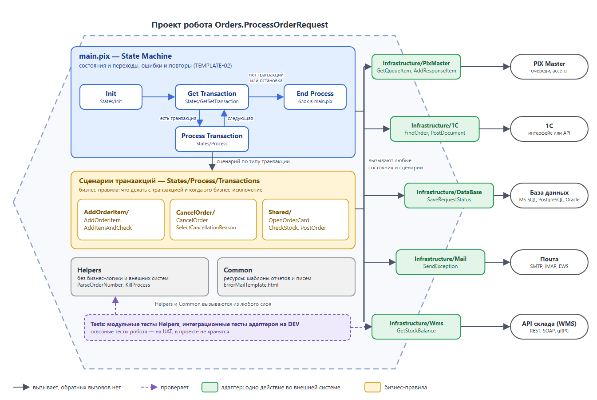
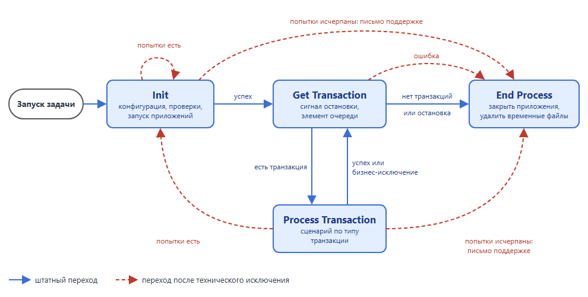
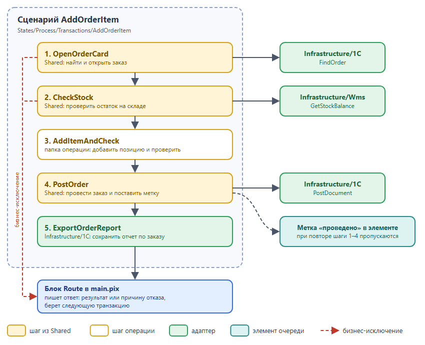

# Шаблон на State Machine

Как устроен робот на шаблоне State Machine (ШАР, шаблон архитектуры робота): на какие слои делится проект и как они зависят друг от друга, как `main.pix` управляет состояниями и как разложить бизнес-логику транзакции. Когда выбирать этот шаблон, описано в [PROJECT-01](project.md#project-01-выбирайте-шаблон-по-типу-процесса).

Транзакции робот берет из очереди PIX Master или из другого источника: папки, почтового ящика, таблицы БД. Без PIX Master шаблон устроен так же, только в `Infrastructure` нет папки `PixMaster`, а Get Transaction берет элемент из своего источника.

Во всех примерах один робот: `Orders.ProcessOrderRequest` берет из очереди PIX Master заявки чат-бота и меняет заказы в 1С (добавить позицию, изменить количество, отменить заказ). Остаток проверяет через API склада, статус заявки пишет в БД, ответ кладет в очередь ответов.

## Содержание

- [TEMPLATE-01. Разделяйте проект на слои](#template-01-разделяйте-проект-на-слои) (🔴 Обязательно)
- [TEMPLATE-02. Используйте состояния State Machine по назначению](#template-02-используйте-состояния-state-machine-по-назначению) (🔴 Обязательно)
- [Сценарий транзакции: паттерн Transaction Script](#сценарий-транзакции-паттерн-transaction-script)

## TEMPLATE-01. Разделяйте проект на слои

🔴 **Обязательно**

Раскладывайте скрипты по папкам-слоям. Тогда в любом проекте команды скрипт лежит по одному и тому же пути, смена интерфейса или API внешней системы правится в одной папке `Infrastructure`, а вспомогательные функции и адаптеры тестируются без запуска робота.



```console
Orders.ProcessOrderRequest
├───main.pix                        State Machine: состояния, переходы, End Process
├───Common                          ресурсы робота: шаблоны отчетов и писем
│   ├───ErrorMailTemplate.html
│   └───FinanceNotification.html
├───Helpers                         функции без бизнес-логики и внешних систем
│   ├───ParseOrderNumber
│   └───KillProcess
├───Infrastructure                  работа с внешними системами, по папке на систему
│   ├───PixMaster
│   │   ├───GetCredential
│   │   ├───GetQueueItem
│   │   └───AddResponseItem
│   ├───1C
│   │   ├───Start1C
│   │   ├───FindOrder
│   │   ├───PostDocument
│   │   └───ExportOrderReport
│   ├───Wms
│   │   └───GetStockBalance
│   ├───DataBase
│   │   └───SaveRequestStatus
│   └───Mail
│       └───SendException
├───States                          работа состояний и бизнес-логика
│   ├───Init
│   │   ├───InitConfig
│   │   ├───ValidateEnvironment
│   │   └───CleanupAndPrep
│   ├───GetSetTransaction
│   │   └───GetTransaction
│   └───Process
│       ├───CompleteTransaction     ответ в очередь ответов и статус заявки в БД
│       └───Transactions
│           ├───RunRequestScenario  выбор сценария по типу заявки
│           ├───AddOrderItem        папка на тип транзакции
│           │   ├───AddOrderItem
│           │   └───AddItemAndCheck
│           ├───CancelOrder
│           │   ├───CancelOrder
│           │   └───SelectCancellationReason
│           └───Shared              шаги, общие для нескольких типов
│               ├───OpenOrderCard
│               ├───CheckStock
│               └───PostOrder
└───Tests
    ├───UnitTests
    │   └───Helpers
    │       └───ParseOrderNumber.EmptyString.ThrowsBusinessException
    └───IntegrationTests
        └───Wms
            └───GetStockBalance.KnownSku.ReturnsBalance
```

Папки называйте по [NAMING-02](naming.md#naming-02-используйте-стандартные-имена-папок), скрипты по [NAMING-03](naming.md#naming-03-называйте-скрипт-глаголом-и-объектом), тесты по [TEST-05](../2-develop/test.md#test-05-именуйте-и-структурируйте-тесты-единообразно). Папку для End Process заводите, только если завершение не помещается в блок `main.pix`. Обычно это закрыть приложения и удалить временные файлы.

| Слой | Что лежит | Чего не кладут | Может вызывать |
|------|-----------|----------------|----------------|
| `main.pix` | Состояния, переходы между ними, End Process | Работу состояний: она в `States` | `States` |
| `States` | Работа Init, Get Transaction, Process Transaction и сценарии транзакций | Код работы с системой, нужный в нескольких местах | Все слои |
| `Infrastructure` | Одно действие во внешней системе: `1C/FindOrder` | Бизнес-решения: что делать, если заказ не найден, решает сценарий | `Helpers`, `Common` |
| `Helpers` | Разбор и преобразование данных: `ParseOrderNumber` | Обращения к внешним системам и бизнес-правила | Другие `Helpers` |
| `Common` | Ресурсы робота: шаблоны отчетов и писем ([PROJECT-02](project.md#project-02-храните-ресурсы-робота-в-самом-проекте)) | Скрипты | Ничего |
| `Tests` | Модульные и интеграционные тесты ([TEST-01](../2-develop/test.md#test-01-покрывайте-тестами-скрипты-с-бизнес-логикой-и-преобразованием-данных)) | Сквозные тесты робота: они проходят на UAT | Тестируемый скрипт |

Обратных вызовов нет: `Infrastructure` не вызывает `States`, `Helpers` не вызывает `Infrastructure`.

**Куда положить скрипт, который нужен в нескольких местах:**

| Кому нужен | Куда | Пример |
|------------|------|--------|
| Одному типу транзакции | Папка этого типа | `AddOrderItem/AddItemAndCheck` |
| Нескольким типам транзакций | `Transactions/Shared` | `OpenOrderCard`: находит заказ или выбрасывает бизнес-исключение |
| Разным состояниям, работает с внешней системой | `Infrastructure/<Система>` | `1C/Start1C`: нужен в Init и при повторе после сбоя |
| Разным состояниям, без внешних систем | `Helpers` | `ParseOrderNumber` |

`Shared` в каждом состоянии не нужен: то, что повторяется в Init, обычно работает с внешней системой и уходит в `Infrastructure`.

[⬆ К содержанию](#содержание)

## TEMPLATE-02. Используйте состояния State Machine по назначению

🔴 **Обязательно**

Точка входа `main.pix` и есть State Machine. Скрипты состояний выполняют работу и возвращают результат или выбрасывают исключение, а куда идти дальше, решает только `main.pix`. Поэтому все переходы робота видны в одном файле.



### Что делает каждое состояние

| Состояние | Что делает | Чего не делает | Скрипты в примере |
|-----------|------------|----------------|-------------------|
| Init | Собирает `config` из ассетов, проверяет доступ к очередям и почте, запускает 1С или подключается к открытой. При повторе сначала закрывает зависшие процессы | Не берет транзакции | `InitConfig`, `ValidateEnvironment`, `CleanupAndPrep`, `1C/Start1C` |
| Get Transaction | Проверяет сигнал остановки ([RECOVERY-06](../2-develop/recovery.md#recovery-06-проверяйте-сигнал-остановки-от-мастера)) и берет один элемент очереди | Не меняет данные во внешних системах | `GetTransaction` |
| Process Transaction | Выбирает сценарий по типу транзакции и выполняет его ([«Сценарий транзакции»](#сценарий-транзакции-паттерн-transaction-script)) | Не закрывает приложения, не выбирает следующее состояние | `RunRequestScenario` |
| End Process | Закрывает приложения, удаляет временные файлы. Если была ошибка, выбрасывает ее снова, и задача в PIX Master получает статус ошибки | Не отвечает пользователю и не меняет статусы элементов: это уже сделал блок `Route` | Блок в `main.pix` |

### Три или четыре состояния

| Процесс | Состояния | Пример |
|---------|-----------|--------|
| Линейный: один набор данных за запуск | Init → Process Transaction → End Process | Отчет из 1С: Init открывает 1С, Process Transaction выгружает отчет и отправляет его на почту, End Process закрывает 1С |
| Транзакционный | Init → Get Transaction → Process Transaction → End Process | Робот заказов из примера |

Схему из четырех состояний в RPA часто называют REFramework, по шаблону Robotic Enterprise Framework от UiPath, с которого она пошла ([глоссарий](../glossary.md)). ШАР построен по той же схеме. В PIX есть и отдельный шаблон PIX REFramework ([«Другие шаблоны»](project.md#другие-шаблоны)).

В роботе из трех состояний нет Get Transaction: после Process Transaction он сразу переходит в End Process. Остальное устроено так же: блоки `Route`, повторы после технического исключения, письмо поддержке и End Process.

### Блоки main.pix

У каждого состояния, кроме End Process, два блока:

| Блок | Что делает |
|------|------------|
| `Init` | Вызывает скрипты состояния внутри try/catch. Исключение сохраняется в `systemError`, к его источнику добавляется текущий шаг ([ERROR-07](../2-develop/error.md#error-07-указывайте-источник-исключения)) |
| `Init - Route` | Выбирает, куда идти дальше. Условия идут плоским списком, в каждом один переход |

Переходы делаются активностью `GoToStep`, а не циклом `while (true)` с выбором состояния. Такой цикл не ограничен ни временем, ни числом итераций ([LOOP-01](../2-develop/loop.md#loop-01-ограничивайте-каждый-цикл-таймаутом-или-числом-итераций)): если ветка не вышла из цикла, робот зависает. У `GoToStep` свой недостаток: подпись шага не связана с целью, и шаг «Переход на Init» может вести в End Process. Поэтому `GoToStep` используется только в блоках `Route` ([LOOP-04](../2-develop/loop.md#loop-04-избегайте-использования-goto)), а подпись шага повторяет имя целевого блока.

### Переходы

| Состояние | Исход | Куда дальше |
|-----------|-------|-------------|
| Init | Успех | Get Transaction |
| | Техническое исключение, попытки есть | Init заново ([RECOVERY-03](../2-develop/recovery.md#recovery-03-восстанавливайте-приложения-после-технического-исключения)) |
| | Попытки исчерпаны | Письмо поддержке, End Process |
| Get Transaction | Транзакция получена | Process Transaction |
| | Транзакций нет, сигнал остановки или техническое исключение | End Process |
| Process Transaction | Успех или бизнес-исключение | `CompleteTransaction` пишет ответ и статус элемента ([QUEUE-02](../3-integrations/queue.md#queue-02-обрабатывайте-элемент-очереди-как-транзакцию)), затем Get Transaction |
| | Техническое исключение, попытки есть | Init |
| | Попытки исчерпаны | Письмо поддержке, End Process ([RECOVERY-05](../2-develop/recovery.md#recovery-05-останавливайте-робота-после-серии-технических-исключений-подряд)) |

Попытки считаются на трех уровнях, и они не зависят друг от друга:

| Уровень | Что повторяется | Где настраивается |
|---------|-----------------|-------------------|
| Запуск | Init или Process Transaction, счетчик `retryCount` | Параметр задачи |
| Очередь | Элемент возвращается в очередь через заданное время | Настройки очереди ([QUEUE-04](../3-integrations/queue.md#queue-04-правильно-обрабатывайте-повторные-попытки-retry)) |
| Задача | Задача запускается заново | Настройки задачи в PIX Master |

### Переменные main.pix

Состояния обмениваются данными через переменные `main.pix`. Шаблон задает базовые:

| Переменная | Что хранит | Кто меняет |
|------------|------------|------------|
| `config` | Словарь настроек: значения ассетов, имена очередей, рабочая папка. Передается входным параметром в скрипты | Init, один раз за запуск |
| `transactionItem` | Текущий элемент очереди | Get Transaction записывает, `Route` после Process Transaction обнуляет |
| `systemError` | Исключение последнего состояния | Блок состояния записывает, `Route` читает, Init обнуляет |
| `retryCount` | Число повторов в текущем запуске | `Route` |

Остальные переменные робот добавляет сам, и набор у каждого робота свой. Для каждой определите, какое состояние ее записывает, и не меняйте ее в других.

Имя ассета в PIX Master задается один раз, при сборке `config` в `main.pix`. Скрипты берут значение по ключу `config`, поэтому переименованный ассет правится в одной строке ([config.md](config.md)).

[⬆ К содержанию](#содержание)

## Сценарий транзакции: паттерн Transaction Script

Так в шаблоне устроены сценарии в `Transactions`. Это один из архитектурных подходов, а не требование: если логика транзакции короткая, отдельные шаги не нужны.

Сценарий транзакции — короткий скрипт, который по порядку вызывает шаги. Каждый шаг лежит в отдельном скрипте, выполняет одно действие и возвращает результат. У каждого типа транзакции свой сценарий, и выбирается он в одном месте (`RunRequestScenario`). Паттерн Transaction Script описан в каталоге Мартина Фаулера.

Сценарий `AddOrderItem` из примера: `OpenOrderCard` → `CheckStock` → `AddItemAndCheck` → `PostOrder` → `1C/ExportOrderReport`.



**Как делить на шаги:**
- Шаг выполняет одно действие и называется глаголом: найти заказ, проверить остаток, провести заказ
- Шаг получает данные через параметры и возвращает результат, а не читает переменные сценария
- Шаг, нужный одному сценарию, лежит в папке операции, а нужный нескольким сценариям лежит в `Shared` ([TEMPLATE-01](#template-01-разделяйте-проект-на-слои))
- Бизнес-исключение выбрасывает тот шаг, который нашел проблему: «заказ не найден», «остатка не хватает» ([ERROR-06](../2-develop/error.md#error-06-разделяйте-бизнес-исключения-и-технические-исключения))
- Необратимое действие выносите в отдельный шаг и после него ставьте метку в элементе очереди ([QUEUE-10](../3-integrations/queue.md#queue-10-отмечайте-в-элементе-очереди-выполненные-необратимые-шаги))

**Что это дает:**
- Сценарий читается как ТЗ: ревьюер видит шаги процесса без кликов по интерфейсу
- По источнику исключения видно, на каком шаге упал робот ([ERROR-07](../2-develop/error.md#error-07-указывайте-источник-исключения))
- Если изменился интерфейс 1С, правится один шаг
- Шаг отлаживается и тестируется отдельно ([TEST-01](../2-develop/test.md#test-01-покрывайте-тестами-скрипты-с-бизнес-логикой-и-преобразованием-данных))

[⬆ К содержанию](#содержание)
