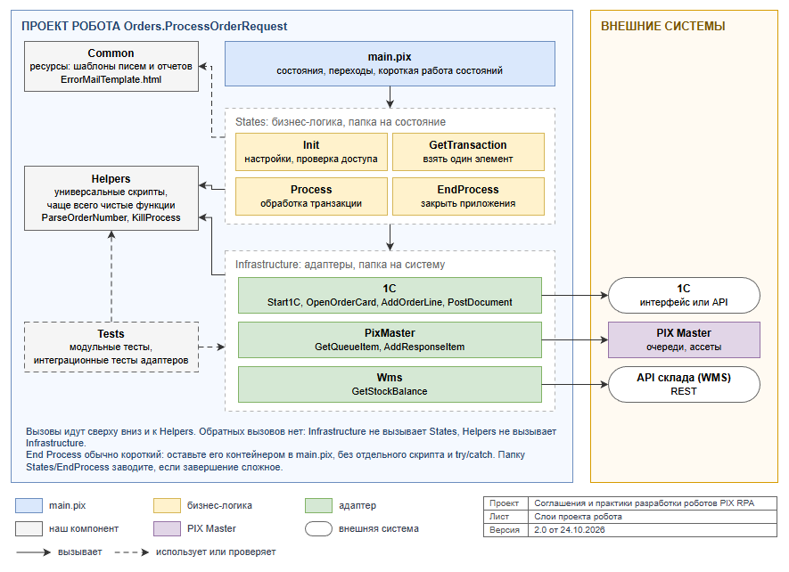
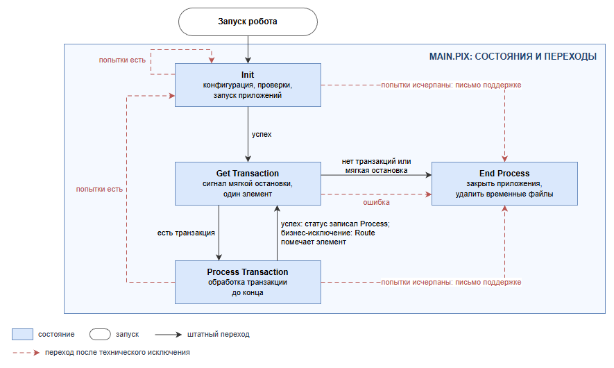
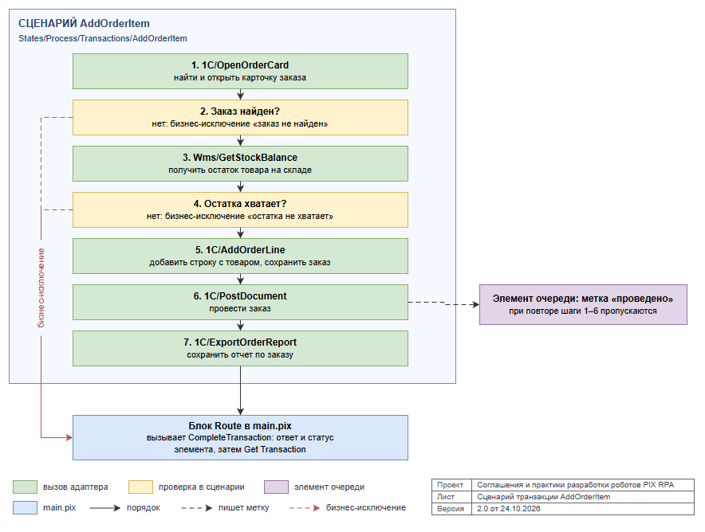

# Шаблоны роботов на State Machine

Как обычно устроены шаблоны роботов команды: на какие слои делится проект, как `main.pix` управляет состояниями и как разложить бизнес-логику транзакции. Готовые шаблоны лежат в репозитории [pix-templates](https://github.com/TheMrDJek/pix-templates), а когда какой выбирать, описано в [PROJECT-01](project.md#project-01-выбирайте-шаблон-по-типу-процесса).

Транзакции робот берет из очереди PIX Master или из другого источника: папки, почтового ящика, таблицы БД. Без PIX Master шаблон устроен так же, только в `Infrastructure` нет папки `PixMaster`, а Get Transaction берет элемент из своего источника.

**Пример в этом файле.** Схемы, дерево папок и таблицы ниже показывают одного и того же робота, чтобы правила складывались в один проект. Робот `Orders.ProcessOrderRequest` берет из очереди PIX Master заявки чат-бота и меняет заказы в 1С: добавляет позицию, меняет количество, отменяет заказ. Остаток он проверяет через API склада. Ответ для чат-бота робот кладет в очередь ответов, а статус заявки хранит сам элемент входной очереди: робот обновляет его последним шагом ([QUEUE-02](../3-integrations/queue.md#queue-02-обрабатывайте-элемент-очереди-как-транзакцию)).

## Содержание

- [TEMPLATE-01. Разделяйте проект на слои](#template-01-разделяйте-проект-на-слои) (🔴 Обязательно)
- [TEMPLATE-02. Используйте состояния State Machine по назначению](#template-02-используйте-состояния-state-machine-по-назначению) (🔴 Обязательно)
- [TEMPLATE-03. Проверяйте доступ ко всем системам робота в Init](#template-03-проверяйте-доступ-ко-всем-системам-робота-в-init) (🔴 Обязательно)
- [Как разложить логику транзакции](#как-разложить-логику-транзакции)

## TEMPLATE-01. Разделяйте проект на слои

🔴 **Обязательно**

Не складывайте скрипты одной кучей в корень проекта. Переходы между состояниями лежат в `main.pix`, а скрипты раскладывайте по папкам по роли: бизнес-логика, работа с внешними системами и универсальные скрипты лежат отдельно. Тогда по пути скрипта видно, что он делает: бизнес-правило вы ищете в `States`, работу с 1С в `Infrastructure/1C`, а смену интерфейса или API системы правите в одной папке.



- `main.pix`: состояния и переходы ([TEMPLATE-02](#template-02-используйте-состояния-state-machine-по-назначению))
- `States`: бизнес-логика, папка на состояние
- `Infrastructure`: работа с внешними системами, папка на систему. Адаптер выполняет действие, а что делать с результатом, решает `States`
- `Helpers`: универсальные скрипты, чаще всего чистые функции. Не обращаются к внешним системам и не содержат бизнес-правил
- `Common`: ресурсы робота, шаблоны писем и отчетов ([PROJECT-02](project.md#project-02-храните-ресурсы-робота-в-самом-проекте))
- `Tests`: модульные и интеграционные тесты ([TEST-01](../2-develop/test.md#test-01-покрывайте-тестами-скрипты-с-бизнес-логикой-и-преобразованием-данных))

Вызовы идут сверху вниз: `main.pix` вызывает `States`, `States` вызывает `Infrastructure` и `Helpers`, `Infrastructure` вызывает `Helpers`. Обратных вызовов нет.

**Короткое состояние оставляйте в `main.pix`.** Если состоянию хватает нескольких активностей или 1–5 строк кода, папку не заводите. Так обычно выглядит End Process: закрыть приложения и удалить временные файлы. Держите его контейнером в `main.pix`, без отдельного скрипта и try/catch. Сложное завершение, например отчет о запуске и итоговое письмо, выносите в `States/EndProcess`.

```console
Orders.ProcessOrderRequest
├───main.pix                    состояния и переходы
├───States                      бизнес-логика, по папке на состояние
│   ├───Init                    InitConfig, ValidateEnvironment, CleanupAndPrep
│   ├───GetSetTransaction       GetTransaction
│   ├───Process                 RunRequestScenario, CompleteTransaction, Transactions
│   └───EndProcess              только если завершение не помещается в контейнер main.pix
├───Infrastructure              работа с внешними системами, по папке на систему
│   ├───1C                      Start1C, FindOrder, PostDocument
│   ├───PixMaster               GetQueueItem, AddResponseItem
│   └───Wms                     GetStockBalance
├───Helpers                     ParseOrderNumber, KillProcess
├───Common                      ErrorMailTemplate.html
└───Tests
    ├───UnitTests
    └───IntegrationTests
```

Папки называйте по [NAMING-02](naming.md#naming-02-используйте-стандартные-имена-папок), скрипты по [NAMING-03](naming.md#naming-03-называйте-скрипт-глаголом-и-объектом), тесты по [TEST-05](../2-develop/test.md#test-05-именуйте-и-структурируйте-тесты-единообразно). Как разложить по папкам сценарии внутри `Process`, описано в справке [«Как разложить логику транзакции»](#как-разложить-логику-транзакции).

Скрипт, нужный в нескольких местах, кладите по роли: работу с системой в `Infrastructure/<Система>`, шаг бизнес-логики для нескольких типов транзакций в `States/Process/Transactions/Shared`, остальное в `Helpers`.

[⬆ К содержанию](#содержание)

## TEMPLATE-02. Используйте состояния State Machine по назначению

🔴 **Обязательно**

Состояний в шаблоне может быть три, пять или десять: столько, сколько нужно процессу. Правило описывает типовой шаблон из четырех состояний: Init → Get Transaction → Process Transaction → End Process. Так устроены REFramework от UiPath, с которого пошла эта схема ([глоссарий](../glossary.md)), и его аналоги на других платформах. Если в вашем шаблоне другие состояния, принцип тот же: работу делают скрипты состояний, а следующее состояние выбирает `main.pix`.

Точка входа `main.pix` и есть State Machine. Скрипты состояний выполняют работу и возвращают результат или выбрасывают исключение, а куда идти дальше, решает только `main.pix`. Поэтому все переходы робота видны в одном файле.



### Что делает каждое состояние

| Состояние | Что делает | Чего не делает | Скрипты в примере |
|-----------|------------|----------------|-------------------|
| Init | Собирает `config` из ассетов, запускает 1С или подключается к открытой, проверяет доступ ко всем системам робота ([TEMPLATE-03](#template-03-проверяйте-доступ-ко-всем-системам-робота-в-init)). При повторе сначала закрывает зависшие процессы | Не берет транзакции | `InitConfig`, `ValidateEnvironment`, `CleanupAndPrep`, `1C/Start1C` |
| Get Transaction | Проверяет сигнал остановки ([RECOVERY-06](../2-develop/recovery.md#recovery-06-проверяйте-сигнал-остановки-от-мастера)) и берет один элемент очереди | Не меняет данные во внешних системах | `GetTransaction` |
| Process Transaction | Выбирает сценарий по типу транзакции и выполняет его ([«Как разложить логику транзакции»](#как-разложить-логику-транзакции)) | Не закрывает приложения, не выбирает следующее состояние | `RunRequestScenario` |
| End Process | Закрывает приложения, удаляет временные файлы. Если была ошибка, выбрасывает ее снова, и задача в PIX Master получает статус ошибки | Не отвечает пользователю и не меняет статусы элементов: это уже сделал `CompleteTransaction` | Блок в `main.pix`, сложное завершение в `States/EndProcess` |

### Линейный процесс: три состояния

| Процесс | Состояния | Пример |
|---------|-----------|--------|
| Линейный: один набор данных за запуск | Init → Process Transaction → End Process | Отчет из 1С: Init открывает 1С, Process Transaction выгружает отчет и отправляет его на почту, End Process закрывает 1С |
| Транзакционный | Init → Get Transaction → Process Transaction → End Process | Робот заказов из примера |

В роботе из трех состояний нет Get Transaction: после Process Transaction он сразу переходит в End Process. Остальное устроено так же: блоки `Route`, повторы после технического исключения, письмо поддержке и End Process.

### Блоки main.pix

У каждого состояния, кроме End Process, два блока:

| Блок | Что делает |
|------|------------|
| `Init` | Вызывает скрипты состояния внутри try/catch. Исключение сохраняется в `systemError`, к его источнику добавляется текущий шаг ([ERROR-07](../2-develop/error.md#error-07-указывайте-источник-исключения)) |
| `Init - Route` | Выбирает, куда идти дальше. Условия идут плоским списком, в каждом один переход |

Переходы делаются активностью `GoToStep`, а не циклом `while (true)` с выбором состояния. Такой цикл не ограничен ни временем, ни числом итераций ([LOOP-01](../2-develop/loop.md#loop-01-ограничивайте-каждый-цикл-таймаутом-или-числом-итераций)): если ветка не вышла из цикла, робот зависает. У `GoToStep` свой недостаток: подпись шага не связана с целью, и шаг «Переход на Init» может вести в End Process. Поэтому `GoToStep` используется только в блоках `Route` ([LOOP-04](../2-develop/loop.md#loop-04-избегайте-использования-goto)), а подпись шага повторяет имя целевого блока.

### Переходы

| Состояние | Исход | Куда дальше |
|-----------|-------|-------------|
| Init | Успех | Get Transaction |
| | Техническое исключение, попытки есть | Init заново ([RECOVERY-03](../2-develop/recovery.md#recovery-03-восстанавливайте-приложения-после-технического-исключения)) |
| | Попытки исчерпаны | Письмо поддержке, End Process |
| Get Transaction | Транзакция получена | Process Transaction |
| | Транзакций нет, сигнал остановки или техническое исключение | End Process |
| Process Transaction | Успех или бизнес-исключение | Блок `Route` вызывает `CompleteTransaction`: скрипт пишет ответ и статус элемента ([QUEUE-02](../3-integrations/queue.md#queue-02-обрабатывайте-элемент-очереди-как-транзакцию)), затем Get Transaction |
| | Техническое исключение, попытки есть | Init |
| | Попытки исчерпаны | Письмо поддержке, End Process ([RECOVERY-05](../2-develop/recovery.md#recovery-05-останавливайте-робота-после-серии-технических-исключений-подряд)) |

Попытки считаются на трех уровнях, и они не зависят друг от друга:

| Уровень | Что повторяется | Где настраивается |
|---------|-----------------|-------------------|
| Запуск | Init или Process Transaction, счетчик `retryCount` | Параметр задачи |
| Очередь | Элемент возвращается в очередь через заданное время | Настройки очереди ([QUEUE-04](../3-integrations/queue.md#queue-04-правильно-обрабатывайте-повторные-попытки-retry)) |
| Задача | Задача запускается заново | Настройки задачи в PIX Master |

### Переменные main.pix

Состояния обмениваются данными через переменные `main.pix`. Шаблон задает базовые:

| Переменная | Что хранит | Кто меняет |
|------------|------------|------------|
| `config` | Словарь настроек: значения ассетов, имена очередей, рабочая папка. Передается входным параметром в скрипты | Init, один раз за запуск |
| `transactionItem` | Текущий элемент очереди | Get Transaction записывает, `Route` после Process Transaction обнуляет |
| `systemError` | Исключение последнего состояния | Блок состояния записывает, `Route` читает, Init обнуляет |
| `retryCount` | Число повторов в текущем запуске | `Route` |

Остальные переменные робот добавляет сам, и набор у каждого робота свой. Для каждой определите, какое состояние ее записывает, и не меняйте ее в других.

Имя ассета в PIX Master задается один раз, при сборке `config` в `main.pix`. Скрипты берут значение по ключу `config`, поэтому переименованный ассет правится в одной строке ([config.md](config.md)).

[⬆ К содержанию](#содержание)

## TEMPLATE-03. Проверяйте доступ ко всем системам робота в Init

🔴 **Обязательно**

До первой транзакции Init проверяет каждую систему, с которой работает робот: все папки `Infrastructure` и рабочие папки на диске. Если доступа нет, скрипт проверки выбрасывает техническое исключение ([ERROR-06](../2-develop/error.md#error-06-разделяйте-бизнес-исключения-и-технические-исключения)) с сообщением по [ERROR-07](../2-develop/error.md#error-07-указывайте-источник-исключения), например `[Wms] Проверка доступа: API не отвечает`. Дальше робот идет по переходам [TEMPLATE-02](#template-02-используйте-состояния-state-machine-по-назначению): повторяет Init, а когда попытки кончились, пишет поддержке и завершает работу.

В примере проверки лежат в `States/Init/ValidateEnvironment`:

| Система | Что проверить |
|---------|---------------|
| 1С | `1C/Start1C` запустил 1С или подключился к открытой, робот вошел под своей учетной записью |
| API склада | Служебный запрос к API проходит с учетными данными робота |
| Очереди PIX Master | Входная очередь и очередь ответов с именами из `config` существуют |
| Почта | Робот подключается к почтовому серверу с учетной записью робота |
| Рабочие папки | Папка есть, робот может создать в ней файл и удалить его |

Проверка не меняет данных: не отправляет писем, не создает записей и элементов очереди. Пропавший посреди запуска доступ ловит обычная обработка технического исключения, поэтому перед каждой транзакцией проверку не повторяйте.

**Почему:**
- **Робот не падает посреди транзакции из-за системы, недоступной с самого начала.** Без проверки робот узнает, что очереди ответов нет, например из-за опечатки в ее имени в ассете, только когда кладет ответ. К этому моменту позиция в заказ 1С уже добавлена, и элемент уходит в повтор с выполненным необратимым шагом ([QUEUE-10](../3-integrations/queue.md#queue-10-отмечайте-в-элементе-очереди-выполненные-необратимые-шаги))
- **Поддержка сразу видит причину.** Письмо приходит с источником `Wms` из Init, а не с ошибкой третьего шага сценария, которую еще надо связать с API склада
- **Первый запуск на новом контуре сразу показывает нехватку прав.** Если на UAT или PROD у учетной записи робота нет прав на рабочую папку или API склада, робот падает в Init, а не на первой заявке

[⬆ К содержанию](#содержание)

## Как разложить логику транзакции

Справка для Process Transaction, где логика длиннее пары шагов. Два подхода решают разные задачи. Transaction Script делит транзакцию на шаги. Стратегия позволяет одному роботу выполнять несколько вариантов процесса. Если транзакция умещается в один-два скрипта, ни один из подходов не нужен: Process Transaction вызывает их сам.

### Сценарий транзакции: паттерн Transaction Script

Подходит, когда транзакция состоит из нескольких шагов, особенно если у робота несколько типов транзакций.

Сценарий транзакции — короткий скрипт, который по порядку вызывает шаги. Каждый шаг лежит в отдельном скрипте, выполняет одно действие и возвращает результат. У каждого типа транзакции свой сценарий, и выбирается он в одном месте, в `RunRequestScenario`. Паттерн Transaction Script описан в каталоге Мартина Фаулера.

```console
States/Process
├───RunRequestScenario      выбор сценария по типу заявки
├───CompleteTransaction     ответ в очередь ответов, статус элемента входной очереди
└───Transactions
    ├───AddOrderItem        папка на тип транзакции: сценарий и его шаги
    │   ├───AddOrderItem
    │   └───AddItemAndCheck
    ├───CancelOrder
    │   ├───CancelOrder
    │   └───SelectCancellationReason
    └───Shared              шаги, общие для нескольких типов
        ├───OpenOrderCard
        ├───CheckStock
        └───PostOrder
```

Сценарий `AddOrderItem` из примера: `OpenOrderCard` → `CheckStock` → `AddItemAndCheck` → `PostOrder` → `1C/ExportOrderReport`.



**Как делить на шаги:**
- Шаг выполняет одно действие и называется глаголом: найти заказ, проверить остаток, провести заказ
- Шаг получает данные через параметры и возвращает результат, а не читает переменные сценария
- Шаг, нужный одному сценарию, лежит в папке этого типа транзакции, а нужный нескольким сценариям лежит в `Shared`
- Если шагу хватает одного действия во внешней системе, сценарий вызывает адаптер `Infrastructure` напрямую, как `1C/ExportOrderReport`
- Бизнес-исключение выбрасывает тот шаг, который нашел проблему: «заказ не найден», «остатка не хватает» ([ERROR-06](../2-develop/error.md#error-06-разделяйте-бизнес-исключения-и-технические-исключения))
- Необратимое действие выносите в отдельный шаг и после него ставьте метку в элементе очереди ([QUEUE-10](../3-integrations/queue.md#queue-10-отмечайте-в-элементе-очереди-выполненные-необратимые-шаги))

**Что это дает:**
- Сценарий читается как ТЗ: ревьюер видит шаги процесса без кликов по интерфейсу
- По источнику исключения видно, на каком шаге упал робот ([ERROR-07](../2-develop/error.md#error-07-указывайте-источник-исключения))
- Если изменился интерфейс 1С, правится один шаг
- Шаг отлаживается и тестируется отдельно ([TEST-01](../2-develop/test.md#test-01-покрывайте-тестами-скрипты-с-бизнес-логикой-и-преобразованием-данных))

### Варианты процесса: стратегия

Подходит, когда у нескольких процессов одинаковые шаги, а отличаются одна-две части. Например, робот готовит отчеты для отдела продаж и для финансов. Выгрузка из 1С, проверка данных и рассылка у них общие, а наполнение отчета и шаблон Excel свои. Вместо двух роботов с общим кодом вы делаете одного робота с двумя стратегиями.

**Как устроить:**
- В PIX Master заведите на одного робота две задачи с разным значением входного параметра: `In_ReportType` = `Sales` и `In_ReportType` = `Finance` ([CONFIG-03](config.md#config-03-используйте-входные-параметры-робота-только-для-значений-запуска))
- Init проверяет значение параметра. Робот с неизвестной стратегией останавливается в Init, а не на первой транзакции
- Шаги, которые отличаются, лежат по папке на стратегию: `States/Process/Strategies/Sales/FillReport` и `States/Process/Strategies/Finance/FillReport`. У скриптов одной роли одинаковые параметры и результат
- Шаблоны Excel лежат в `Common`: `SalesReport.xlsx` и `FinanceReport.xlsx`
- Стратегию выбирают в одном месте, как сценарий в `RunRequestScenario`: условие по значению параметра вызывает скрипт нужной стратегии
- Робот пишет стратегию в лог в начале запуска, чтобы по логу было видно, какой вариант работал

**Плюсы:**
- Общие шаги правятся один раз, а не в двух роботах
- В PIX Master один пакет робота и одна версия на контуре

**Минусы:**
- Правка одной стратегии выходит новой версией робота для всех задач, и проверять приходится каждую стратегию
- Если варианты расходятся больше чем в одной-двух частях, условий по стратегии становится много, и двух роботов поддерживать проще. Признак: проверка стратегии появилась больше чем в двух местах сценария

[⬆ К содержанию](#содержание)
