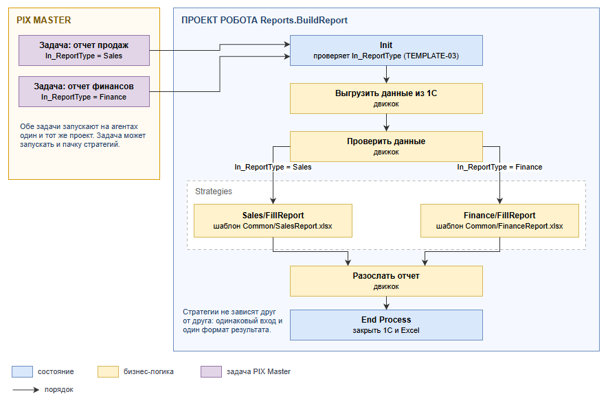

# Шаблоны роботов на State Machine

Как обычно устроены шаблоны роботов команды: на какие слои делится проект, как `main.pix` управляет состояниями и как разложить бизнес-логику транзакции. Готовые шаблоны лежат в репозитории [pix-templates](https://github.com/TheMrDJek/pix-templates), а когда какой выбирать, описано в [PROJECT-01](project.md#project-01-выбирайте-шаблон-по-типу-процесса).

Транзакции робот берет из очереди PIX Master или из другого источника: папки, почтового ящика, таблицы БД. Без PIX Master шаблон устроен так же, только в `Infrastructure` нет папки `PixMaster`, а Get Transaction берет элемент из своего источника.

**Пример в этом файле.** Схемы, дерево папок и таблицы ниже показывают одного и того же робота, чтобы правила складывались в один проект. Робот `Orders.ProcessOrderRequest` берет из очереди PIX Master заявки чат-бота и меняет заказы в 1С: добавляет позицию, меняет количество, отменяет заказ. Остаток он проверяет через API склада. Ответ для чат-бота робот кладет в очередь ответов, а статус заявки хранит сам элемент входной очереди: робот обновляет его последним шагом ([QUEUE-02](../3-integrations/queue.md#queue-02-обрабатывайте-элемент-очереди-как-транзакцию)).

## Содержание

- [TEMPLATE-01. Раскладывайте скрипты по папкам по роли](#template-01-раскладывайте-скрипты-по-папкам-по-роли) (🔴 Обязательно)
- [TEMPLATE-02. Выполняйте в каждом состоянии только его работу](#template-02-выполняйте-в-каждом-состоянии-только-его-работу) (🔴 Обязательно)
- [TEMPLATE-03. Проверяйте в Init настройки и доступ ко всем системам робота](#template-03-проверяйте-в-init-настройки-и-доступ-ко-всем-системам-робота) (🔴 Обязательно)
- [Сценарий транзакции: паттерн Transaction Script](#сценарий-транзакции-паттерн-transaction-script)
- [Варианты процесса: стратегия](#варианты-процесса-стратегия)

## TEMPLATE-01. Раскладывайте скрипты по папкам по роли

🔴 **Обязательно**

Не складывайте скрипты одной кучей в корень проекта. Переходы между состояниями лежат в `main.pix`, а скрипты раскладывайте по папкам по роли: бизнес-логика, работа с внешними системами и универсальные скрипты лежат отдельно. Тогда по пути скрипта видно, что он делает: бизнес-правило вы ищете в `States`, работу с 1С в `Infrastructure/1C`, а смену интерфейса или API системы правите в одной папке.


- `main.pix`: состояния и переходы ([TEMPLATE-02](#template-02-выполняйте-в-каждом-состоянии-только-его-работу))
- `States`: бизнес-логика, то есть что и когда делать: проверки, решения, порядок шагов. Папка на состояние
- `Infrastructure`: как сделать во внешней системе: найти, открыть, заполнить, провести. Папка на систему. Файлы вне проекта тоже внешняя система: входные и выходные папки, сетевая шара, обмен файлами с другими системами лежат в `Infrastructure/FileSystem`. Адаптер не знает, зачем его вызвали: он возвращает результат, а решает `States`
- `Helpers`: универсальные скрипты, чаще всего чистые функции. Не обращаются к внешним системам и не содержат бизнес-правил
- `Common`: ресурсы робота, шаблоны писем и отчетов ([PROJECT-02](project.md#project-02-храните-ресурсы-робота-в-самом-проекте))
- `Tests`: модульные и интеграционные тесты ([TEST-01](../2-develop/test.md#test-01-покрывайте-тестами-скрипты-с-бизнес-логикой-и-преобразованием-данных))

**Любое действие в интерфейсе или API системы лежит в `Infrastructure`, даже если оно нужно один раз.** Проверьте себя: скрипт кликает в системе или читает ее? Тогда это `Infrastructure`. Скрипт сравнивает, выбирает или выбрасывает бизнес-исключение? Тогда это `States`. Например, `1C/OpenOrderCard` открывает карточку заказа, а если заказа нет, возвращает «не найден». Бизнес-исключение «заказ не найден» выбрасывает сценарий. Разбор задачи по шагам есть в справке [«Сценарий транзакции»](#сценарий-транзакции-паттерн-transaction-script).

С файлами критерий тот же: если папка может не ответить или не дать прав, работа с ней лежит в `Infrastructure/FileSystem`. Собрать путь, создать и почистить временную папку можно в `Helpers` или прямо на месте: адаптер ради одной строки кода не нужен.

Вызовы идут сверху вниз: `main.pix` вызывает `States`, `States` вызывает `Infrastructure` и `Helpers`, `Infrastructure` вызывает `Helpers`. Обратных вызовов нет.

**Короткое состояние оставляйте в `main.pix`.** Если состоянию хватает нескольких активностей или 1–5 строк кода, папку не заводите. Так обычно выглядит End Process: закрыть приложения и удалить временные файлы. Держите его контейнером в `main.pix`, без отдельного скрипта и try/catch. Сложное завершение, например отчет о запуске и итоговое письмо, выносите в `States/EndProcess`.

```console
Orders.ProcessOrderRequest
├───main.pix                    состояния и переходы
├───States                      бизнес-логика, по папке на состояние
│   ├───Init                    InitConfig, ValidateEnvironment, CleanupAndPrep
│   ├───GetTransaction          GetTransaction
│   ├───Process                 RunRequestScenario, CompleteTransaction, Transactions
│   └───EndProcess              только если завершение не помещается в контейнер main.pix
├───Infrastructure              работа с внешними системами, по папке на систему
│   ├───1C                      Start1C, OpenOrderCard, AddOrderLine, PostDocument, ExportOrderReport
│   ├───PixMaster               GetQueueItem, AddResponseItem
│   └───Wms                     GetStockBalance
├───Helpers                     ParseOrderNumber, KillProcess
├───Common                      ErrorMailTemplate.html
└───Tests
    ├───UnitTests
    └───IntegrationTests
```

Папки называйте по [NAMING-02](naming.md#naming-02-используйте-стандартные-имена-папок), скрипты по [NAMING-03](naming.md#naming-03-называйте-скрипт-глаголом-и-объектом), тесты по [TEST-05](../2-develop/test.md#test-05-именуйте-и-структурируйте-тесты-единообразно). Как разложить по папкам сценарии внутри `Process`, описано в справке [«Сценарий транзакции»](#сценарий-транзакции-паттерн-transaction-script).

Скрипт, нужный в нескольких местах, кладите по роли: работу с системой в `Infrastructure/<Система>`, шаг бизнес-логики для нескольких типов транзакций в `States/Process/Transactions/Shared`, остальное в `Helpers`.

[⬆ К содержанию](#содержание)

## TEMPLATE-02. Выполняйте в каждом состоянии только его работу

🔴 **Обязательно**

Состояний в шаблоне может быть три, пять или десять: столько, сколько нужно процессу. Правило описывает классический шаблон из четырех состояний с повторами: Init → Get Transaction → Process Transaction → End Process. Так устроены REFramework от UiPath, с которого пошла эта схема ([глоссарий](../glossary.md)), и его аналоги на других платформах. Если в вашем шаблоне другие состояния, принцип тот же: каждое состояние делает свою работу, а следующее состояние выбирает `main.pix`.

Повторы нужны, потому что робот чаще всего работает с интерфейсом. Окно подвисает, элемент не находится, сессия 1С обрывается. Обычно такой сбой проходит, если перезапустить приложение и повторить транзакцию, поэтому после технического исключения шаблон возвращается в Init.


### main.pix

`main.pix` это точка входа робота и обертка над слоями. С него начинается работа: он запускает Init и дальше ведет робота по состояниям. Каждое состояние в `main.pix` это блок, который вызывает скрипты из `States`. Блок состояния ловит исключение и сохраняет его в `systemError`. После каждого состояния, кроме End Process, стоит блок `Route`: он смотрит, чем закончилось состояние, и выбирает, куда идти дальше. Все переходы робота видны в одном файле.

Переход между состояниями делайте активностью [«Перейти на шаг»](https://docs.pixrobotics.com/articles/#!rpa/actions-baseactivities-gotostep) в блоке `Route`: условие проверяет, чем закончилось состояние, а внутри условия стоит переход на нужный блок. В PIX Studio есть и [«Условный переход к шагу»](https://docs.pixrobotics.com/articles/#!rpa/actions-baseactivities-conditionalgoto), но в шаблонах используется «Перейти на шаг».

Подписывайте шаг перехода именем целевого блока. Подпись не связана с целью: шаг «Переход на Init» может вести в End Process, и на ревью такую ошибку легко пропустить. Вне блоков `Route` переходы на шаг не используйте ([LOOP-04](../2-develop/loop.md#loop-04-избегайте-использования-goto)).

Встречается и другой способ собрать State Machine: бесконечный цикл `while (true)`, внутри которого условие выбирает следующее состояние. Так не делайте. Такой цикл не ограничен ни временем, ни числом итераций ([LOOP-01](../2-develop/loop.md#loop-01-ограничивайте-каждый-цикл-таймаутом-или-числом-итераций)): если какая-то ветка не выйдет из цикла, робот зависнет.

### Init

- Собирает `config` из ассетов и других источников: входных параметров, файла настроек
- Запускает приложения, с которыми работает робот: 1С, браузер
- Проверяет настройки и доступ ко всем системам робота ([TEMPLATE-03](#template-03-проверяйте-в-init-настройки-и-доступ-ко-всем-системам-робота))
- Если транзакции приходят не из очереди, один раз собирает их в коллекцию: читает письма из ящика, строки таблицы на сайте или в файле. Дальше Get Transaction берет из коллекции по одному элементу
- При повторе после технического исключения сбрасывает исключение прошлой попытки, закрывает процесс приложения и открывает его заново ([RECOVERY-03](../2-develop/recovery.md#recovery-03-восстанавливайте-приложения-после-технического-исключения)). Собранную коллекцию повтор не перечитывает

Init не обрабатывает транзакции. Скрипты в примере: `InitConfig`, `ValidateEnvironment`, `CleanupAndPrep`, `1C/Start1C`.

**Почему в Init так много работы.** Init построен по принципу fail fast, «падай рано»: ошибку окружения или настройки нужно найти как можно раньше, пока робот еще ничего не изменил. Init готовит и проверяет все, что можно подготовить и проверить до первой транзакции: настройки, приложения, доступы, данные. Если что-то не так, робот падает сразу в Init и не начинает ни одной транзакции. Без этого недонастроенный робот берет транзакцию, проходит половину шагов и падает в Process Transaction. Транзакция остается обработанной наполовину, а по ошибке не видно, что дело в настройке. Какие проверки нужны, описано в [TEMPLATE-03](#template-03-проверяйте-в-init-настройки-и-доступ-ко-всем-системам-робота).

### Get Transaction

- Проверяет сигнал мягкой остановки задачи активностью «Проверить сигнал остановки» ([RECOVERY-06](../2-develop/recovery.md#recovery-06-проверяйте-сигнал-остановки-от-мастера))
- Берет один элемент из очереди или следующий элемент из коллекции
- Если элементу нужны дополнительные данные, догружает их. Например, отдельным запросом в БД получает по номеру заказа из элемента данные клиента и состав заказа

Get Transaction ничего не меняет во внешних системах и не пишет статусы. Во многих шаблонах это состояние называется GetSetTransaction и заодно записывает данные. Мы так не делаем: начатую транзакцию до конца доводит Process Transaction. Скрипт в примере: `GetTransaction`.

### Process Transaction

Process Transaction обрабатывает транзакцию полностью, от первого шага до записи результата: выполняет работу во внешних системах, меняет статус элемента, пишет в БД, отвечает пользователю. Не переносите эту работу в `Route`. Если логика длинная или у робота несколько типов транзакций, разложите ее по справке [«Сценарий транзакции»](#сценарий-транзакции-паттерн-transaction-script). Если один робот выполняет несколько вариантов процесса, смотрите справку [«Варианты процесса: стратегия»](#варианты-процесса-стратегия). В примере типов заявок несколько, поэтому `RunRequestScenario` выбирает сценарий по типу заявки, а в конце `CompleteTransaction` кладет ответ в очередь ответов и ставит элементу статус «успешно».

Исключение составляет обработка пачками. Если робот обрабатывает элементы пачкой, промежуточное состояние пачки можно обновлять в `Route`: держать в памяти или во временной папке.

Process Transaction не закрывает приложения и не выбирает следующее состояние.

### Переходы

Что делает блок `Route` после каждого состояния и куда ведет робота:

| Состояние | Исход | Что делает `Route` | Куда дальше |
|-----------|-------|--------------------|-------------|
| Init | Успех | Ничего | Get Transaction |
| | Техническое исключение, попытки есть | Увеличивает `retryCount` | Init заново ([RECOVERY-03](../2-develop/recovery.md#recovery-03-восстанавливайте-приложения-после-технического-исключения)) |
| | Попытки исчерпаны или ошибка в настройках | Пишет поддержке | End Process |
| Get Transaction | Транзакция получена | Ничего | Process Transaction |
| | Транзакций нет, сигнал мягкой остановки или техническое исключение | Ничего | End Process |
| Process Transaction | Успех | Ничего: статус и ответ уже записал Process Transaction | Get Transaction |
| | Бизнес-исключение | Помечает элемент как бизнес-исключение и оповещает, если нужно: например, отвечает пользователю с причиной отказа ([QUEUE-02](../3-integrations/queue.md#queue-02-обрабатывайте-элемент-очереди-как-транзакцию)) | Get Transaction |
| | Техническое исключение, попытки есть | Помечает элемент как техническую ошибку для поддержки, увеличивает `retryCount` | Init ([RECOVERY-03](../2-develop/recovery.md#recovery-03-восстанавливайте-приложения-после-технического-исключения)) |
| | Попытки исчерпаны | Пишет поддержке | End Process ([RECOVERY-05](../2-develop/recovery.md#recovery-05-останавливайте-робота-после-серии-технических-исключений-подряд)) |

Попытки считаются на трех уровнях, и они не зависят друг от друга:

| Уровень | Что повторяется | Где настраивается |
|---------|-----------------|-------------------|
| Запуск | Init или Process Transaction, счетчик `retryCount` | Параметр задачи |
| Очередь | Элемент возвращается в очередь через заданное время | Настройки очереди ([QUEUE-04](../3-integrations/queue.md#queue-04-правильно-обрабатывайте-повторные-попытки-retry)) |
| Задача | Задача запускается заново | Настройки задачи в PIX Master |

Число попыток и паузу между ними задавайте настройкой, а не в коде: в шаблонах [pix-templates](https://github.com/TheMrDJek/pix-templates) это параметры. Повтор через Init нужен, когда сбой проходит после перезапуска приложения: окно 1С зависло, браузер не ответил. Если робот работает только с API или БД, перезапускать нечего: повторы запуска можно выключить (`retryCount` = 0), а временные ошибки API (`5xx`, таймаут, [INTEGRATION-04](../3-integrations/integration.md#integration-04-выполняйте-http-запросы-через-httpclient)) повторять в адаптере или повтором элемента в очереди ([QUEUE-04](../3-integrations/queue.md#queue-04-правильно-обрабатывайте-повторные-попытки-retry)).

### End Process

End Process очищает окружение: закрывает то, что было открыто на весь запуск. Например, выключает 1С, закрывает Excel, закрывает соединения с БД, удаляет временные файлы. Если была ошибка, End Process выбрасывает ее снова, и задача в PIX Master получает статус ошибки. Статусы элементов он не меняет: их уже записали Process Transaction и `Route`.

> [!NOTE]
> **Закрывать приложение не всегда выгодно.** Робот запускается по триггеру, когда в очереди появляются элементы. Он включает 1С, а это 30–40 секунд, обрабатывает пару элементов, закрывает 1С и завершается. Через пять секунд приходит новый элемент, и робот снова ждет запуска 1С. В таком случае оставьте 1С открытой, а Init пусть подключается к ней. Если 1С за это время зависла или сессия истекла, Init перезапустит ее, и это все равно быстрее, чем включать 1С на каждый запуск.

### Линейный процесс: три состояния

| Процесс | Состояния | Пример |
|---------|-----------|--------|
| Линейный: один набор данных за запуск | Init → Process Transaction → End Process | Отчет из 1С: Init открывает 1С, Process Transaction выгружает отчет и отправляет его на почту, End Process закрывает 1С |
| Транзакционный | Init → Get Transaction → Process Transaction → End Process | Робот заказов из примера |

В роботе из трех состояний нет Get Transaction: после Process Transaction он сразу переходит в End Process. Остальное устроено так же: блоки `Route`, повторы после технического исключения, письмо поддержке и End Process.

### Переменные main.pix

Состояния обмениваются данными через переменные `main.pix`. Шаблон задает базовые:

| Переменная | Что хранит | Кто меняет |
|------------|------------|------------|
| `config` | Словарь настроек: значения ассетов, имена очередей, рабочая папка. Передается входным параметром в скрипты | Init, один раз за запуск |
| `transactionItem` | Текущий элемент очереди или коллекции | Get Transaction записывает, `Route` после Process Transaction обнуляет |
| `systemError` | Исключение последнего состояния | Блок состояния записывает, `Route` читает, Init обнуляет |
| `retryCount` | Число повторов в текущем запуске | `Route` |

Остальные переменные робот добавляет сам, и набор у каждого робота свой. Для каждой определите, какое состояние ее записывает, и не меняйте ее в других.

Имя ассета в PIX Master задается один раз, при сборке `config` в `main.pix`. Скрипты берут значение по ключу `config`, поэтому переименованный ассет правится в одной строке ([config.md](config.md)).

[⬆ К содержанию](#содержание)

## TEMPLATE-03. Проверяйте в Init настройки и доступ ко всем системам робота

🔴 **Обязательно**

До первой транзакции Init проверяет две вещи: настройки, которые собрал в `config`, и доступ к каждой системе робота, то есть к каждой папке `Infrastructure`.

| Что проверить | Как |
|---------------|-----|
| Настройки | Проверяйте сразу при сборке `config`. Каждый ассет и входной параметр получен и заполнен: значение из одних пробелов считается пустым (`string.IsNullOrWhiteSpace`), пробелы и переводы строки по краям обрезаются. Значения в нужном формате: адреса почты похожи на адреса, даты разбираются и идут по порядку, числа в допустимых пределах |
| Приложения с интерфейсом: 1С, браузер, SAP | Init запустил приложение или подключился к открытому, робот вошел под своей учетной записью. В примере это `1C/Start1C` |
| API | Служебный запрос к API проходит с учетными данными робота |
| Очереди PIX Master | Входная очередь и очередь ответов с именами из `config` существуют |
| Почта | Робот подключается к почтовому серверу с учетной записью робота |
| Рабочие папки, `FileSystem` | Папка есть, робот может создать в ней файл и удалить его |

В примере настройки проверяет `InitConfig`, а доступ к системам `ValidateEnvironment`.

| Что не так | Что делает робот |
|------------|------------------|
| Нет доступа к системе | Техническое исключение ([ERROR-06](../2-develop/error.md#error-06-разделяйте-бизнес-исключения-и-технические-исключения)). Робот повторяет Init, а когда попытки кончились, пишет поддержке и завершает работу |
| Ошибка в настройке | Повтор не поможет, поэтому робот сразу пишет поддержке, какую настройку поправить, и завершает работу |

Проверка не меняет данных: не отправляет писем, не создает записей и элементов очереди. Пропавший посреди запуска доступ ловит обычная обработка технического исключения, поэтому перед каждой транзакцией проверку не повторяйте.

**Почему:**
- **Транзакция не остается сделанной наполовину.** Без проверки робот узнает, что очереди ответов нет, например из-за опечатки в ее имени в ассете, только когда кладет ответ. К этому моменту позиция в заказ 1С уже добавлена, и элемент уходит в повтор с выполненным необратимым шагом ([QUEUE-10](../3-integrations/queue.md#queue-10-отмечайте-в-элементе-очереди-выполненные-необратимые-шаги))
- **Ошибка в ассете видна до первой заявки.** Если в ассете с адресом поддержки опечатка, робот без проверки узнает об этом только при первом сбое, когда не сможет написать поддержке
- **Первый запуск на новом контуре сразу показывает нехватку прав.** Если на UAT или PROD у учетной записи робота нет прав на рабочую папку или API склада, робот падает в Init, а не на первой заявке

[⬆ К содержанию](#содержание)

## Сценарий транзакции: паттерн Transaction Script

Справка для Process Transaction, где транзакция состоит из нескольких шагов, особенно если у робота несколько типов транзакций. Если транзакция умещается в один-два скрипта, сценарий не нужен: Process Transaction вызывает их сам.

Сценарий транзакции — короткий скрипт, который по порядку вызывает адаптеры и общие шаги, а между вызовами проверяет результат и принимает решения. У каждого типа транзакции свой сценарий, и выбирается он в одном месте, в `RunRequestScenario`.

```console
States/Process
├───RunRequestScenario      выбор сценария по типу заявки
├───CompleteTransaction     ответ в очередь ответов и статус «успешно» в конце Process Transaction
└───Transactions
    ├───AddOrderItem        папка на тип транзакции
    │   └───AddOrderItem    сценарий
    ├───ChangeQuantity
    │   └───ChangeQuantity
    ├───CancelOrder
    │   ├───CancelOrder
    │   └───SelectCancellationReason   выбор причины отмены по правилам заказчика
    └───Shared              шаги, общие для нескольких типов
        └───CheckOrderEditable         заказ не отгружен и не закрыт
```

Сценарий `AddOrderItem` добавляет позицию в заказ. 1С к этому моменту уже открыта: ее запустил Init через `1C/Start1C`.

| Шаг | Кто делает | Что происходит |
|-----|------------|----------------|
| 1 | `1C/OpenOrderCard` | Находит и открывает карточку заказа из заявки |
| 2 | Сценарий | Заказа нет: бизнес-исключение «заказ не найден» |
| 3 | `Wms/GetStockBalance` | Получает остаток товара на складе |
| 4 | Сценарий | Остатка меньше, чем в заявке: бизнес-исключение «остатка не хватает» |
| 5 | `1C/AddOrderLine` | Добавляет строку с товаром и количеством, сохраняет заказ |
| 6 | `1C/PostDocument` | Проводит заказ. После этого сценарий ставит в элементе очереди метку «проведено» |
| 7 | `1C/ExportOrderReport` | Сохраняет отчет по заказу |
| 8 | `CompleteTransaction` | После сценария Process Transaction кладет ответ в очередь ответов и ставит элементу статус «успешно» |

Если сценарий выбросил бизнес-исключение, элемент помечает блок `Route`.


**Как делить на шаги:**
- Проверка, нужная нескольким сценариям, лежит в `Shared`. Длинную проверку одного сценария вынесите в отдельный скрипт в папке этого типа транзакции, как `SelectCancellationReason`
- Скрипт получает данные через параметры и возвращает результат, а не читает переменные сценария
- После необратимого действия ставьте метку в элементе очереди ([QUEUE-10](../3-integrations/queue.md#queue-10-отмечайте-в-элементе-очереди-выполненные-необратимые-шаги))

**Что это дает:**
- Сценарий читается как ТЗ: в нем нет кликов, только вызовы адаптеров и решения
- Если изменилась форма в 1С, правится адаптер в `Infrastructure/1C`, сценарий не меняется
- Адаптеры и проверки отлаживаются и тестируются отдельно ([TEST-01](../2-develop/test.md#test-01-покрывайте-тестами-скрипты-с-бизнес-логикой-и-преобразованием-данных))

[⬆ К содержанию](#содержание)

## Варианты процесса: стратегия

Справка для робота, в котором один и тот же шаг выполняется по-разному. Такой робот делится на движок и стратегии. Движок один для всех: получает входные данные, готовит окружение, передает данные стратегии и обрабатывает результат. Стратегия выполняет только свой вариант шага. У всех стратегий одинаковый вход и один формат результата, поэтому движку все равно, какая стратегия сейчас работает.

**Пример: цены на культуры со 100 сайтов.** Робот `Prices.ParseSites` собирает цены на зерно и масличные со 100 сайтов и загружает их в BI-систему. Движок запускает браузер, открывает сайт, находит страницу с ценами, проверяет результат и загружает его в BI. Сайты устроены по-разному, поэтому извлечь цены со страницы умеет только стратегия этого сайта. Каждая стратегия возвращает таблицу одного формата: культура, цена, дата, сайт.



Без стратегий здесь два плохих варианта. Сто роботов повторяют один и тот же запуск браузера и загрузку в BI, и правка загрузки превращается в сто правок. Один робот с условием на каждый сайт быстро превращается в скрипт, где правка одного сайта задевает соседние. Стратегия берет лучшее из обоих: общий код один, а сайты не мешают друг другу.

Так же устроен робот, который готовит отчеты для продаж и для финансов: движок выгружает данные из 1С и рассылает отчет, стратегия заполняет свой отчет по своему шаблону Excel.

**Стратегии не зависят друг от друга.** Стратегия не вызывает другую стратегию и не берет из нее скрипты. Если двум стратегиям нужен похожий код, повторите его: это осознанное отступление от принципа DRY. Повтор обходится дешевле связи, из-за которой правка одного сайта ломает другой. Общим бывает только то, что лежит в движке.

**Сначала спроектируйте вход и результат.** Стратегии остаются независимыми, пока у них один жесткий контракт: какие данные стратегия получает и в каком формате возвращает результат. Тогда новая или исправленная стратегия не задевает остальные 99. Если контракт придется поменять, править нужно все стратегии сразу. Поэтому главный риск лежит на аналитике: до первой стратегии разберите вход и результат на нескольких непохожих сайтах, зафиксируйте формат и дальше его не меняйте.

**Как устроить:**
- Каждая стратегия лежит в своей папке: `States/Process/Strategies/AgroSite01/ExtractPrices`, `States/Process/Strategies/AgroSite02/ExtractPrices`. Скрипты разных стратегий принимают одинаковые параметры и возвращают результат одного формата
- Какие стратегии запускать, задает входной параметр задачи ([CONFIG-03](config.md#config-03-используйте-входные-параметры-робота-только-для-значений-запуска)): `In_Strategies` = `AgroSite01;AgroSite02`. В PIX Master заводите задачи под нужный набор: на группу сайтов со своим расписанием или на один сайт, чтобы проверить его отдельно. Все задачи запускают на агентах один и тот же проект
- Init проверяет, что каждая стратегия из параметра есть в проекте ([TEMPLATE-03](#template-03-проверяйте-в-init-настройки-и-доступ-ко-всем-системам-робота)): робот с неизвестной стратегией останавливается в Init
- Стратегию выбирают в одном месте: условие по имени стратегии вызывает ее скрипт. Движок перебирает стратегии из параметра по очереди
- Робот пишет стратегию в лог, чтобы по логу было видно, на каком сайте он работал

**Плюсы:**
- Новый сайт добавляют новой папкой в `Strategies`: движок и остальные 99 стратегий не меняются
- Сайт поменял верстку, и правится одна стратегия. Остальные сайты продолжают работать
- Несколько разработчиков пишут стратегии параллельно и не мешают друг другу
- Результат всех стратегий в одном формате, поэтому BI-система принимает данные любого сайта одинаково
- Задачи в PIX Master собираются как удобно: группа сайтов по своему расписанию, один сайт для отладки
- Один проект и одна его версия на контуре вместо сотни роботов

**Минусы:**
- Ошибка в контракте стоит дорого: если вход или формат результата пришлось поменять, правят все стратегии
- Правка движка затрагивает все стратегии: после нее проверяют каждую. Поэтому движок меняют редко, а новое поведение по возможности добавляют стратегией
- Новая или исправленная стратегия выходит новой версией проекта для всех задач
- Похожий код повторяется в нескольких стратегиях
- Если варианту нужен свой вход или свой формат результата, это уже не стратегия, а отдельный процесс: сделайте для него отдельного робота

[⬆ К содержанию](#содержание)
