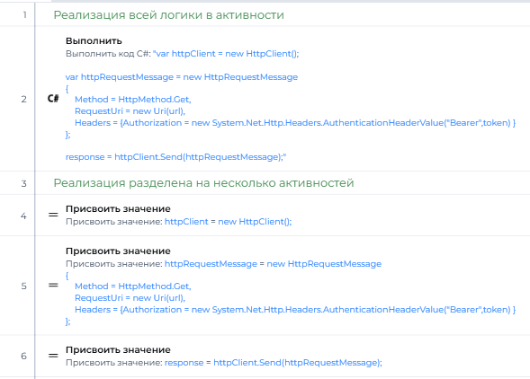

# Код и активности

Общие принципы написания кода робота. Они относятся и к C#-коду, и к скриптам PIX: в активностях скриптов вызываются те же функции и объекты, поэтому правила одни.

## Содержание

- [CODE-01. Соблюдайте соглашение о коде C#](#code-01-соблюдайте-соглашение-о-коде-c) — 🟡 Рекомендуется
- [CODE-02. Не повторяйтесь (DRY)](#code-02-не-повторяйтесь-dry) — 🟡 Рекомендуется
- [CODE-03. Оставляйте скрипту одну ответственность (SRP)](#code-03-оставляйте-скрипту-одну-ответственность-srp) — 🟡 Рекомендуется
- [CODE-04. Не размещайте большой код в активности «Выполнить»](#code-04-не-размещайте-большой-код-в-активности-выполнить) — 🟡 Рекомендуется
- [CODE-05. Делайте проще (KISS)](#code-05-делайте-проще-kiss) — 🟡 Рекомендуется
- [CODE-06. Не добавляйте функциональность впрок (YAGNI)](#code-06-не-добавляйте-функциональность-впрок-yagni) — 🟡 Рекомендуется
- [CODE-07. Программируйте защитно](#code-07-программируйте-защитно) — 🟡 Рекомендуется
- [CODE-08. Используйте минимальное количество аргументов](#code-08-используйте-минимальное-количество-аргументов) — 🟡 Рекомендуется
- [CODE-09. Избегайте булевых флагов в аргументах методов](#code-09-избегайте-булевых-флагов-в-аргументах-методов) — 🟡 Рекомендуется
- [CODE-10. Записывайте инициализацию коллекций в столбик](#code-10-записывайте-инициализацию-коллекций-в-столбик) — 🟡 Рекомендуется
- [CODE-11. Используйте активность «Комментарий» только для неочевидного](#code-11-используйте-активность-комментарий-только-для-неочевидного) — 🟡 Рекомендуется
- [CODE-12. Заменяйте часто вызываемые скрипты контейнерами (временное решение)](#code-12-заменяйте-часто-вызываемые-скрипты-контейнерами-временное-решение) — 🟢 По ситуации

## CODE-01. Соблюдайте соглашение о коде C#

🟡 **Рекомендуется**

Стандарт кода необходим для поддержания удобочитаемости кода, согласованности и совместной работы в команде разработчиков. Для PIX RPA особенно важно следовать единому стилю, так как это упрощает поддержку и развитие роботов разными сотрудниками.

### Основные соглашения о стиле кода

Базируйтесь на [официальных соглашениях о коде C#](https://learn.microsoft.com/ru-ru/dotnet/csharp/fundamentals/coding-style/coding-conventions) от Microsoft, адаптируя их к особенностям PIX RPA.

Правила оформления LINQ-запросов приведены в правиле [LINQ-01](linq.md#linq-01-форматируйте-linq-запросы).

[⬆ К содержанию](#содержание)

## CODE-02. Не повторяйтесь (DRY)

🟡 **Рекомендуется**

**Суть принципа:** Избегайте дублирования кода, логики и данных.

**Применение в PIX RPA:**
- Выделяйте повторяющуюся логику в отдельные скрипты или функции
- Создавайте универсальные утилитные методы для общих операций (парсинг дат, обработка файлов)
- Используйте параметризацию для адаптации скриптов к разным ситуациям

[⬆ К содержанию](#содержание)

## CODE-03. Оставляйте скрипту одну ответственность (SRP)

🟡 **Рекомендуется**

**Суть принципа:** Каждый модуль должен отвечать только за одну часть функциональности.

**Применение в PIX RPA:**
- Разделяйте скрипты по функциональному назначению
- Создавайте отдельные скрипты для каждого этапа обработки
- Избегайте "универсальных" скриптов, выполняющих множество разнородных действий

[⬆ К содержанию](#содержание)

## CODE-04. Не размещайте большой код в активности «Выполнить»

🟡 **Рекомендуется**

Активность **'Выполнить'** в PIX RPA позволяет вставлять и выполнять произвольный код на C# непосредственно в потоке процесса. Хотя эта возможность может показаться удобной для быстрого решения задач, неправильное её использование создаёт значительные проблемы при отладке, сопровождении и масштабировании роботов.

### Основные проблемы с большим кодом в активности 'Выполнить'

1. **Невозможность отладки**
   - Нельзя установить точки останова внутри кода
   - Невозможно отследить изменение переменных
   - Сложно локализовать ошибки в больших блоках кода

2. **Ухудшение читаемости процесса**
   - Логика "спрятана" в отдельных блоках кода
   - Сложно понять поток выполнения процесса
   - Трудно визуально оценить, что делает робот

3. **Сложности с повторным использованием**
   - Код внутри активности сложно переиспользовать в других процессах
   - Дублирование кода между разными роботами
   - Трудности с поддержкой однотипных решений



### Преимущества структурированного подхода

- **Улучшение отладки**: возможность установки точек останова, пошаговое выполнение
- **Повышение читаемости**: понятный визуальный поток процесса
- **Упрощение сопровождения**: легче вносить изменения, меньше риск ошибок

[⬆ К содержанию](#содержание)

## CODE-05. Делайте проще (KISS)

🟡 **Рекомендуется**

**Суть принципа:** Проектирование должно быть максимально простым и понятным.

**Применение в PIX RPA:**
- Отдавайте предпочтение простым и прямолинейным решениям
- Избегайте сложных условий и глубоких вложений
- Используйте понятные имена и структуру кода

[⬆ К содержанию](#содержание)

## CODE-06. Не добавляйте функциональность впрок (YAGNI)

🟡 **Рекомендуется**

**Суть принципа:** Не добавляйте функциональность, пока она реально не потребуется.

**Применение в PIX RPA:**
- Реализуйте только необходимую для текущих требований функциональность
- Не усложняйте код гипотетическими сценариями
- Внедряйте проверки и обработку только для реальных ситуаций

[⬆ К содержанию](#содержание)

## CODE-07. Программируйте защитно

🟡 **Рекомендуется**

**Суть принципа:** Предполагайте возможные проблемы и защищайтесь от них.

**Применение в PIX RPA:**
- Проверяйте наличие динамичных UI-элементов перед взаимодействием
- Обрабатывайте граничные случаи и пустые значения
- Используйте значения по умолчанию и резервные пути выполнения

[⬆ К содержанию](#содержание)

## CODE-08. Используйте минимальное количество аргументов

🟡 **Рекомендуется**

Большое количество аргументов в функциях и скриптах усложняет понимание, тестирование и поддержку кода. Стремитесь к минимально необходимому количеству параметров.

### Основные рекомендации:

- **Оптимальное количество**: стремитесь к 0-3 аргументам в большинстве функций
- **Максимальное количество**: избегайте более 5 аргументов в функции
- **Связанные аргументы** лучше объединять в единую структуру (словарь, объект)
- **Порядок аргументов**: обязательные аргументы идут первыми, необязательные с дефолтными значениями - последними

### Признаки проблем с количеством аргументов:
- Функция принимает более 5 параметров
- Несколько аргументов связаны между собой логически
- Вызов функции требует длинного списка параметров
- Сложно запомнить порядок и назначение аргументов
- Большинство вызовов используют одинаковые значения для некоторых аргументов

### Особенности применения в PIX RPA:
- **Для хранения сложных аргументов** используйте Dictionary или DataTable, если нельзя создать отдельный класс

[⬆ К содержанию](#содержание)

## CODE-09. Избегайте булевых флагов в аргументах методов

🟡 **Рекомендуется**

Булевые флаги в аргументах методов (boolean parameters) сигнализируют о нарушении принципа единственной ответственности (SRP). Когда метод принимает булевый флаг, это обычно означает, что он выполняет две разные функции в зависимости от значения флага.

### Проблемы с булевыми флагами

**Нарушение принципа единственной ответственности**
- функция выполняет разные действия в зависимости от значения флага
- Увеличивается сложность метода и вероятность ошибок

**Снижение читаемости кода**
- При вызове метода неясно, что означает `true` или `false`
- Приходится обращаться к документации или исходному коду для понимания

**Усложнение поддержки**
- При добавлении новой функциональности возникает соблазн добавить еще один флаг
- Со временем количество флагов и сложность кода растут

### Решение: разделение скриптов

Вместо использования булевых флагов, создавайте отдельные методы для каждой функции:
Например вместо CreateFile → CreateFile, CreateTempFile

### Особенности для PIX RPA

В контексте PIX RPA избегание булевых флагов особенно важно:

**В активностях кода C#**: разделяйте методы и функции по принципу единственной ответственности.

**При работе с аргументами робота**: предпочитайте определение конкретных аргументов вместо флагов:

### Преимущества подхода без булевых флагов

- **Улучшение читаемости**: код становится более понятным и самодокументируемым
- **Упрощение поддержки**: изменения и расширения проще вносить в специализированные методы
- **Облегчение тестирования**: каждый метод имеет одну функцию и проще тестируется
- **Повышение гибкости**: легче комбинировать функциональность при необходимости
- **Соблюдение SOLID принципов**: особенно Single Responsibility Principle

### Когда использование булевых флагов может быть оправдано

В некоторых случаях булевые флаги могут быть допустимы:

- **Незначительные вариации поведения**: например, `includeHeaders: true/false`
- **Стандартные API и паттерны**: например, `StringComparison.OrdinalIgnoreCase`
- **Простые настройки без изменения основной функциональности**

[⬆ К содержанию](#содержание)

## CODE-10. Записывайте инициализацию коллекций в столбик

🟡 **Рекомендуется**

Если коллекция инициализируется несколькими значениями (список свойств, словарь настроек, массив форматов), записывайте каждый элемент на отдельной строке. Такую запись быстрее читать, в ней легко найти нужный элемент, а в истории Git изменение одного элемента затрагивает одну строку.

```csharp
// ❌ Плохо: все значения в одну строку
new List<string> { "inn", "dateFirstReg", "shortNameRus", "okved", "charterCapital", "leader", "legalAddresses", "www" }

// ✅ Хорошо: одно значение — одна строка
new List<string>
{
    "inn",
    "dateFirstReg",
    "shortNameRus",
    "okved",
    "charterCapital",
    "leader",
    "legalAddresses",
    "www"
}
```

Правило относится и к значениям свойств активностей PIX RPA: в редакторе свойства многострочная запись читается так же удобно, как в коде. Для двух-трех коротких значений допустима запись в одну строку: `new[] { "dd.MM.yyyy", "yyyy-MM-dd" }`.

[⬆ К содержанию](#содержание)

## CODE-11. Используйте активность «Комментарий» только для неочевидного

🟡 **Рекомендуется**

Активность "Комментарий" в PIX RPA часто используется для добавления пояснений к процессу, однако её чрезмерное применение может негативно сказаться на читаемости и поддерживаемости робота.

### Основные проблемы избыточных комментариев

- **Визуальный шум**: большое количество комментариев перегружает схему процесса
- **Устаревание информации**: комментарии часто не обновляются при изменении логики
- **Дублирование**: комментарии повторяют то, что должно быть понятно из структуры процесса
- **Ложное чувство документированности**: наличие комментариев не гарантирует понимания процесса

### Вместо активности "Комментарий" используйте:

1. **Понятные имена переменных и активностей**:
   - `totalInvoiceAmount` вместо `temp1`
   - `GetCustomerDetails` вместо `Process Data`

2. **Структурированные последовательности**:
   - Группируйте логически связанные активности
   - Используйте вложенные последовательности с говорящими именами

3. **Осмысленные имена аргументов**:
   - `ReportDestinationFolder` вместо `Folder` или `Path`

4. **Документацию на уровне процесса**:
   - Описывайте назначение и логику работы процесса на стартовой странице робота
   - Создавайте отдельный документ с описанием архитектуры и бизнес-логики

### Когда использовать активность "Комментарий"

Используйте активность "Комментарий" только в следующих случаях:

1. **Временные метки и напоминания**:
   ```
   TODO: Обновить логику расчета после получения новых требований (Ожидается к 15.05.2023)
   ```

2. **Документирование неочевидных решений**:
   ```
   Используем Thread.Sleep(3000) из-за задержек в отображении элемента на странице, даже когда селектор уже найден
   ```

3. **Пояснение сложных бизнес-правил**:
   ```
   Если сумма > 1000000, требуется дополнительное подтверждение согласно регламенту Fin-2023/05
   ```

4. **Маркировка критичных участков**:
   ```
   ВНИМАНИЕ! Не изменять последовательность операций — влияет на формирование итоговой суммы
   ```

### Рекомендации для самодокументируемых процессов

1. **Используйте осмысленные имена для всех элементов**:
   - Называйте переменные и активности так, чтобы их назначение было очевидно
   - Избегайте сокращений, неясных аббревиатур и технического жаргона

2. **Структурируйте процесс логически**:
   - Группируйте связанные действия
   - Используйте подпроцессы для выделения повторяющейся логики

3. **Соблюдайте баланс**:
   - Полное отсутствие документации так же вредно, как и её избыток
   - Документируйте то, что неочевидно, а не то, что и так понятно

4. **Поддерживайте документацию в актуальном состоянии**:
   - Обновляйте комментарии при изменении логики
   - Удаляйте устаревшие комментарии

[⬆ К содержанию](#содержание)

## CODE-12. Заменяйте часто вызываемые скрипты контейнерами (временное решение)

🟢 **По ситуации**

- Если скрипт часто вызывается, замените его на контейнер (пока не решится вопрос логами)

[⬆ К содержанию](#содержание)
