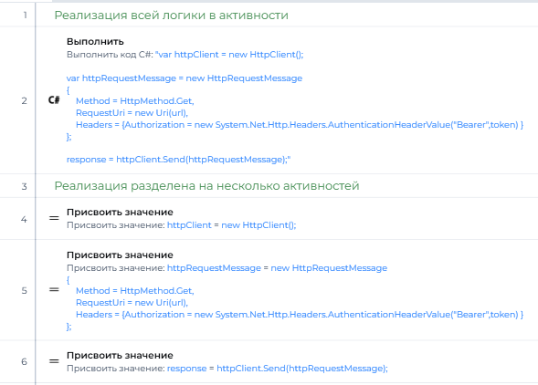
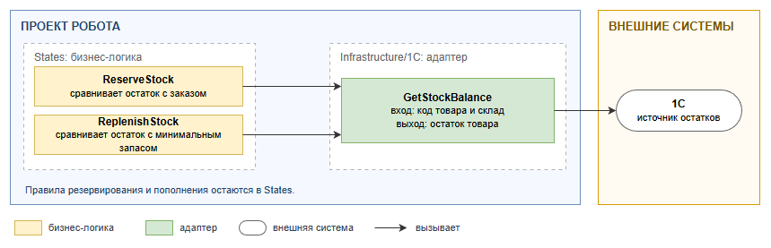

# Код и активности

Правила оформления C#-кода и работы со скриптами PIX.

## Содержание

- [CODE-01. Соблюдайте принятые соглашения о коде](#code-01-соблюдайте-принятые-соглашения-о-коде) (🔴 Обязательно)
- [CODE-02. Проверяйте данные перед использованием (валидация)](#code-02-проверяйте-данные-перед-использованием-валидация) (🔴 Обязательно)
- [CODE-03. Не размещайте большой код в активности «Выполнить»](#code-03-не-размещайте-большой-код-в-активности-выполнить) (🔴 Обязательно)
- [CODE-04. Поручайте скрипту одну задачу](#code-04-поручайте-скрипту-одну-задачу) (🟡 Рекомендуется)
- [CODE-05. Выносите общую логику в одно место](#code-05-выносите-общую-логику-в-одно-место) (🟡 Рекомендуется)
- [CODE-06. Передавайте скрипту только необходимые параметры](#code-06-передавайте-скрипту-только-необходимые-параметры) (🟡 Рекомендуется)
- [CODE-07. Не комментируйте очевидные действия](#code-07-не-комментируйте-очевидные-действия) (🟡 Рекомендуется)
- [Принципы программирования в RPA](#принципы-программирования-в-rpa) (📘 Справка)

## CODE-01. Соблюдайте принятые соглашения о коде

🔴 **Обязательно**

Оформляйте C#-код, в том числе выражения в свойствах активностей PIX, по согласованным требованиям проекта. Если требования компании и заказчика расходятся, согласуйте их до применения. В вопросах, которые не описаны в проекте, опирайтесь на [соглашения Microsoft для C#](https://learn.microsoft.com/ru-ru/dotnet/csharp/fundamentals/coding-style/coding-conventions). Имена параметров и переменных оформляйте по [правилам проекта](variable.md).

- Пишите `string` и `int` вместо `System.String` и `System.Int32`.
- Для шаблонов в коде предпочитайте интерполяцию, например `$"Заказ {orderNumber}"`. Подставляемые значения видны рядом с текстом. Для внешних шаблонов выбирайте способ по формату заполнителей. Простые именованные заполнители вроде `{email}` можно заменять через `Replace`, а позиционные `{0}`, `{1}` с форматированием обрабатывать через `string.Format`. Подробнее о способах сборки строк в [разделе «Строки»](string.md).
- Называйте результат LINQ-запроса по содержимому, например `activeCustomers` для списка активных клиентов. Длинные цепочки методов записывайте по одному вызову на строку с отступом. См. [LINQ-01](linq.md#linq-01-форматируйте-linq-запросы).
- Короткий список можно записать в одну строку. Если версия C# в проекте поддерживает выражения коллекций, используйте запись вроде `string[] formats = ["dd.MM.yyyy", "yyyy-MM-dd"];`. Для длинного списка записывайте по одному элементу на строку, чтобы было проще найти и изменить нужное значение в свойстве активности. В справочнике есть [пример создания списка из двух коллекций](csharp.md#создать-коллекцию-и-включить-элементы-другой).

[⬆ К содержанию](#содержание)

## CODE-02. Проверяйте данные перед использованием (валидация)

🔴 **Обязательно**

При [валидации](../glossary.md#проверка-данных) проверяйте структуру данных, наличие обязательных значений, их формат и допустимость по правилам процесса. Для каждой операции проверяйте только те условия, от которых зависит её корректное выполнение.

Неподходящее значение может вызвать сбой через несколько шагов после получения данных. Проверяйте данные до операции, чтобы робот мог сообщить, какое условие нарушено.

**Где проверять данные.** При получении или разборе данных проверяйте структуру и формат, которые нужны для дальнейшей обработки. Перед операцией проверяйте дополнительные [предусловия](../glossary.md#проверка-данных), которые ещё не гарантированы. Например, адрес получателя проверяйте только в ветке отправки письма.

| Когда | Что проверить |
|---|---|
| При чтении Excel-файла по согласованному шаблону | Нужный лист существует и содержит обязательные колонки. Например, на листе «Заявки» есть «Номер заявки» и «ИНН». Даже фиксированный шаблон пользователь может изменить. |
| Перед поиском контрагента по ИНН | Значение заполнено и соответствует требованиям к ИНН для этого процесса. При нарушении сообщите об ошибке исходных данных. Пустой запрос не должен приводить к результату «Контрагент не найден». |
| Перед отправкой письма | Адрес получателя заполнен и имеет формат, который принимает почтовый компонент. Проверка формата не подтверждает существование ящика. |
| При разборе дат и подготовке отчёта | Если источник задаёт формат `dd.MM.yyyy`, разбирайте дату в этом формате. Успешный разбор подтверждает формат. Для отчётного периода отдельно проверьте, что начало не позже окончания. |
| Перед записью цены после скидки | Если процесс запрещает отрицательную цену, результат расчёта должен быть не меньше нуля. Не исправляйте ошибочный расчёт молчаливой заменой на ноль. |
| После поиска заказа перед его изменением | Результат однозначен и относится к нужному заказу. Если по уникальному номеру найдено несколько записей, не выбирайте первую без предусмотренного процессом правила. |

Структуру файла проверяйте один раз при чтении, обязательные значения в каждой обрабатываемой строке. Порядок и точный состав колонок проверяйте там, где от них зависит обработка. Дополнительные листы и колонки допустимы, если они ей не мешают.

Настройки и входные параметры запуска проверяйте в Init по [TEMPLATE-03](../1-project/template.md#template-03-проверяйте-в-init-настройки-и-доступ-ко-всем-системам-робота).

**Когда не повторять проверку.** Полагайтесь на проверку вызывающего скрипта, пока её результат остаётся в силе. Например, если расчёт скидки сохраняет [инвариант](../glossary.md#проверка-данных) и возвращает цену не меньше нуля, следующему скрипту не нужно проверять её заново. Если последующее изменение данных может нарушить условие, проверьте его снова.

**Что делать, если проверка не прошла.** Не выполняйте операцию с неподходящими данными. Дальнейшее действие зависит от причины и от того, что предусмотрено процессом:

| Ситуация | Как обработать |
|---|---|
| Сценарий предусматривает отдельную ветку для такого результата | **Верните явный результат.** Например, парсер возвращает «Дата не распознана», а сценарий берёт дату из другого источника, если это предусмотрено процессом. |
| Заявка нарушает обязательное условие, и обработать её по правилам процесса нельзя | **Выбросьте бизнес-исключение.** Например, в строке не заполнен обязательный ИНН. Укажите, что нужно исправить в заявке. |
| Робот не смог получить или проверить данные из-за системного сбоя либо неверной настройки | **Передайте техническое исключение обработчику.** Например, робот не смог открыть реестр из-за блокировки файла. Сохраните исходную причину сбоя. |

Если операция завершилась и данных действительно нет, обработайте пустой результат по правилам процесса. Сбой получения данных передавайте обработчику.

Тип исключения выбирайте по [ERROR-03](error.md#error-03-разделяйте-бизнес-исключения-и-технические-исключения), сообщение оформляйте по [ERROR-04](error.md#error-04-указывайте-источник-исключения). Укажите нарушенное условие, не копируя исходное значение поля.

Значение по умолчанию используйте только там, где оно предусмотрено процессом.

[⬆ К содержанию](#содержание)

## CODE-03. Не размещайте большой код в активности «Выполнить»

🔴 **Обязательно**

В активности «Выполнить» оставляйте короткие выражения и простые операции. Многошаговую логику разбивайте на отдельные активности, чтобы между шагами можно было остановить выполнение и проверить значения переменных.

**Почему это важно для отладки.** В отладчике PIX Studio C#-код внутри одной активности «Выполнить» выполняется целиком. Внутри него нельзя поставить точку остановки на отдельной строке и пройти код по шагам. Если в блоке на сотню строк возникает ошибка или получается неверный результат, приходится добавлять временное логирование либо разбирать блок на части, чтобы найти причину.

**Как разделять шаги.** Выделяйте в отдельные активности операции, результат которых нужно проверять отдельно. На скриншоте так разделена работа с HTTP-запросом. В рабочем роботе создавайте `HttpClient` в Init и передавайте его скрипту по [INTEGRATION-03](../3-integrations/integration.md#integration-03-создавайте-httpclient-один-раз-на-запуск-робота).

Связное преобразование одного значения можно оставить в одной активности. Если несколько шагов образуют самостоятельную задачу, вынесите их в отдельный скрипт и сохраните разделение на активности.

> [!IMPORTANT]
> **Исключение для COM/Interop в PIX Studio 3.2.1 и более ранних версиях.** Требование разделять код на активности не распространяется на связанную работу с COM-объектами через Interop. При разделении такого кода между активностями теряется контекст и содержимое COM-объектов. Получение объектов, операции с ними и освобождение ресурсов выполняйте в одной активности «Выполнить». Подготовку входных данных и обработку результата можно вынести отдельно, если они не требуют передачи COM-объектов между активностями.
>
> Для диагностики логируйте основные этапы и указывайте операцию, на которой произошёл сбой. Освобождайте ресурсы и при исключении. Ошибку передавайте обработчику.
>
> В более новых версиях Studio это поведение ещё нужно проверить. Обновите исключение, если проверка подтвердит, что контекст и содержимое COM-объектов сохраняются между активностями.

К коду, сгенерированному языковой моделью, применяйте те же правила. При сбое проверяйте промежуточные значения, чтобы установить причину.

[⬆ К содержанию](#содержание)

## CODE-04. Поручайте скрипту одну задачу

🟡 **Рекомендуется**

По принципу единственной ответственности каждый скрипт отвечает за одну задачу. Объединяйте в нём шаги, которые решают эту задачу, и называйте скрипт по действию. См. [NAMING-03](../1-project/naming.md#naming-03-называйте-скрипт-по-тому-что-он-делает).

**Когда разделять скрипт.** Выносите шаги в разные скрипты, если требования к ним меняются независимо. Например, поиск заказа в 1С и отправку итогового отчёта можно разделить на `FindOrder` и `SendReport`. Тогда смена получателей отчёта не затронет поиск, а поиск можно проверить без отправки письма.

В активности «Выполнить скрипт» имя параметра видно рядом со значением. Булевый параметр подходит для настройки одной операции. Например, `in_IncludeHeaders` задаёт, добавлять ли заголовки при выгрузке таблицы.

Если по флагу скрипт выбирает между самостоятельными операциями, разделите их. Например, вместо одного скрипта с параметром `in_IsCancellation` вызывайте `UpdateOrder` для изменения заказа или `CancelOrder` для отмены.

Открытие приложения и вход можно оставить в одном скрипте `PrepareApplication`, если робот выполняет их вместе, чтобы подготовить приложение к работе.

Если обработка заявки состоит из нескольких шагов, их порядок можно поручить сценарию транзакции. Например, сценарий вызывает `FindOrder`, проверяет результат поиска и передаёт найденный заказ в скрипт обработки. См. [«Сценарий транзакции»](../1-project/template.md#сценарий-транзакции-паттерн-transaction-script).

[⬆ К содержанию](#содержание)

## CODE-05. Выносите общую логику в одно место

🟡 **Рекомендуется**

Выносите повторяющуюся проверку или операцию в общий скрипт, если при изменении правила пришлось бы исправить все её копии.

- Если робот отправляет одно и то же уведомление из нескольких блоков `Catch`, перенесите отправку в общий обработчик. Передавайте ему исключение, если шаг не может обработать его сам. Тогда для смены шаблона письма хватит одной правки. См. [ERROR-06](error.md#error-06-обрабатывайте-исключения-на-правильном-уровне-абстракции).
- Если несколько операций в 1С копируют одни и те же активности поиска остатка, вынесите их в `GetStockBalance`. Передавайте ему код товара и склад. Скрипт возвращает остаток, а каждая операция сама решает, хватает ли этого количества.

Оставляйте похожую логику раздельной, если требования к ней меняются независимо. Например, формулы розничной скидки и компенсации за возврат могут совпадать. Изменение условий скидки не должно менять расчёт компенсации.

[⬆ К содержанию](#содержание)

## CODE-06. Передавайте скрипту только необходимые параметры

🟡 **Рекомендуется**

В активности «Выполнить скрипт» передавайте данные, которые нужны вызываемому скрипту. По аргументам должно быть видно, что подготовить для его запуска или теста.

| Что нужно скрипту | Как передать |
|---|---|
| Отдельные значения | Возьмите из `config` рабочую папку и шаблон имени файла. Скрипту поиска отчёта передайте эти значения как `in_WorkFolder` и `in_FileNamePattern`. |
| Данные одной сущности | Для строки реестра нужны номер, дата и сумма счёта. Если скрипты проекта уже обмениваются объектами типа `Invoice`, передайте счёт одним аргументом `in_Invoice`. |
| Набор настроек окружения | Скрипт подготовки окружения проверяет рабочие папки, доступ к системам и наличие очередей. Передайте ему `config` и укажите, какие ключи он читает. Состав словаря описан в [CONFIG-07](../1-project/config.md#config-07-храните-в-config-только-настройки). |

Длинный список аргументов сам по себе не повод передавать весь `config` или вводить новый тип. Если список растёт, проверьте, все ли данные нужны скрипту и относятся ли они к одной задаче. См. [CODE-04](#code-04-поручайте-скрипту-одну-задачу).

[⬆ К содержанию](#содержание)

## CODE-07. Не комментируйте очевидные действия

🟡 **Рекомендуется**

Убирайте комментарии, которые повторяют название активности или описывают очевидное действие. Например, переименуйте «Присвоить значение» в «Сохранить номер заказа». В схеме будет видно новое имя, и комментарий «Сохраняем номер заказа» станет лишним.

Если без комментария трудно понять, что делает блок, упростите его. Разделите блок на шаги и объедините связанные активности в последовательность с понятным названием. Самостоятельную операцию вынесите в отдельный скрипт, если её удобнее проверять отдельно.

Используйте активность «Комментарий» рядом с шагом, если нужно сохранить причину решения, ограничение системы или требование из ТЗ.

| Когда нужен комментарий | Что написать |
|---|---|
| Порядок действий зависит от поведения системы | «Печатная форма использует номер проводки. Печатаем после проведения документа». |
| На шаг влияет отдельное требование из ТЗ | «По п. 4.2 ТЗ счета на сумму свыше 1 000 000 рублей требуют второго согласования». |
| Временное решение нужно убрать после исправления | «TODO SUP-1234. Убрать повторный запрос после исправления API склада». |

Если меняете шаг, проверьте, что комментарий ещё верен. Удаляйте комментарий вместе с шагом, к которому он относится.

[⬆ К содержанию](#содержание)

## Принципы программирования в RPA

📘 **Справка**

### Скрипты как функции

В визуальном RPA процесс делят на задачи, которые можно запускать отдельно. В PIX мы собираем робота из скриптов и вызываем их как функции. Каждый скрипт выполняет одну задачу, получает данные через параметры и при необходимости возвращает результат. Сценарий задаёт порядок вызовов. Такое разбиение называют **функциональной декомпозицией**.

Для сценария достаточно скриптов и их параметров. Объектно-ориентированное программирование (ООП) может пригодиться внутри C#-кода или при разработке собственных активностей.

### SRP. Поручайте скрипту одну задачу

Допустим, один скрипт считает сумму счёта и отправляет письмо с результатом. Бухгалтерия просит изменить расчёт скидки, а отдел сопровождения просит добавить в письмо новые поля. Обе правки приходится вносить в один скрипт, хотя требования к расчёту и письму меняются независимо.

Выделите эти задачи в два скрипта. `CalculateInvoiceTotal` считает сумму и возвращает её. `SendInvoiceNotification` получает готовую сумму и отправляет письмо. Сценарий вызывает их по порядку. Теперь при изменении письма вы работаете со скриптом отправки, а расчёт можно проверить отдельно без рассылки.

Так в RPA можно применять принцип единственной ответственности, Single Responsibility Principle (SRP), из SOLID. Роберт Мартин объясняет его через причины изменения кода. Части, которые меняются по одним требованиям, держат вместе. Части с независимыми требованиями разделяют. [Объяснение Роберта Мартина](https://blog.cleancoder.com/uncle-bob/2014/05/08/SingleReponsibilityPrinciple.html).

Внутри одной задачи может быть несколько шагов. Например, скрипт отправки письма собирает тему и текст, добавляет вложение и отправляет сообщение. Эти действия можно оставить вместе. Критерии разделения скриптов описаны в [CODE-04](#code-04-поручайте-скрипту-одну-задачу).

### DRY. Выносите общую логику в один скрипт

`ReserveStock` проверяет, хватает ли товара для заказа. `ReplenishStock` решает, пора ли пополнить склад. Оба сценария вызывают `GetStockBalance`, чтобы получить остаток из 1С. Если способ чтения остатка изменится, правка понадобится в одном скрипте. Решения о резервировании и пополнении остаются в своих сценариях. См. [CODE-05](#code-05-выносите-общую-логику-в-одно-место).

### Слабая связанность. Передавайте скрипту нужные данные

Передайте в `GetStockBalance` код товара и склад отдельными параметрами. Если в заказе изменится поле, из которого берут код товара, поправьте подготовку параметров в сценарии заказа. Скрипт чтения остатка продолжит получать код товара и склад в прежнем виде. См. [CODE-06](#code-06-передавайте-скрипту-только-необходимые-параметры).

### KISS. Выбирайте простое решение для текущей задачи

Чтобы проверить, хватает ли товара для заказа, сравните остаток с количеством в заказе. Для этого подойдёт условие `stockBalance >= requestedQuantity`. Для заказа на пять единиц остатка в четыре не хватит, а при остатке в пять проверка пройдёт. Пока правило сводится к одному сравнению, оставьте условие прямо в сценарии.

### YAGNI. Реализуйте то, что уже нужно процессу

Пока робот читает остатки только из 1С, ему достаточно одного адаптера. Добавляйте выбор источника и второй адаптер, когда появится требование получать остатки из другой системы.

[⬆ К содержанию](#содержание)
