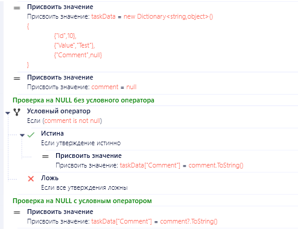
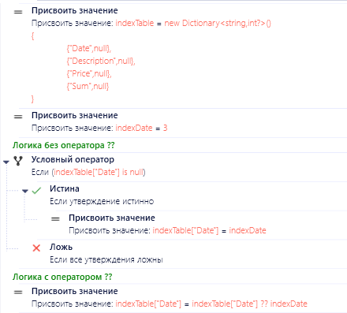
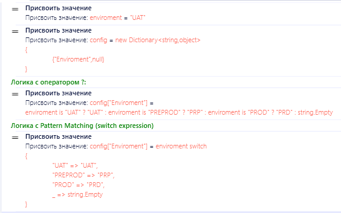

# Условия и условные операторы

Как писать условия в скриптах и коде, чтобы логику робота можно было прочитать с одного взгляда.

## Содержание

- [CONDITION-01. Используйте выражения для простого выбора значения](#condition-01-используйте-выражения-для-простого-выбора-значения) (🟡 Рекомендуется)
- [CONDITION-02. Избегайте глубоких вложений в скриптах](#condition-02-избегайте-глубоких-вложений-в-скриптах) (🟡 Рекомендуется)
- [CONDITION-03. Избегайте отрицательных условий](#condition-03-избегайте-отрицательных-условий) (🟡 Рекомендуется)
- [CONDITION-04. Избегайте громоздких if-else конструкций](#condition-04-избегайте-громоздких-if-else-конструкций) (🟡 Рекомендуется)
- [Применение в PIX RPA](#применение-в-pix-rpa)

## CONDITION-01. Используйте выражения для простого выбора значения

🟡 **Рекомендуется**

Если обе ветки условия только присваивают значение одной переменной, запишите простой выбор в выражении активности «Присвоить значение». Так варианты значения видны рядом, без перехода между ветками схемы.

Оставляйте отдельные ветки, если робот выполняет разные действия: отправляет письмо, записывает файл или вызывает скрипт. Разделяйте выражение на шаги, если промежуточные результаты нужно проверять при отладке.

### Как выбрать выражение

| Задача | Выражение | Что происходит |
|---|---|---|
| Выбрать одно из двух значений | `hasAttachments ? "С вложениями" : "Без вложений"` | При `true` результатом будет «С вложениями», при `false` «Без вложений». |
| Обратиться к объекту, который может быть `null` | `comment?.Trim()` | При `null` результат тоже `null`. Иначе `Trim()` уберёт пробелы по краям строки. |
| Подставить значение при `null` | `comment ?? "Без комментария"` | Возвращает `comment`, если он не равен `null`. При `null` возвращает «Без комментария». |
| Выбрать значение по нескольким вариантам | `switch`-выражение | Сопоставляет исходное значение с вариантами, как в примере с кодами контуров ниже. |

В C#-коде также можно использовать `comment ??= "Без комментария"`. Этот оператор записывает текст в саму переменную, только если она равна `null`.

### Доступ к объекту через `?.`

На скриншоте робот записывает в `taskData["Comment"]` результат `comment?.ToString()`. Если `comment` равен `null`, результат тоже `null`. Иначе робот вызывает `ToString()` и получает строковое представление значения.



В этом примере исходное значение `taskData["Comment"]` равно `null`. Если `comment` равен `null`, а в словаре уже был текст, варианты поведут себя по-разному: пустая ветка сохранит текст, а присваивание результата `comment?.ToString()` запишет `null`. При сокращении условия сохраняйте нужное поведение.

### Значение по умолчанию через `??`

На скриншоте ключ `"Date"` существует, но его значение равно `null`. Выражение `indexTable["Date"] ?? indexDate` выбирает запасной индекс из `indexDate`. Если текущий индекс задан, робот сохраняет его.



### Несколько вариантов через `switch`

Для нескольких вариантов используйте `switch`-выражение, если вложенные операторы `?:` трудно читать. На скриншоте робот сопоставляет названию контура короткий код: `"UAT"` соответствует `"UAT"`, `"PREPROD"` соответствует `"PRP"`, `"PROD"` соответствует `"PRD"`. Результат записывается в `config["Environment"]`.



Ветка `_ => string.Empty` возвращает пустую строку для остальных значений. Если неизвестный контур означает ошибку настройки, проверьте его до преобразования или выбросьте исключение в этой ветке.

### Оформляйте проверки предусловий как guard clauses

Guard clause, или защитная проверка, проверяет причину, по которой операцию нельзя продолжать, и сразу прекращает её выполнение. Размещайте такие проверки перед основной логикой. При отказе верните предусмотренный результат или выбросьте исключение по [CODE-02](code.md#code-02-проверяйте-данные-перед-использованием-валидация).

Например, перед отправкой письма проверьте `string.IsNullOrWhiteSpace(customerEmail)`. Если адрес обязателен и не заполнен, выбросьте исключение. После проверки размещайте отправку письма без дополнительной ветки `else`.

Применяйте этот подход к предусловиям. Для выбора между обычными действиями процесса сохраняйте ветки `if-else`.

### Учитывайте границы проверок

`?.` и `?[]` проверяют объект слева от оператора на `null`. Например, `items?[0]` вернёт `null`, если коллекция равна `null`, но при обращении к пустому массиву или списку возникнет исключение. `?[]` также не проверяет наличие ключа в словаре. Если допустимый индекс или наличие ключа ещё не гарантированы, проверьте их перед обращением.

Операторы `??` и `??=` срабатывают только для `null`. Пустая строка и строка из пробелов останутся без изменений.

Используйте запасные значения, когда они предусмотрены процессом. Например, для необязательного комментария допустим текст «Без комментария». Обязательные данные проверяйте до использования, как в примере защитной проверки выше.

Синтаксис операторов: [`?:`](https://learn.microsoft.com/ru-ru/dotnet/csharp/language-reference/operators/conditional-operator), [`?.` и `?[]`](https://learn.microsoft.com/ru-ru/dotnet/csharp/language-reference/operators/member-access-operators#null-conditional-operators--and-), [`??` и `??=`](https://learn.microsoft.com/ru-ru/dotnet/csharp/language-reference/operators/null-coalescing-operator), [`switch`-выражение](https://learn.microsoft.com/ru-ru/dotnet/csharp/language-reference/operators/switch-expression).

Примеры операторов, `switch` и защитных проверок, которые можно запустить в C#, собраны в [справочнике по синтаксису](csharp.md#базовые-конструкции-появившиеся-до-c-10).

[⬆ К содержанию](#содержание)

## CONDITION-02. Избегайте глубоких вложений в скриптах

🟡 **Рекомендуется**

Держите основной путь обработки на виду. Если для действия «Создать заказ» приходится подниматься по схеме и искать, в каких ветках робот уже побывал, разберите эти условия по назначению. На третьем уровне вложенности проверьте, можно ли упростить схему или код.

- **Предусловие для всей операции.** Если его ещё не проверили, поставьте защитную проверку перед основной логикой. Прервите операцию с результатом или исключением по [CODE-02](code.md#code-02-проверяйте-данные-перед-использованием-валидация).
- **Пропуск элемента.** Если элемент по правилам процесса можно пропустить, сделайте это в начале итерации. В C# для перехода к следующему элементу используйте `continue`.
- **Самостоятельный шаг.** Если в ветке появилась отдельная задача, например построение отчёта, вынесите её в скрипт с понятным именем. Критерии разделения описаны в [CODE-04](code.md#code-04-поручайте-скрипту-одну-задачу).

Оставляйте вложенность, когда следующий шаг зависит от предыдущего. Например, проверяйте статус заказа в ветке, где робот уже нашёл заказ. Объединяйте короткие проверки, если они ведут к одному действию и по выражению по-прежнему понятно, что проверяет робот.

### Пример обработки выгрузки

Робот собирает номера заказов для отчёта. Если в выгрузке нет обязательных колонок, он останавливает обработку. Отменённые заказы пропускает, у остальных проверяет номер.

Во вложенном варианте добавление номера в список находится внутри проверки выгрузки, цикла и проверки статуса строки.

```csharp
static List<string> GetOrderNumbers(
    bool hasRequiredColumns,
    IEnumerable<(string OrderNumber, bool IsCancelled)> rows)
{
    var orderNumbers = new List<string>();

    if (hasRequiredColumns)
    {
        foreach (var row in rows)
        {
            if (!row.IsCancelled)
            {
                if (string.IsNullOrWhiteSpace(row.OrderNumber))
                {
                    throw new FormatException("В строке выгрузки нет номера заказа.");
                }

                orderNumbers.Add(row.OrderNumber);
            }
        }

        return orderNumbers;
    }

    throw new FormatException("В выгрузке нет обязательных колонок.");
}
```

После упрощения видно, что робот сначала проверяет выгрузку, а в цикле пропускает отменённые строки до проверки номера. Оба варианта одинаково обрабатывают этот набор входных данных, включая ошибки.

```csharp
static List<string> GetOrderNumbers(
    bool hasRequiredColumns,
    IEnumerable<(string OrderNumber, bool IsCancelled)> rows)
{
    if (!hasRequiredColumns)
    {
        throw new FormatException("В выгрузке нет обязательных колонок.");
    }

    var orderNumbers = new List<string>();
    foreach (var row in rows)
    {
        if (row.IsCancelled)
        {
            continue;
        }

        if (string.IsNullOrWhiteSpace(row.OrderNumber))
        {
            throw new FormatException("В строке выгрузки нет номера заказа.");
        }

        orderNumbers.Add(row.OrderNumber);
    }

    return orderNumbers;
}
```

В схеме PIX придерживайтесь того же порядка. Проверка колонок стоит перед циклом, а шаги обработки строки выполняются только для заказов, которые идут в отчёт.

[⬆ К содержанию](#содержание)

## CONDITION-03. Избегайте отрицательных условий

🟡 **Рекомендуется**

Использование отрицательных условий (с операторами отрицания) усложняет понимание кода, так как человеческий мозг обрабатывает положительные утверждения легче, чем отрицательные.

### Почему отрицательные условия создают проблемы

1. **Когнитивная нагрузка**
   - Человеческому мозгу требуется больше усилий для обработки отрицаний
   - Двойные отрицания особенно трудны для понимания
   - Негативная логика менее интуитивна

2. **Снижение ясности**
   - Отрицательные условия часто приводят к путанице
   - Утверждения "не не X" требуют дополнительного умственного преобразования
   - Сложнее понять намерение кода

3. **Увеличение вероятности ошибок**
   - Легче допустить логическую ошибку при отрицательной логике
   - Сложнее отлаживать отрицательные условия
   - Больше шансов неправильно интерпретировать условие

### Примеры отрицательных условий

```csharp
// ❌ Плохо: отрицательное условие
if (!isInvalid)
{
    // Выполнить действие
}

// ❌ Плохо: двойное отрицание
if (!customer.IsNotActive)
{
    // Выполнить действие для активного клиента?
}

// ❌ Плохо: отрицание сложного условия
if (!(age >= 18 && hasParentalConsent))
{
    // Сложно быстро понять эту логику
}

// ❌ Плохо: отрицательное условие с оператором else
if (!isValid)
{
    // Обработка невалидного случая
}
else
{
    // Обработка валидного случая
}
```

### Решение: используйте положительные условия

```csharp
// ✅ Хорошо: положительное условие
if (isValid)
{
    // Выполнить действие
}

// ✅ Хорошо: использование понятной переменной
bool isActive = !customer.IsNotActive;
if (isActive)
{
    // Выполнить действие для активного клиента
}

// ✅ Хорошо: переформулировка сложного условия
bool isMinorWithoutConsent = age < 18 || !hasParentalConsent;
if (isMinorWithoutConsent)
{
    // Логика теперь понятнее
}

// ✅ Хорошо: поменять порядок блоков для использования положительного условия
if (isValid)
{
    // Обработка валидного случая
}
else
{
    // Обработка невалидного случая
}
```

### Особые случаи использования отрицания

Существуют ситуации, когда отрицательные условия могут быть уместны:

1. **Guard Clauses (защитные условия)**
   ```csharp
   // Допустимое использование отрицания в защитных условиях
   if (string.IsNullOrEmpty(name))
       return;
   
   // Основная логика метода...
   ```

2. **Проверка на отсутствие или негативный результат**
   ```csharp
   bool isNotFound = !collection.Contains(item);
   if (isNotFound)
   {
       // Четкое значение переменной помогает понять намерение
   }
   ```

3. **Логика предикатов**
   ```csharp
   // Функция-предикат, которая проверяет условие
   bool IsNotEligible(Customer customer) => 
       customer.Balance < 0 || customer.Status != "Active";
   
   // Использование с понятным именем функции
   if (IsNotEligible(customer))
   {
       // Отказ в обслуживании
   }
   ```

[⬆ К содержанию](#содержание)

## CONDITION-04. Избегайте громоздких if-else конструкций

🟡 **Рекомендуется**

Громоздкую цепочку if-else можно упростить несколькими способами.

### Основные проблемы с громоздкими if-else конструкциями

1. **Сложность понимания**
   - Затруднительно быстро определить логику выполнения
   - Повышается когнитивная нагрузка при чтении кода
   - Требуется больше времени на анализ всех ветвлений

2. **Снижение поддерживаемости**
   - Внесение изменений в один блок часто затрагивает другие блоки
   - Сложнее выявить и исправить дефекты
   - Увеличивается время на тестирование при модификациях

3. **Нарушение принципа SRP**
   - Метод с множеством условий обычно делает слишком много
   - Сложнее соблюдать принцип единственной ответственности
   - Возрастает сцепление между разными частями логики

### Примеры громоздких условий

```csharp
// ❌ Плохо: сложный многоуровневый if-else
public string ProcessOrder(Order order)
{
    if (order != null)
    {
        if (order.IsValid)
        {
            if (order.Items.Count > 0)
            {
                if (order.Customer.IsActive)
                {
                    if (order.TotalAmount <= order.Customer.CreditLimit)
                    {
                        // Обработка заказа
                        return "Order processed successfully";
                    }
                    else
                    {
                        return "Credit limit exceeded";
                    }
                }
                else
                {
                    return "Customer is not active";
                }
            }
            else
            {
                return "Order has no items";
            }
        }
        else
        {
            return "Invalid order";
        }
    }
    else
    {
        return "Order is null";
    }
}
```

### Решения для упрощения условных операторов

- Для простых условных присваиваний используйте тернарный оператор, см. [CONDITION-01](#condition-01-используйте-выражения-для-простого-выбора-значения).
- Для цепочек проверок используйте Guard Clauses, см. [CONDITION-02](#condition-02-избегайте-глубоких-вложений-в-скриптах).

Для более сложных случаев подойдут следующие подходы.

#### 1. Вынесение проверок в отдельный метод

```csharp
// ✅ Хорошо: вынесение логики в отдельные методы
public string ProcessOrder(Order order)
{
    if (ValidateOrder(order, out string errorMessage))
        return ProcessValidOrder(order);
    
    return errorMessage;
}

private bool ValidateOrder(Order order, out string errorMessage)
{
    errorMessage = string.Empty;
    
    if (order == null)
    {
        errorMessage = "Order is null";
        return false;
    }
    
    if (!order.IsValid)
    {
        errorMessage = "Invalid order";
        return false;
    }
    
    // Другие проверки...
    
    return true;
}

private string ProcessValidOrder(Order order)
{
    // Логика обработки валидного заказа
    return "Order processed successfully";
}
```

#### 2. Использование словарей или обработчиков команд

```csharp
// ✅ Хорошо: замена цепочки if-else на словарь
private static readonly Dictionary<OrderStatus, Func<Order, string>> OrderProcessors = 
    new Dictionary<OrderStatus, Func<Order, string>>
    {
        { OrderStatus.New, order => ProcessNewOrder(order) },
        { OrderStatus.Pending, order => ProcessPendingOrder(order) },
        { OrderStatus.Shipped, order => ProcessShippedOrder(order) },
        { OrderStatus.Delivered, order => ProcessDeliveredOrder(order) },
        { OrderStatus.Cancelled, order => ProcessCancelledOrder(order) }
    };

public string ProcessOrder(Order order)
{
    if (order == null)
        return "Order is null";
        
    if (OrderProcessors.TryGetValue(order.Status, out var processor))
        return processor(order);
        
    return "Unknown order status";
}
```

#### 3. Использование pattern matching

```csharp
// ✅ Хорошо: pattern matching для обработки разных типов
public string ProcessPayment(IPayment payment)
{
    return payment switch
    {
        CreditCardPayment cc => ProcessCreditCard(cc),
        DebitCardPayment dc => ProcessDebitCard(dc),
        BankTransferPayment bt => ProcessBankTransfer(bt),
        CashPayment cp => ProcessCash(cp),
        _ => "Unsupported payment method"
    };
}
```

[⬆ К содержанию](#содержание)

## Применение в PIX RPA

#### 1. В активностях с кодом C#

- Используйте тернарные операторы для коротких условий присваивания
- Применяйте Early Return (защитные условия) для проверок входных данных
- Выносите сложную логику в отдельные методы
- Избегайте глубоких вложений в коде активностей

```csharp
// Пример для PIX RPA (C# активность)
public string GetCustomerStatus(string customerId, int purchaseAmount)
{
    // Защитные условия
    if (string.IsNullOrEmpty(customerId))
        return "Error: Empty customer ID";
        
    // Использование тернарного оператора
    string category = purchaseAmount > 10000 ? "Premium" : "Regular";
    
    // Дальнейшая логика...
    return $"Customer: {customerId}, Category: {category}";
}
```

#### 2. В рабочих процессах (Workflows)

- Разделяйте сложные решения на серию простых условий
- Используйте параллельные ветви вместо вложенных условий
- Создавайте отдельные подпроцессы для различных сценариев
- Используйте активность "Если" в начале процесса для раннего выхода
- Располагайте проверки условий в начале последовательности
- При невыполнении условий сразу переходите к финальным шагам

#### 3. При работе с переменными

- Используйте промежуточные переменные для упрощения сложных выражений
- Применяйте значимые имена для булевых переменных
- Давайте говорящие имена переменным, которые отражают положительный смысл

```csharp
// Пример для PIX RPA (работа с переменными)
// Вместо сложного условия
if (dataTable != null && dataTable.Rows.Count > 0 && dataTable.Columns.Contains("Status") && dataTable.Rows[0]["Status"].ToString() == "Active")
{
    // Действия...
}

// Используйте промежуточные переменные
bool hasData = dataTable != null && dataTable.Rows.Count > 0;
bool hasStatusColumn = hasData && dataTable.Columns.Contains("Status");
bool isStatusActive = hasStatusColumn && dataTable.Rows[0]["Status"].ToString() == "Active";

if (isStatusActive)
{
    // Действия...
}
```

#### 4. Для проверки предусловий

Проверки предусловий оформляйте как Guard Clauses. Если предусловие нарушено, выбрасывайте исключение и не перехватывайте его тут же: его обработает состояние робота (см. [Соглашение об исключениях](error.md)).

```csharp
// Проверка предусловий (Guard Clauses)
if (string.IsNullOrEmpty(filePath))
    throw new ArgumentException("Путь к файлу не может быть пустым");

if (!File.Exists(filePath))
    throw new FileNotFoundException($"Файл не найден: {filePath}");

// Основной код выполняется только при валидных условиях
```

### Общие рекомендации

1. **Максимальная глубина вложенности**
   - Старайтесь не превышать 2-3 уровня вложенности условий
   - При большей глубине рефакторите код

2. **Именование и переформулировка условий**
   - Переименовывайте переменные и методы с негативным смыслом (вместо `IsNotValid` используйте `IsInvalid`)
   - Используйте законы де Моргана для упрощения: `!(A && B)` эквивалентно `!A || !B`
   - Применяйте значимые имена для переменных: `bool isAdminUser = user.IsActive && user.HasRole("Admin");`

3. **Выбор подхода к упрощению**
   - Для простых условий присваивания используйте тернарный оператор
   - Для цепочек проверок применяйте защитные условия (Guard Clauses)
   - Для сложной логики разделяйте код на методы с чётким назначением

4. **Улучшение читаемости**
   - Используйте скобки для группировки сложных условий
   - Разбивайте сложные логические выражения на строки
   - Извлекайте сложные условия в методы с говорящими именами

5. **Работа с коллекциями**
   - Используйте LINQ для замены вложенных циклов
   - Применяйте Where, Select, Any вместо циклов с условиями
   - При обработке элементов коллекции выделяйте логику в отдельные методы

[⬆ К содержанию](#содержание)
