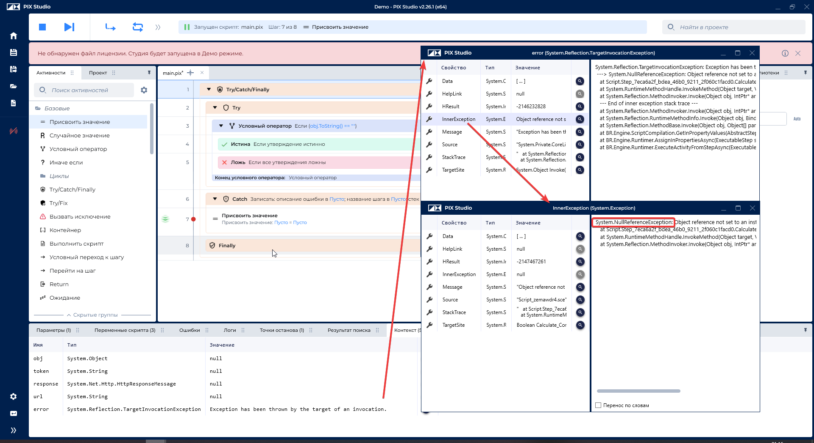

# Исключения

Правильная обработка исключений — ключевой аспект разработки надежных роботов в PIX RPA. Грамотный подход к исключениям позволяет создавать устойчивые решения и упрощает диагностику проблем.

**Основные принципы работы с исключениями в PIX RPA:**
- Исключения следует использовать только для обработки исключительных (непредвиденных) ситуаций
- Нормальный поток выполнения должен управляться с помощью условных выражений, а не исключений
- Ошибки при нормальной работе процесса должны обрабатываться с помощью проверок и условий

## Содержание

- [ERROR-01. Избегайте появления 'Exception has been thrown by the target of an invocation.'](#error-01-избегайте-появления-exception-has-been-thrown-by-the-target-of-an-invocation) — 🔴 Обязательно
- [ERROR-02. Не генерируйте исключения повторно](#error-02-не-генерируйте-исключения-повторно) — 🟡 Рекомендуется
- [ERROR-03. Не оставляйте Catch пустым и не используйте Try/Catch/Finally в бизнес-логике](#error-03-не-оставляйте-catch-пустым-и-не-используйте-trycatchfinally-в-бизнес-логике) — 🔴 Обязательно
- [ERROR-04. Используйте свойство Data для хранения дополнительной информации в исключениях](#error-04-используйте-свойство-data-для-хранения-дополнительной-информации-в-исключениях) — 🟢 По ситуации
- [ERROR-05. Обрабатывайте исключения на правильном уровне абстракции](#error-05-обрабатывайте-исключения-на-правильном-уровне-абстракции) — 🟡 Рекомендуется
- [ERROR-06. Разделяйте бизнес-исключения и технические исключения](#error-06-разделяйте-бизнес-исключения-и-технические-исключения) — 🔴 Обязательно
- [ERROR-07. Указывайте источник исключения](#error-07-указывайте-источник-исключения) — 🔴 Обязательно

## ERROR-01. Избегайте появления 'Exception has been thrown by the target of an invocation.'

🔴 **Обязательно**

Некоторые ошибки в PIX выбрасывают исключение с текстом 'Exception has been thrown by the target of an invocation'. На самом деле, настоящая ошибка указана в InnerException данного исключения.

**Пример обработки вложенного исключения:** _(пример на C#, примеры скриптов PIX будут добавлены)_

```csharp
try
{
    // Код, который может вызвать исключение
    InvokeScriptOrActivity();
}
catch (Exception ex)
{
    // Проверяем наличие внутреннего исключения
    if (ex.Message.Contains("Exception has been thrown by the target of an invocation") && ex.InnerException != null)
    {
        // Логируем внутреннее исключение вместо внешнего
        Logger.Error($"Произошла ошибка: {ex.InnerException.Message}");
        // Можно также проверить тип внутреннего исключения
        if (ex.InnerException is NullReferenceException)
        {
            // Специфическая обработка для NullReferenceException
        }
    }
    else
    {
        // Обработка обычного исключения
        Logger.Error($"Произошла ошибка: {ex.Message}");
    }
}
```

**Пример вызова исключения NullReferenceException:**



[⬆ К содержанию](#содержание)

## ERROR-02. Не генерируйте исключения повторно

🟡 **Рекомендуется**

> [!NOTE]
> 🚧 **Раздел в работе.** Пока только на чистом C#, в PIX RPA работает по другому.

Повторная генерация исключений (`throw ex`) уничтожает исходный стек вызовов, что сильно затрудняет отладку. Вместо этого используйте `throw` без параметров для сохранения исходной информации об ошибке.

**Неправильно:**
```csharp
try
{
    // Код, который может вызвать исключение
    ProcessData(inputData);
}
catch (Exception ex)
{
    Logger.Error($"Ошибка обработки данных: {ex.Message}");
    
    // Так делать НЕ НАДО - теряется оригинальный стек вызовов
    throw ex;
    
    // Так тоже не рекомендуется - обертывание исключения без добавления контекста
    throw new Exception("Ошибка!", ex);
}
```

**Правильно:**
```csharp
try
{
    // Код, который может вызвать исключение
    ProcessData(inputData);
}
catch (Exception ex)
{
    // Логируем ошибку с контекстом
    Logger.Error($"Ошибка обработки данных [{inputData.Id}]: {ex.Message}");
    
    // Правильно - сохраняет оригинальный стек вызовов
    throw;
    
    // Альтернативно - обертывание с добавлением ценного контекста
    // throw new DataProcessingException($"Ошибка обработки данных для ID {inputData.Id}", ex);
}
```

**Преимущества сохранения оригинального стека вызовов:**
- Точное определение места возникновения ошибки
- Сохранение всей цепочки вызовов методов
- Упрощение отладки и диагностики проблем
- Возможность быстрее найти и устранить корневую причину

[⬆ К содержанию](#содержание)

## ERROR-03. Не оставляйте Catch пустым и не используйте Try/Catch/Finally в бизнес-логике

🔴 **Обязательно**

Пустые блоки Catch создают иллюзию обработки ошибок, а Try/Catch в бизнес-логике приводит к запутанному коду и снижению производительности.

**Проблемы пустых блоков Catch:**
- Скрывают ошибки, делая их обнаружение невозможным
- Оставляют систему в неопределенном состоянии
- Усложняют отладку и поиск источника проблем
- Создают ложное впечатление, что ошибка обработана

**Проблемы использования Try/Catch в бизнес-логике:**
- Код становится сложнее для понимания и поддержки
- Снижается производительность (обработка исключений ресурсоемка, но в рамках простых роботов не критично)
- Смешиваются нормальный поток выполнения и обработка ошибок
- Исключения используются для контроля потока выполнения

**Типичный антипаттерн: конвертация строки в DateTime через исключения** _(пример на C#, примеры скриптов PIX будут добавлены)_

**Неправильно:**
```csharp
public DateTime ConvertToDateTime(string dateStr)
{
    try
    {
        // Пробуем сначала формат дд.мм.гггг
        return DateTime.ParseExact(dateStr, "dd.MM.yyyy", CultureInfo.InvariantCulture);
    }
    catch
    {
        try
        {
            // Если не получилось, пробуем мм/дд/гггг
            return DateTime.ParseExact(dateStr, "MM/dd/yyyy", CultureInfo.InvariantCulture);
        }
        catch
        {
            // Если и так не получилось, возвращаем значение по умолчанию
            // При этом не учитывается, что это может быть любой другой формат
            // и в логах PIX RPA будет отображаться ошибка, хотя это нормальный путь исполнения
            return DateTime.MinValue;
        }
    }
}
```

**Правильно:**
```csharp
public DateTime ConvertToDateTime(string dateStr)
{
    if (string.IsNullOrEmpty(dateStr))
    {
        return DateTime.MinValue;
    }
    
    // Определяем массив возможных форматов
    string[] formats = { "dd.MM.yyyy", "MM/dd/yyyy", "yyyy-MM-dd" };
    
    DateTime result;
    if (DateTime.TryParseExact(
        dateStr, 
        formats,
        CultureInfo.InvariantCulture,
        DateTimeStyles.None, 
        out result))
    {
        return result;
    }
    
    // Если ни один формат не подошел
    return DateTime.MinValue; // или можно выбросить бизнес-исключение
}
```

**Антипаттерн: использование исключений для проверки существования файлов** _(пример на C#, примеры скриптов PIX будут добавлены)_

**Неправильно:**
```csharp
public void SaveDataToFile(string filePath, string data)
{
    try
    {
        // Пытаемся записать данные в файл напрямую
        File.WriteAllText(filePath, data);
    }
    catch (DirectoryNotFoundException)
    {
        // Если директория не существует, создаем её и пробуем снова
        // В логах PIX RPA при этом будет ошибка, хотя это ожидаемый сценарий
        Directory.CreateDirectory(Path.GetDirectoryName(filePath));
        File.WriteAllText(filePath, data);
    }
}
```

**Правильно:**
```csharp
public void SaveDataToFile(string filePath, string data)
{
    // Проверяем существование директории перед записью
    string directory = Path.GetDirectoryName(filePath);
    if (!Directory.Exists(directory))
    {
        Directory.CreateDirectory(directory);
    }
    
    // Теперь безопасно записываем данные без риска получить исключение
    File.WriteAllText(filePath, data);
}
```

**Важные рекомендации по работе с UI в PIX RPA:**
1. **Используйте активности поиска элемента** вместо try/catch
2. **Настраивайте разумные таймауты** для поиска элементов
3. **Разделяйте логику поиска элементов** и взаимодействия с ними (если элементы динамичные)
4. **Создавайте четкие селекторы**, чтобы минимизировать ошибки поиска

> [!IMPORTANT]
> **Особенность PIX RPA.** Платформа автоматически логирует все исключения, даже те, которые перехватываются в блоках catch. Это создает лишние записи в логах и может дезинформировать при анализе проблем. Когда вы используете try/catch для контроля потока выполнения, в логах появляются ошибки, хотя фактически это может быть нормальный сценарий выполнения.

**Рекомендации:**
**Вместо Try/Catch используйте функции с префиксом Try-:**
- `DateTime.TryParse()` и `DateTime.TryParseExact()` вместо `DateTime.Parse()` в блоке try-catch
- `int.TryParse()` вместо `Convert.ToInt32()` в блоке try-catch
- `Dictionary.TryGetValue()` вместо доступа по ключу в блоке try-catch

**Для файловых операций используйте проверки вместо исключений:**
- `File.Exists()` перед `File.ReadAllText()`
- `Directory.Exists()` перед `Directory.GetFiles()`
- `Directory.CreateDirectory()` создаст директорию, если она не существует (не выбрасывает исключений)

**Для сетевых операций:**
- Проверяйте соединение перед отправкой запроса
- Используйте таймауты и повторные попытки вместо простого перехвата исключений

**В сложных алгоритмах:**
- Проверяйте граничные условия и недопустимые значения в начале метода
- Применяйте паттерн Guard Clause для раннего выхода из метода

**Когда допустимо использовать try-catch:**
- Внешний уровень приложения для глобальной обработки ошибок
- Взаимодействие с внешними системами, где ошибки непредсказуемы
- Работа с неуправляемыми ресурсами (в сочетании с блоком finally)
- Специфические сценарии, где ошибка — это ожидаемая часть бизнес-логики

Исключения должны использоваться для обработки **исключительных ситуаций**, а не для обычного контроля потока выполнения программы.

[⬆ К содержанию](#содержание)

## ERROR-04. Используйте свойство Data для хранения дополнительной информации в исключениях

🟢 **По ситуации**

Свойство `Exception.Data` представляет собой коллекцию ключ-значение, которая позволяет хранить дополнительную контекстную информацию об ошибке без создания пользовательских типов исключений.

**Преимущества использования Exception.Data:**
- Добавление бизнес-контекста к стандартным исключениям
- Возможность передачи структурированной информации без создания новых типов
- Простота использования в PIX RPA, где создание новых типов ограничено
- Возможность добавления данных на разных уровнях обработки исключения

**Пример использования:** _(пример на C#, примеры скриптов PIX будут добавлены)_
```csharp
public void ProcessInvoice(Invoice invoice)
{
    try
    {
        // Проверка данных счета
        if (invoice.Total < 0)
        {
            var ex = new ArgumentException("Сумма счета не может быть отрицательной");
            
            // Добавляем контекстную информацию в свойство Data
            ex.Data.Add("InvoiceId", invoice.Id);
            ex.Data.Add("InvoiceTotal", invoice.Total);
            ex.Data.Add("Customer", invoice.CustomerName);
            ex.Data.Add("CreatedDate", invoice.Date);
            
            throw ex;
        }
        
        // Обработка счета...
    }
    catch (Exception ex)
    {
        // Добавляем информацию о текущей операции
        ex.Data.Add("Operation", "ProcessInvoice");
        ex.Data.Add("Timestamp", DateTime.Now);
        
        // Логируем ошибку вместе с контекстом
        LogExceptionWithContext(ex);
        throw;
    }
}

private void LogExceptionWithContext(Exception ex)
{
    var contextInfo = new StringBuilder();
    contextInfo.AppendLine($"Ошибка: {ex.Message}");
    
    // Извлекаем всю информацию из коллекции Data
    foreach (DictionaryEntry entry in ex.Data)
    {
        contextInfo.AppendLine($"   {entry.Key}: {entry.Value}");
    }
    
    Logger.Error(contextInfo.ToString());
}
```

**Рекомендации по использованию Exception.Data:**
1. **Добавляйте только значимую информацию** — не перегружайте исключение лишними данными
2. **Используйте понятные ключи** — названия должны быть говорящими
3. **Добавляйте контекст на разных уровнях** — каждый уровень обработки может добавить свою информацию
4. **Проверяйте наличие ключей перед чтением** — используйте `ex.Data.Contains(key)` перед получением значений
5. **Не храните чувствительную информацию** — пароли, токены и личные данные не должны добавляться в исключения

**Пример проверки и извлечения данных:**
```csharp
// Безопасное извлечение значений
if (ex.Data.Contains("InvoiceId"))
{
    var invoiceId = ex.Data["InvoiceId"];
    // Использование invoiceId для обработки...
}
```

> [!IMPORTANT]
> В PIX RPA использование `Exception.Data` — это хороший способ добавить бизнес-контекст к исключению, особенно в ситуациях, когда создание собственных типов исключений невозможно или избыточно.

**Когда использовать Exception.Data вместо пользовательских исключений:**
- Когда нет возможности создать собственный класс исключения (например, в PIX RPA без DLL)
- Для временного хранения дополнительной информации об ошибках
- При необходимости добавить контекст на разных уровнях обработки
- В ситуациях, когда избыточно создавать отдельный тип для редкого сценария ошибки

**Ограничения подхода с Exception.Data:**
- Нет строгой типизации хранимых данных
- Нет проверки на этапе компиляции
- Сложнее поддерживать согласованную структуру данных
- Требует дополнительной документации для понимания ожидаемых ключей

[⬆ К содержанию](#содержание)

## ERROR-05. Обрабатывайте исключения на правильном уровне абстракции

🟡 **Рекомендуется**

Исключения должны обрабатываться на том уровне, где есть достаточно контекста для принятия решения о дальнейших действиях. Не подавляйте исключения на низких уровнях без добавления ценной информации.

**Рекомендации по определению уровня обработки:**
1. **Низкий уровень (служебные методы)**: перехватывайте только для добавления контекста, затем пробрасывайте дальше
2. **Средний уровень (бизнес-логика)**: обрабатывайте исключения, когда можете принять информированное решение
3. **Высокий уровень (координаторы процессов)**: глобальная обработка ошибок для целостности процесса
4. **Верхний уровень (точка входа)**: общий перехватчик для логирования и восстановления

[⬆ К содержанию](#содержание)

## ERROR-06. Разделяйте бизнес-исключения и технические исключения

🔴 **Обязательно**

Главное отличие: при бизнес-исключении робот откладывает одну транзакцию и продолжает работу со следующей. При технической ошибке робот пытается восстановиться, а после нескольких ошибок подряд останавливается ([RECOVERY-05](recovery.md#recovery-05-останавливайте-робота-после-серии-технических-исключений-подряд)).

**Бизнес-исключение** возникает, когда с данными транзакции что-то не так. Робот работает исправно, но обработать эту транзакцию по правилам процесса не может. **Техническое исключение** (системное) возникает, когда сломалось окружение: система не отвечает, файл заблокирован, окно не появилось.

**Как отличить.** Представьте, что робот повторил транзакцию через 10 минут, ничего не меняя. Если ошибка повторится, это бизнес-исключение. Если может пройти, это техническое.

**Примеры:**

| Процесс | Бизнес-исключение | Техническое исключение |
|---------|-------------------|----------------------|
| Разбор входящей почты | Спам или письмо не по форме. Робот переносит его в папку «Не обработано» ([MAIL-03](../3-integrations/mail.md#mail-03-отмечайте-обработанные-письма-явно)) и берет следующее | Почтовый сервер не отвечает |
| Сверка двух документов | Один документ новой формы, которую робот не умеет читать. Робот помечает пару и переходит к следующей | Файл открыт другим пользователем и заблокирован |
| Создание счета в учетной системе | Контрагента с таким ИНН нет в справочнике или сумма выше лимита | Учетная система не отвечает, окно не открылось |
| Загрузка реестра из Excel | В строке не заполнен ИНН. Робот откладывает эту строку, остальные загружает | Сетевая папка с реестром недоступна |

| | Бизнес-исключение | Техническое исключение |
|---|---|---|
| **Что делает робот** | Записывает причину и берет следующую транзакцию | Повторяет транзакцию, перезапускает приложения, при серии ошибок останавливается |
| **Повтор** | Не нужен: данные те же | Нужен по правилам [QUEUE-04](../3-integrations/queue.md#queue-04-правильно-обрабатывайте-повторные-попытки-retry) |
| **Элемент очереди в PIX Master** | Статус Failed, тип ошибки «Бизнес». Повторные попытки мастер не запускает | Статус Failed, тип ошибки «Техническая» |
| **Кто разбирается** | Бизнес-пользователь: исправляет данные | Поддержка или разработчик: чинят окружение |

**Как пометить бизнес-исключение в PIX RPA.** Если в проекте есть библиотека с собственным типом (например, `BusinessRuleException`), используйте его. Если собственные типы создать нельзя, используйте стандартное исключение с пометкой в `Data` (см. [ERROR-04](#error-04-используйте-свойство-data-для-хранения-дополнительной-информации-в-исключениях)):

```csharp
var ex = new InvalidOperationException($"Счет {invoiceNumber}: не указан ИНН поставщика");
ex.Data["ExceptionType"] = "Business";
throw ex;
```

Обработчик состояния Process Transaction проверяет пометку: бизнес-исключение завершает транзакцию со статусом бизнес-ошибки, любое другое исключение робот обрабатывает как техническое.

**Правила:**
- Исключение без пометки «бизнес» робот считает техническим
- Текст бизнес-исключения пишите для бизнес-пользователя: что не так с данными и что исправить. Например: «Счет INV-123: в справочнике нет контрагента с ИНН 7701234567»
- Бизнес-исключение робот не повторяет
- Бизнес-исключения логируйте уровнем WARNING: робот отработал штатно ([LOG-03](log.md#log-03-используйте-подходящие-уровни-логирования))

[⬆ К содержанию](#содержание)

## ERROR-07. Указывайте источник исключения

🔴 **Обязательно**

В PIX RPA исключение из вложенного скрипта часто доходит до обработчика состояния без понятного контекста: сообщение `Object reference not set to an instance of an object` или `Exception has been thrown by the target of an invocation` (см. [ERROR-01](#error-01-избегайте-появления-exception-has-been-thrown-by-the-target-of-an-invocation)) не говорит, в каком скрипте, на каком шаге и в какой системе произошла ошибка. По такому сообщению поддержка не может ни разобрать инцидент, ни понять, поможет ли повтор.

Когда вы выбрасываете исключение сами или перехватываете чужое, чтобы добавить контекст, указывайте источник:

- **Система** — с какой внешней системой работали (`1С`, `CRM`, `SMTP`)
- **Операция** — что делали (`создание документа`, `поиск клиента`)
- **Место** — состояние и скрипт робота (`ProcessTransaction / CreateInvoice`)

```csharp
// Сообщение начинается с источника
throw new InvalidOperationException($"[1С] Создание счета: документ {invoiceNumber} не проведен, статус «{status}»");

// Исходное исключение сохраняется как InnerException, источник — в Data
catch (HttpRequestException ex)
{
    var wrapped = new InvalidOperationException($"[CRM] Поиск клиента {customerId}: сервис недоступен", ex);
    wrapped.Data["Source"] = "ProcessTransaction/FindCustomer";
    throw wrapped;
}
```

**Правила:**
- Формат начала сообщения: `[Система] Операция: подробности`
- При обертывании всегда передавайте исходное исключение как `InnerException`: без него теряется первопричина (см. [ERROR-02](#error-02-не-генерируйте-исключения-повторно))
- Место в коде записывайте в `ex.Data["Source"]` (см. [ERROR-04](#error-04-используйте-свойство-data-для-хранения-дополнительной-информации-в-исключениях)), а не в текст сообщения: текст сообщения видит бизнес-пользователь в статусе очереди
- Не оборачивайте исключение, если нечего добавить к контексту

[⬆ К содержанию](#содержание)
