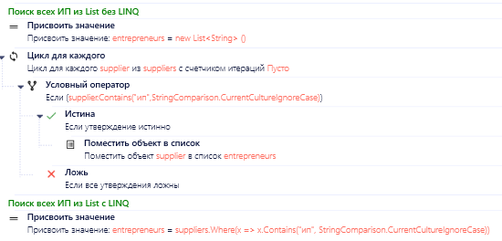
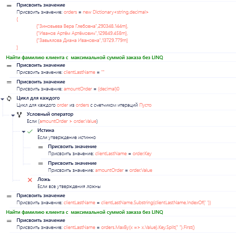

# LINQ

LINQ (Language Integrated Query) фильтрует, сортирует и группирует коллекции в одном выражении. В PIX RPA один LINQ-запрос заменяет цикл из нескольких активностей.

Для больших объемов данных есть PLINQ: те же запросы выполняются параллельно.

## Содержание

- [LINQ-01. Форматируйте LINQ-запросы](#linq-01-форматируйте-linq-запросы) (🟡 Рекомендуется)
- [LINQ-02. Фильтруйте и проецируйте данные как можно раньше](#linq-02-фильтруйте-и-проецируйте-данные-как-можно-раньше) (🟡 Рекомендуется)
- [LINQ-03. Используйте оптимальные методы LINQ](#linq-03-используйте-оптимальные-методы-linq) (🟡 Рекомендуется)
- [LINQ-04. Материализуйте результат, если он нужен несколько раз](#linq-04-материализуйте-результат-если-он-нужен-несколько-раз) (🟡 Рекомендуется)
- [LINQ-05. Применяйте PLINQ только для тяжелых вычислений в памяти](#linq-05-применяйте-plinq-только-для-тяжелых-вычислений-в-памяти) (🟢 По ситуации)
- [LINQ-06. Используйте цикл вместо LINQ, где он понятнее](#linq-06-используйте-цикл-вместо-linq-где-он-понятнее) (🟡 Рекомендуется)
- [Чек-лист и примеры](#чек-лист-и-примеры)
- [Дополнительные ресурсы](#дополнительные-ресурсы)

## LINQ-01. Форматируйте LINQ-запросы

🟡 **Рекомендуется**

В PIX RPA часто используется LINQ для обработки данных. Следуйте этим рекомендациям для поддержания читаемости:

- **Предпочитайте метод-синтаксис выражение-синтаксису** для лучшей читаемости
```csharp
var filteredItems = items
    .Where(i => i.IsActive)
    .Select(i => new { i.Id, i.Name })
    .ToList();
```

- **Форматируйте цепочки методов** для улучшения читаемости
```csharp
// Плохо: сложно читать
var result = collection.Where(x => x.IsValid).Select(x => x.Name).OrderBy(x => x).Distinct().ToList();

// Хорошо: каждый метод с новой строки и с отступом
var result = collection
    .Where(x => x.IsValid)
    .Select(x => x.Name)
    .OrderBy(x => x)
    .Distinct()
    .ToList();
```

[⬆ К содержанию](#содержание)

## LINQ-02. Фильтруйте и проецируйте данные как можно раньше

🟡 **Рекомендуется**

- **Отложенное выполнение**: LINQ-запросы исполняются только при обращении к результатам (итерации, ToList(), First() и т.д.)
- **Материализация**: используйте ToList(), ToArray() для сохранения результатов, если они нужны несколько раз
- **Раннее ограничение данных**: фильтруйте (Where) как можно раньше в цепочке методов
- **Выборочное проецирование**: извлекайте (Select) только необходимые поля вместо всей сущности

```csharp
// Плохо: извлечение всех данных, многократный проход
var customers = dataTable.AsEnumerable();
var activeCustomers = customers.Where(r => r.Field<bool>("IsActive"));
var customerNames = activeCustomers.Select(r => r.Field<string>("Name"));
var result = customerNames.ToList();

// Хорошо: ранняя фильтрация, проекция только нужных полей, однократный проход
var result = dataTable.AsEnumerable()
    .Where(r => r.Field<bool>("IsActive"))
    .Select(r => r.Field<string>("Name"))
    .ToList();
```

[⬆ К содержанию](#содержание)

## LINQ-03. Используйте оптимальные методы LINQ

🟡 **Рекомендуется**

- **Проверка наличия элементов**: Any() вместо Count() > 0
- **Поиск элемента по условию**: FirstOrDefault(x => условие) вместо Where(x => условие).FirstOrDefault()
- **Уникальные значения**: Distinct() для коллекций с дубликатами
- **Объединение коллекций**: Union() объединяет без дубликатов, Concat() сохраняет дубликаты
- **Разница между коллекциями**: Except() для элементов, присутствующих только в первой коллекции
- **Пересечение коллекций**: Intersect() для элементов, присутствующих в обеих коллекциях

```csharp
// Плохо: избыточные методы
if (items.Count() > 0) { /* ... */ }
var item = items.Where(x => x.Id == 5).FirstOrDefault();

// Хорошо: оптимальные методы
if (items.Any()) { /* ... */ }
var item = items.FirstOrDefault(x => x.Id == 5);
```

[⬆ К содержанию](#содержание)

## LINQ-04. Материализуйте результат, если он нужен несколько раз

🟡 **Рекомендуется**

При многократном использовании результатов LINQ-запроса сохраняйте их в переменную:

```csharp
// Плохо: многократный проход по коллекции
var count = customers.Where(c => c.IsActive).Count();
var total = customers.Where(c => c.IsActive).Sum(c => c.Balance);
var avg = customers.Where(c => c.IsActive).Average(c => c.Balance);

// Хорошо: кэширование результатов
var activeCustomers = customers.Where(c => c.IsActive).ToList();
var count = activeCustomers.Count();
var total = activeCustomers.Sum(c => c.Balance);
var avg = activeCustomers.Average(c => c.Balance);
```

[⬆ К содержанию](#содержание)

## LINQ-05. Применяйте PLINQ только для тяжелых вычислений в памяти

🟢 **По ситуации**

Для ускорения обработки больших коллекций в памяти можно использовать AsParallel(). Применяйте PLINQ только для вычислений, которые не обращаются к внешним ресурсам:

- не используйте PLINQ для работы с UI, файлами, БД и API: параллельные обращения ломают UI-автоматизацию и перегружают внешние системы
- PLINQ не сохраняет порядок элементов без `AsOrdered()`
- на небольших коллекциях накладные расходы на распараллеливание больше выигрыша

```csharp
// Последовательная обработка
var result = collection.Where(x => IsComplexCondition(x)).ToList();

// Параллельная обработка (в несколько потоков)
var result = collection.AsParallel()
    .Where(x => IsComplexCondition(x))
    .ToList();
```

[⬆ К содержанию](#содержание)

## LINQ-06. Используйте цикл вместо LINQ, где он понятнее

🟡 **Рекомендуется**

- **Производительность**: для критичных операций цикл for быстрее (for > foreach > LINQ)
- **Сложная отладка**: для больших и сложных запросов
- **Внешние сервисы**: при цикличной работе с файлами, БД, почтой, UI предпочтительнее использовать циклы (проще отлаживать)
- **Сложная бизнес-логика**: когда условия обработки сложные и изменяются во время выполнения

[⬆ К содержанию](#содержание)

## Чек-лист и примеры

- Понимать разницу между IEnumerable (работа в памяти) и IQueryable (работа с БД)
- Фильтровать (Where) данные как можно раньше в цепочке методов
- Извлекать (Select) только нужные поля, а не всю сущность
- Использовать Any() вместо Count() > 0 для проверки наличия элементов
- Избегать многократных запросов к одной коллекции (кэшировать результаты через ToList())
- Применять методы агрегации (Sum, Average, Min, Max) к отфильтрованным данным
- Предпочитать метод FirstOrDefault(предикат) вместо Where(предикат).FirstOrDefault()
- Вызывать Where() перед Select() для раннего сокращения объема данных
- Использовать ?? и ?.  при работе с коллекциями, которые могут быть null
- Применять Distinct() для получения уникальных значений
- Использовать GroupBy().ToLookup() для кэширования результатов группировки
- Предпочитать LINQ-запросы с методами вместо LINQ-запросов с SQL-подобным синтаксисом

### Типичные примеры использования LINQ в PIX RPA

#### Пример 1: Обработка данных из DataTable

```csharp
// Фильтрация и агрегация данных из DataTable
var result = dataTable.AsEnumerable()
    .Where(row => row.Field<DateTime>("Date") >= DateTime.Today.AddDays(-7))
    .GroupBy(row => row.Field<string>("Category"))
    .Select(group => new {
        Category = group.Key,
        TotalAmount = group.Sum(row => row.Field<decimal>("Amount")),
        Count = group.Count()
    })
    .OrderByDescending(x => x.TotalAmount)
    .ToList();
```

#### Пример 2: Работа со словарями (Dictionary)

```csharp
// Обработка данных из Dictionary (часто используется в PIX RPA)
var configData = new Dictionary<string, object> {
    ["Settings"] = new Dictionary<string, object> {
        ["Retry"] = 3,
        ["Timeout"] = 30,
        ["Servers"] = new[] { "Server1", "Server2", "Server3" }
    },
    ["Credentials"] = new Dictionary<string, string> {
        ["UserName"] = "Admin",
        ["Domain"] = "Corp"
    }
};

// Получение списка серверов из конфигурации
var servers = ((Dictionary<string, object>)configData["Settings"])
    .TryGetValue("Servers", out var serversObj) && serversObj is string[] serversArray
    ? serversArray
    : Array.Empty<string>();
```




[⬆ К содержанию](#содержание)

## Дополнительные ресурсы

- [Документация по LINQ](https://learn.microsoft.com/ru-ru/dotnet/csharp/programming-guide/concepts/linq/)
- [101 примеров LINQ (Для ознакомления, но майкрософт не поддерживают проект, отправили его в архив)](https://github.com/dotnet/try-samples/blob/main/101-linq-samples/index.md)
- [Производительность LINQ](https://learn.microsoft.com/ru-ru/dotnet/standard/linq/write-efficient-queries)

[⬆ К содержанию](#содержание)
