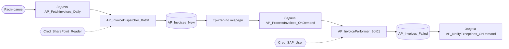

# Работа робота в PIX Master

Что разработчик настраивает в PIX Master для своего робота: как называть роботов, очереди, задачи и ассеты, какой триггер выбрать и как компоненты связаны между собой. Единые имена позволяют по любому компоненту понять, к какому проекту он относится.

Настройка хостов, мониторинг и права доступа — зона администраторов PIX Master, в этих соглашениях они не описываются.

> [!NOTE]
> Названия разделов и настроек в интерфейсе могут отличаться в зависимости от версии PIX Master. Если описанная настройка отсутствует в вашей версии, придерживайтесь соглашения об именовании и документируйте, как задача решается у вас.

## Содержание

- [Общий формат имен](#общий-формат-имен)
- [MASTER-01. Именуйте агентов по типу робота](#master-01-именуйте-агентов-по-типу-робота) — 🔴 Обязательно
- [MASTER-02. Учитывайте различия в настройке Unattended и Attended роботов](#master-02-учитывайте-различия-в-настройке-unattended-и-attended-роботов) — 🟡 Рекомендуется
- [MASTER-03. Именуйте задачи по формату {Проект}_{Процесс}_{Периодичность}](#master-03-именуйте-задачи-по-формату-проект_процесс_периодичность) — 🔴 Обязательно
- [MASTER-04. Выбирайте тип триггера по характеру процесса](#master-04-выбирайте-тип-триггера-по-характеру-процесса) — 🟡 Рекомендуется
- [MASTER-05. Планируйте задачи без перекрытий и с учетом зависимостей](#master-05-планируйте-задачи-без-перекрытий-и-с-учетом-зависимостей) — 🟡 Рекомендуется
- [MASTER-06. Настраивайте повторы и эскалацию на уровне задач](#master-06-настраивайте-повторы-и-эскалацию-на-уровне-задач) — 🔴 Обязательно
- [Связь между компонентами](#связь-между-компонентами)
- [Сквозной процесс с использованием всех компонентов](#сквозной-процесс-с-использованием-всех-компонентов)
- [Рекомендации по проектированию интеграции](#рекомендации-по-проектированию-интеграции)

## Общий формат имен

Все компоненты оркестратора именуются по единому принципу: от общего к частному, части разделяются символом `_`, внутри частей используется PascalCase, только латиница (см. [VARIABLE-06](../2-develop/variable.md#variable-06-не-используйте-кириллицу-в-именах)).

| Компонент | Формат | Пример |
|-----------|--------|--------|
| Очередь | `{Проект}_{ТипДанных}_{Назначение}` | `AP_Invoices_Processing` |
| Хост | `{Контур}-{Расположение}-{Назначение}-{Номер}` | `PROD-MSK-AP-01` |
| Unattended-робот | `{Проект}_{Процесс}_Bot{Номер}` | `AP_InvoiceProcessing_Bot01` |
| Attended-робот | `{Департамент}_{РабочееМесто}_{ТипАссистента}` | `Finance_AccountManager_Assistant` |
| Задача | `{Проект}_{Процесс}_{Периодичность}` | `AP_ProcessInvoices_Daily` |
| Учетные данные | `Cred_{Система}_{Назначение}` | `Cred_SAP_ReadOnly` |
| Параметр | `Param_{Проект}_{Категория}_{Название}` | `Param_AP_Email_SupportAddress` |
| Коллекция настроек | `Config_{Проект}_{Назначение}` | `Config_AP_ValidationRules` |

`{Проект}` — код проекта или бизнес-домена (`AP`, `HR`, `Finance`). Один и тот же код используется во всех компонентах проекта, поэтому по имени любого компонента видно, к какому проекту он относится.

[⬆ К содержанию](#содержание)

## MASTER-01. Именуйте агентов по типу робота

🔴 **Обязательно**

- **Unattended-роботы:** `{Проект}_{Процесс}_Bot{Номер}`
  - Примеры: `AP_InvoiceProcessing_Bot01`, `HR_Onboarding_Bot02`
- **Attended-роботы:** `{Департамент}_{РабочееМесто}_{ТипАссистента}`
  - Примеры: `Finance_AccountManager_Assistant`, `HR_Recruiter_Helper`

Для процессов по схеме Dispatcher/Performer (см. [PROJECT-06](../1-project/project.md#project-06-разделяйте-загрузку-и-обработку-транзакций-dispatcher--performer)) роль указывается в имени процесса: `AP_InvoiceDispatcher_Bot01`, `AP_InvoicePerformer_Bot01`.

[⬆ К содержанию](#содержание)

## MASTER-02. Учитывайте различия в настройке Unattended и Attended роботов

🟡 **Рекомендуется**

| Параметр | Unattended | Attended |
|----------|------------|----------|
| Запуск | Автоматический по расписанию/триггеру | Ручной пользователем |
| Выполнение | На выделенных серверах | На рабочих станциях пользователей |
| Интерфейс | Часто не требуется (headless) | Взаимодействие с пользователем |
| Логирование | Детальное | Базовое |
| Обработка ошибок | Автоматическая + эскалация | С участием пользователя |

[⬆ К содержанию](#содержание)

## MASTER-03. Именуйте задачи по формату {Проект}_{Процесс}_{Периодичность}

🔴 **Обязательно**

- Используйте формат: `{Проект}_{Процесс}_{Периодичность}`
- Примеры:
  - `AP_ProcessInvoices_Daily` — ежедневная обработка счетов
  - `HR_GenerateReports_Weekly` — еженедельная генерация отчетов
  - `Finance_Reconciliation_Monthly` — ежемесячная сверка
  - `AP_ProcessInvoices_OnDemand` — запуск по триггеру или вручную

[⬆ К содержанию](#содержание)

## MASTER-04. Выбирайте тип триггера по характеру процесса

🟡 **Рекомендуется**

- **Расписание** (Schedule) — для регулярного выполнения задач
  - Используйте стандартные форматы Cron для настройки
  - Документируйте причину выбора конкретного расписания
- **Событие** (Event) — для реакции на системные события
  - Связывайте с конкретными источниками событий
  - Обеспечьте обработку сбоев и повторных попыток
- **Очередь** (Queue) — при появлении новых элементов в очереди
  - Настраивайте пороговые значения для запуска
  - Обеспечьте корректную обработку очередей

[⬆ К содержанию](#содержание)

## MASTER-05. Планируйте задачи без перекрытий и с учетом зависимостей

🟡 **Рекомендуется**

- **Избегайте перекрытия** задач, потенциально использующих одни и те же ресурсы
- **Распределяйте нагрузку** в течение дня/недели для оптимального использования инфраструктуры
- **Учитывайте зависимости** между задачами при планировании (Dispatcher должен успеть заполнить очередь до запуска Performer'а)
- **Документируйте временные окна** для технического обслуживания
- **Учитывайте окна доступности целевых систем**: регламентные работы, закрытие периода, ночные пересчеты

[⬆ К содержанию](#содержание)

## MASTER-06. Настраивайте повторы и эскалацию на уровне задач

🔴 **Обязательно**

- Настройте стратегии повторных попыток для разных типов задач
- Определите максимальное количество повторных попыток
- Настройте эскалацию при исчерпании повторных попыток
- Обеспечьте ведение журнала ошибок для последующего анализа

Повторы задачи не заменяют повторы транзакций внутри робота (см. [QUEUE-04](../3-integrations/queue.md#queue-04-правильно-обрабатывайте-повторные-попытки-retry)): задача повторяется, если робот не смог запуститься или завершился аварийно.

[⬆ К содержанию](#содержание)

## Связь между компонентами

| Компонент 1 | Связь | Компонент 2 | Примечания |
|-------------|-------|-------------|------------|
| Хост | выполняет → | Агент робота | Один хост может исполнять несколько агентов |
| Агент робота | обрабатывает → | Очередь данных | Робот может работать с несколькими очередями |
| Задача | запускает → | Агент робота | По расписанию или триггеру |
| Триггер | активирует → | Задачу | При наступлении события или изменении очереди |
| Ассет | используется → | Агентом робота | Для конфигурации и доступа к системам |
| Очередь данных | активирует → | Триггер | При поступлении новых элементов |

[⬆ К содержанию](#содержание)

## Сквозной процесс с использованием всех компонентов

1. **Получение данных:**
   - Робот `AP_InvoiceDispatcher_Bot01` на хосте `PROD-MSK-AP-01`
   - Задача `AP_FetchInvoices_Daily` по расписанию `0 8 * * *` (каждый день в 8:00)
   - Использует ассет `Cred_SharePoint_Reader` для доступа к файлам
   - Помещает данные в очередь `AP_Invoices_New`

2. **Обработка транзакций:**
   - Триггер `Trigger_AP_ProcessInvoices` активируется при наличии элементов в очереди
   - Запускает задачу `AP_ProcessInvoices_OnDemand`
   - Задача запускает робота `AP_InvoicePerformer_Bot01` на хосте `PROD-MSK-AP-02`
   - Робот использует ассеты `Cred_SAP_User` и `Config_AP_ValidationRules`
   - Обработанные элементы перемещаются в очередь `AP_Invoices_Processed`
   - Ошибки направляются в очередь `AP_Invoices_Failed`

3. **Обработка исключений:**
   - Триггер `Trigger_AP_HandleExceptions` активируется при появлении элементов в очереди ошибок
   - Запускает задачу `AP_NotifyExceptions_OnDemand`
   - Задача запускает робота `AP_Notification_Bot01`
   - Робот использует ассет `Param_AP_Email_SupportList` для отправки уведомлений

[⬆ К содержанию](#содержание)

## Рекомендации по проектированию интеграции

- Создавайте схемы и документацию по взаимодействию компонентов
- Обеспечьте непротиворечивую стратегию именования для всех связанных компонентов
- Разработайте план действий при сбоях на каждом этапе процесса
- Регулярно проверяйте целостность всей цепочки взаимодействий

[⬆ К содержанию](#содержание)
